# CurseForge gallery

A short tour of Azeroth Unspoken for the project's gallery on CurseForge, in the order to upload it. For each image: the title and the description to paste, in English and in Italian (each description is at most 256 characters, CurseForge's limit: the build stops on a longer one). The images are the mockups of [the assets folder](../README.md) without the "CURRENT" badge; each still says it is a mockup.

A line for the project description, so that nobody takes the gallery for screenshots:

```text
Images: illustrative mockups built from the addon code, not in-game screenshots.
```

```text
Immagini: mockup illustrativi costruiti dal codice dell'addon, non screenshot del gioco.
```

Regenerate with `.venv/Scripts/python -I -X utf8 tools/build_assets.py` (the texts are in its `GALLERY` list).

## 01-a-narrator-only-you-see.png

<a href="01-a-narrator-only-you-see.png">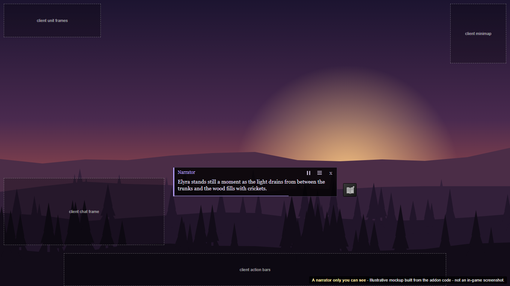</a>

**Title**

```text
A narrator only you can see
```

**Description** (249 characters)

```text
When something happens (a new zone, a fight, a level, dusk in a forest), a small box near the bottom of the screen shows a hand-written line that fits the moment. Only you see it: nothing goes to chat unless you choose. It works offline, with no AI.
```

**Titolo**

```text
Un narratore che vedi solo tu
```

**Descrizione** (255 caratteri)

```text
Quando succede qualcosa (una nuova zona, un combattimento, un livello, il tramonto in un bosco), un riquadro in basso mostra una frase scritta a mano per quel momento. La vedi solo tu: in chat non va nulla, se non lo scegli tu. Funziona offline, senza IA.
```

## 02-four-voices.png

<a href="02-four-voices.png">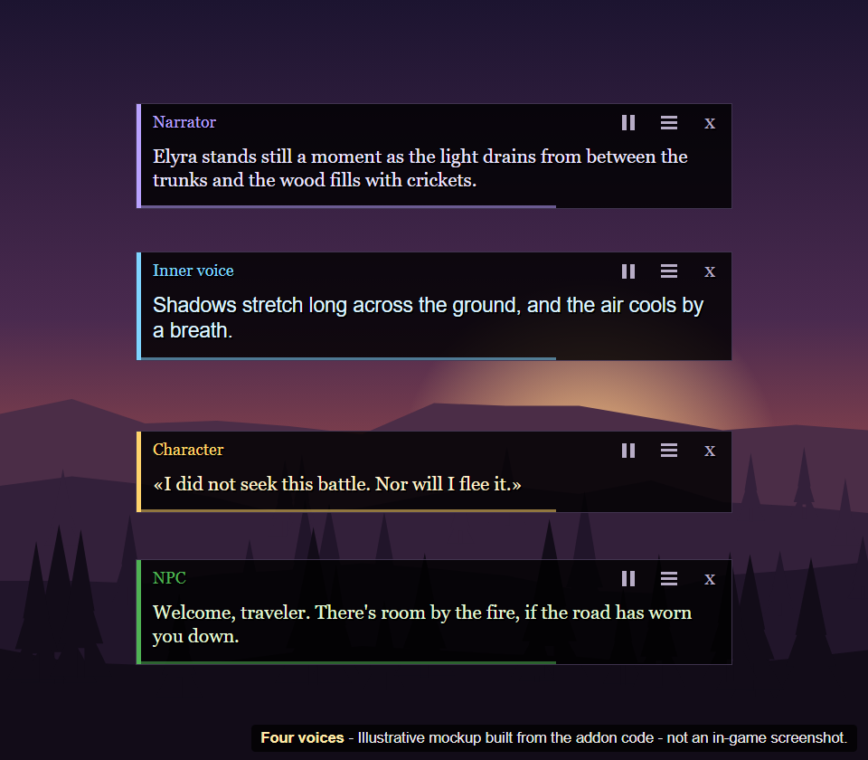</a>

**Title**

```text
Four voices
```

**Description** (183 characters)

```text
The narrator, your character's inner voice, your character and the NPCs each have their own colour, and the inner voice has its own typeface: you can tell at a glance who is speaking.
```

**Titolo**

```text
Quattro voci
```

**Descrizione** (179 caratteri)

```text
Il narratore, la voce interiore, il personaggio e gli NPC hanno ciascuno il proprio colore, e la voce interiore il proprio carattere: si capisce a colpo d'occhio chi sta parlando.
```

## 03-your-pace-your-style.png

<a href="03-your-pace-your-style.png">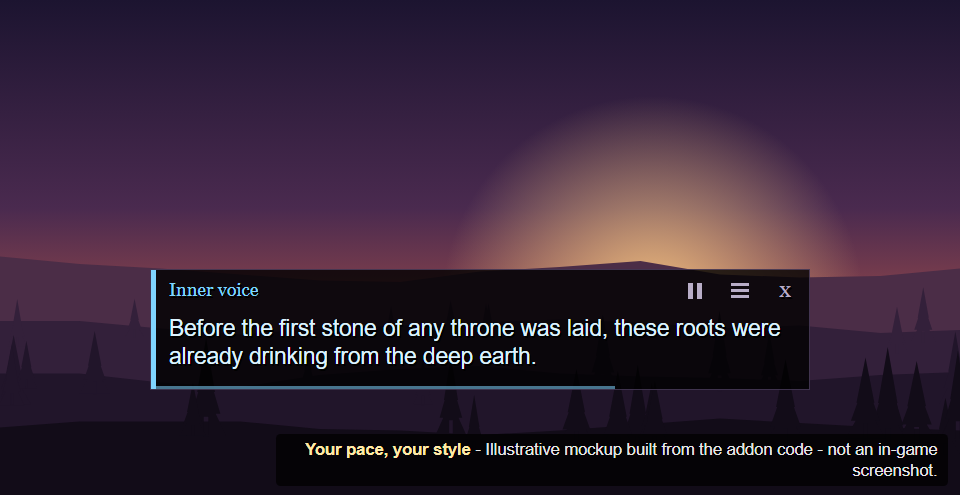</a>

**Title**

```text
Your pace, your style
```

**Description** (212 characters)

```text
Intensity (0-100) sets how often the narrator speaks; the prose depth (Natural, Literary, Elevated) sets its tone. Here, the Elevated line for arriving in a forest. Silence is fine too: never a flood of messages.
```

**Titolo**

```text
Il tuo ritmo, il tuo stile
```

**Descrizione** (229 caratteri)

```text
L'intensità (0-100) decide quanto spesso parla il narratore; la profondità (Naturale, Letteraria, Elevata) ne decide il tono. Qui, la frase Elevata per l'arrivo in un bosco. Anche il silenzio va bene: mai una pioggia di messaggi.
```

## 04-say-it-aloud-if-you-want.png

<a href="04-say-it-aloud-if-you-want.png">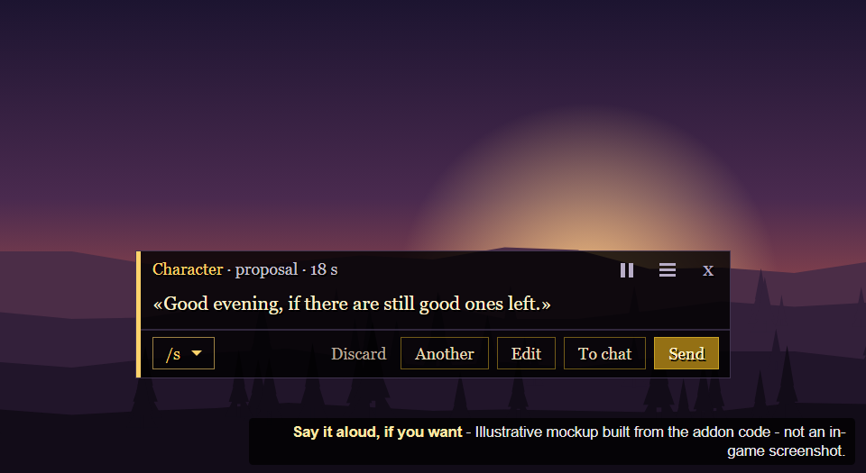</a>

**Title**

```text
Say it aloud, if you want
```

**Description** (216 characters)

```text
Choose the confirm mode and a line your character could say becomes a chat proposal: send it, edit it, ask for another or discard it. Nothing is sent without your click, unless you turn on automatic sending yourself.
```

**Titolo**

```text
Dillo ad alta voce, se vuoi
```

**Descrizione** (240 caratteri)

```text
Con la modalità di conferma, una frase che il tuo personaggio potrebbe dire diventa una proposta per la chat: inviala, modificala, chiedine un'altra o scartala. Senza il tuo clic non parte nulla, a meno che tu non attivi l'invio automatico.
```

## 05-edit-before-you-send.png

<a href="05-edit-before-you-send.png">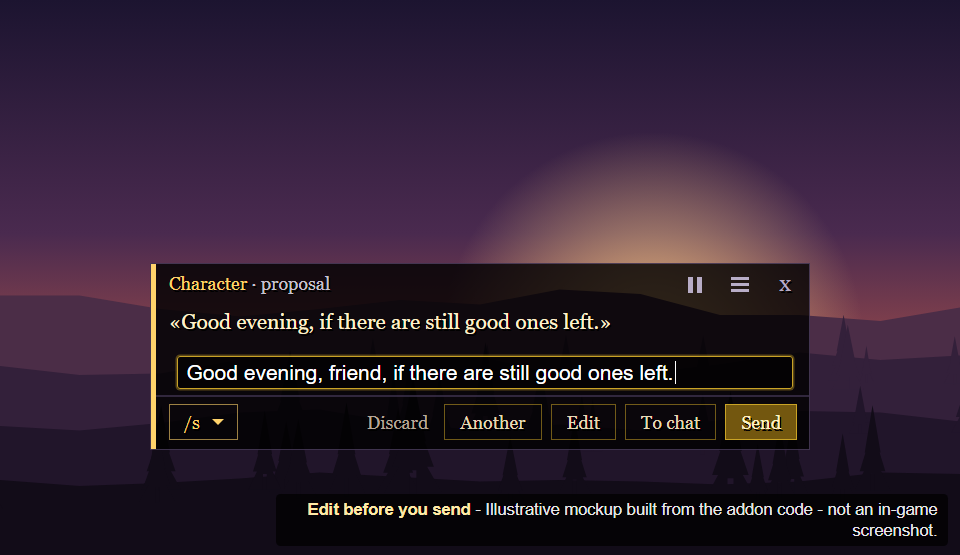</a>

**Title**

```text
Edit before you send
```

**Description** (97 characters)

```text
The editor opens on the proposed line: change a word, add a name, then send it to /say or /emote.
```

**Titolo**

```text
Modifica prima di inviare
```

**Descrizione** (105 caratteri)

```text
L'editor si apre sulla frase proposta: cambia una parola, aggiungi un nome, poi inviala in /say o /emote.
```

## 06-songs-rhymes-and-verses.png

<a href="06-songs-rhymes-and-verses.png">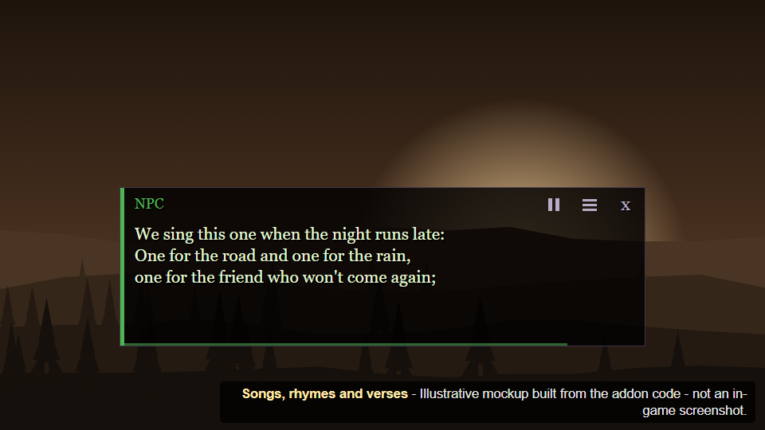</a>

**Title**

```text
Songs, rhymes and verses
```

**Description** (178 characters)

```text
Some moments bring a longer piece, such as an innkeeper's rhyme, a road song or an old inscription, revealed line by line. The pieces you hear are kept in the journal's songbook.
```

**Titolo**

```text
Canzoni, filastrocche e versi
```

**Descrizione** (206 caratteri)

```text
Alcuni momenti portano un brano più lungo, come la filastrocca di un locandiere, una canzone di strada o un'antica iscrizione, che appare riga dopo riga. I brani ascoltati restano nel canzoniere del diario.
```

## 07-npc-alive.png

<a href="07-npc-alive.png">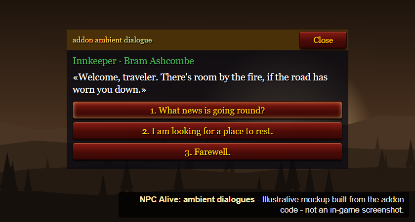</a>

**Title**

```text
NPC Alive: ambient dialogues
```

**Description** (239 characters)

```text
At a vendor, a flight master or a trainer, or with an innkeeper, a small window offers a short simulated conversation: a line from the NPC and up to three answers. It is clearly labelled, never goes to chat and changes nothing in the game.
```

**Titolo**

```text
NPC Alive: dialoghi d'ambiente
```

**Descrizione** (245 caratteri)

```text
Da un mercante, un maestro di volo o un istruttore, o con un locandiere, una piccola finestra propone una breve conversazione simulata: una battuta dell'NPC e fino a tre risposte. È ben segnalata, non va mai in chat e non cambia nulla nel gioco.
```

## 08-a-journal-that-remembers.png

<a href="08-a-journal-that-remembers.png">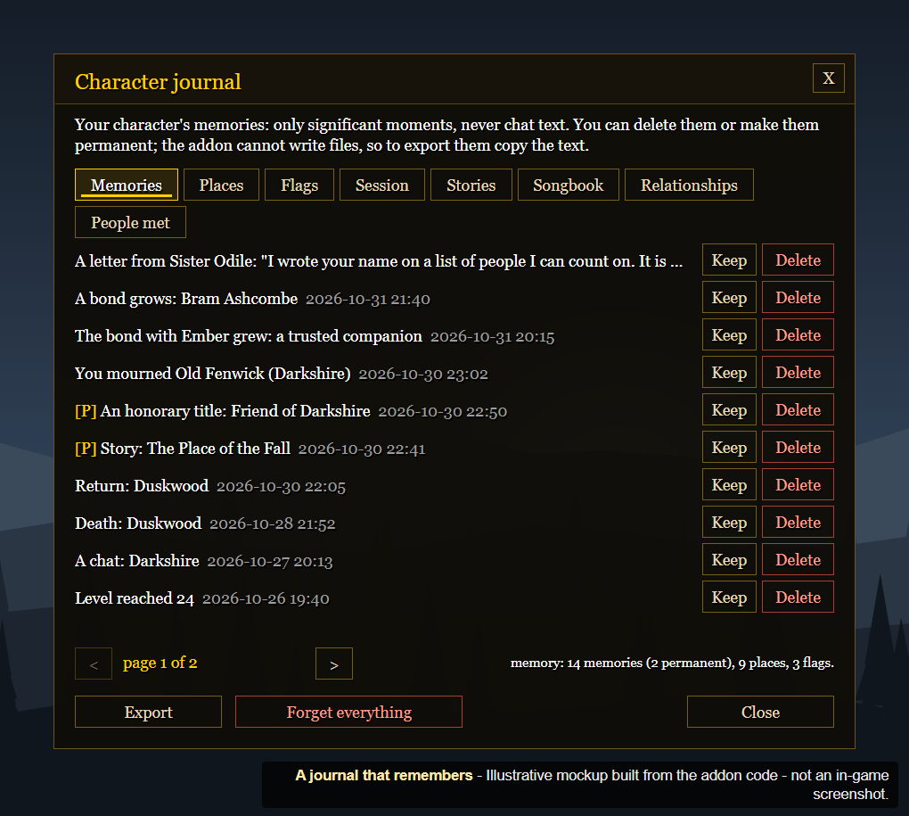</a>

**Title**

```text
A journal that remembers
```

**Description** (214 characters)

```text
/au journal lists what your character has lived: first visits, returns, deaths, levels, letters from friends. Keep a memory, delete it, or export the journal as text. The narrator only recalls what really happened.
```

**Titolo**

```text
Un diario che ricorda
```

**Descrizione** (232 caratteri)

```text
/au journal elenca ciò che il tuo personaggio ha vissuto: prime visite, ritorni, morti, livelli, lettere degli amici. Tieni un ricordo, cancellalo o esporta il diario come testo. Il narratore ricorda solo ciò che è successo davvero.
```

## 09-personal-stories.png

<a href="09-personal-stories.png">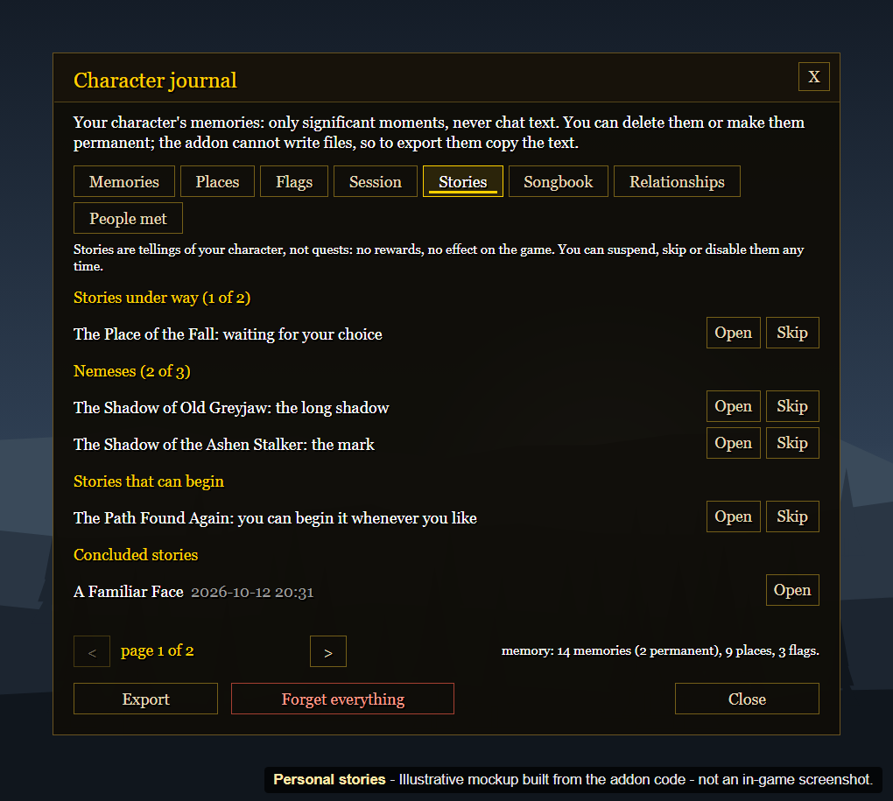</a>

**Title**

```text
Personal stories
```

**Description** (219 characters)

```text
Story Arcs are small tellings that begin from real events: a fall and the return, a face you keep meeting, a foe that keeps bringing you down. They are not quests: no rewards, and you can pause or skip them at any time.
```

**Titolo**

```text
Storie personali
```

**Descrizione** (243 caratteri)

```text
Le Story Arcs sono piccoli racconti che nascono da eventi veri: una caduta e il ritorno, un volto che continui a incontrare, un nemico che continua ad abbatterti. Non sono missioni: niente ricompense, e puoi sospenderle o saltarle quando vuoi.
```

## 10-relationships.png

<a href="10-relationships.png">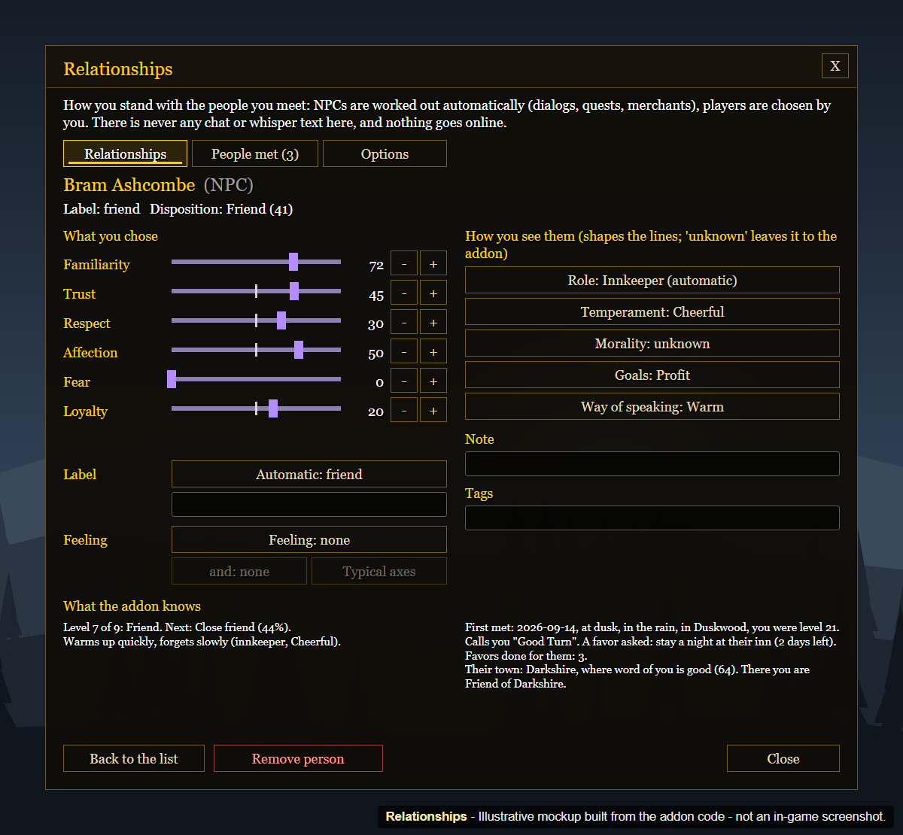</a>

**Title**

```text
Relationships
```

**Description** (233 characters)

```text
The addon remembers how you stand with NPCs and with the players you choose: trust, respect, affection, a bond from Hated to Deep bond, the first meeting, favours and nicknames. Narration only: no NPC behaves differently in the game.
```

**Titolo**

```text
Relazioni
```

**Descrizione** (245 caratteri)

```text
L'addon ricorda come stai con gli NPC e con i giocatori che scegli tu: fiducia, rispetto, affetto, un legame da Odiato a Legame profondo, il primo incontro, i favori e i soprannomi. Solo narrazione: nessun NPC si comporta diversamente nel gioco.
```

## 11-your-characters-soul.png

<a href="11-your-characters-soul.png">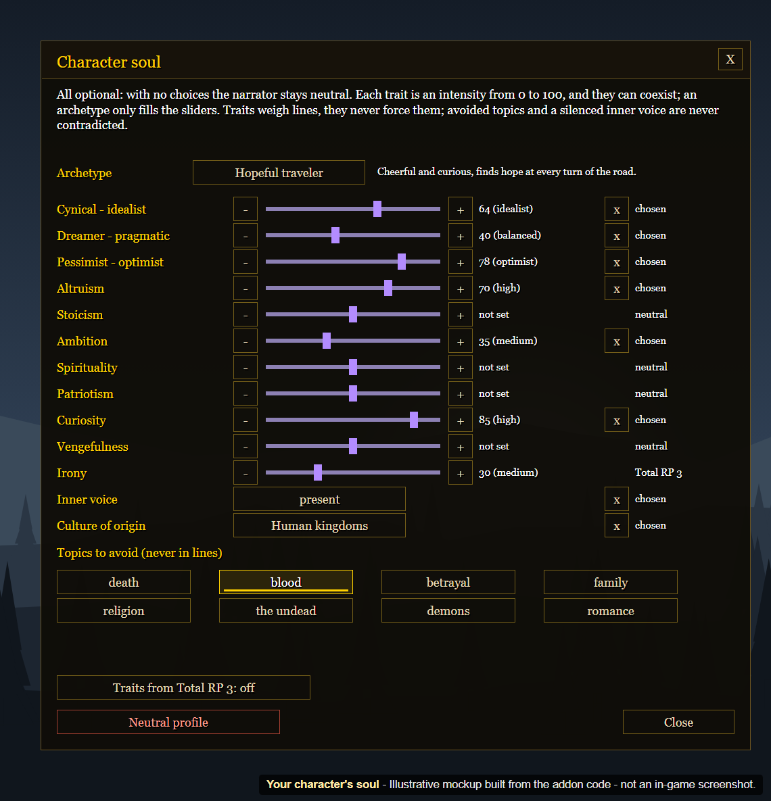</a>

**Title**

```text
Your character's soul
```

**Description** (199 characters)

```text
Give your character a personality (idealist or cynical, curious, ambitious, with or without an inner voice), and the lines that fit come up more often. With Total RP 3 it can start from your profile.
```

**Titolo**

```text
L'anima del personaggio
```

**Descrizione** (190 caratteri)

```text
Dai al tuo personaggio una personalità (idealista o cinico, curioso, ambizioso, con o senza voce interiore) e le frasi adatte arrivano più spesso. Con Total RP 3 può partire dal tuo profilo.
```

## 12-a-guided-first-launch.png

<a href="12-a-guided-first-launch.png">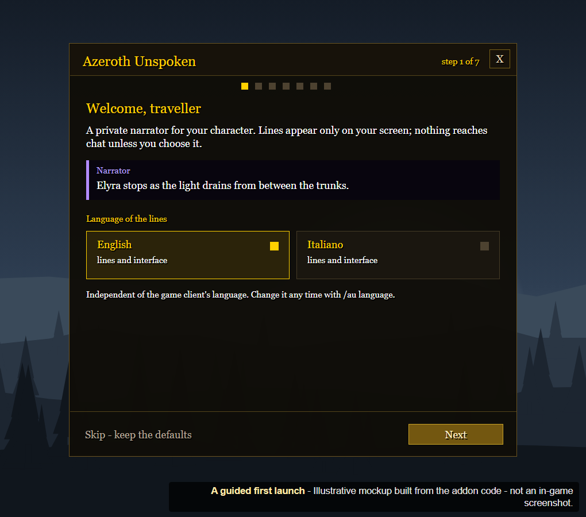</a>

**Title**

```text
A guided first launch
```

**Description** (174 characters)

```text
A short guide, which you can skip, sets language, experience, intensity, style, modules, chat and keys in seven steps (eight with Total RP 3), with a test line along the way.
```

**Titolo**

```text
Una guida al primo avvio
```

**Descrizione** (181 caratteri)

```text
Una breve guida, che puoi saltare, imposta lingua, esperienza, intensità, stile, moduli, chat e tasti in sette passi (otto con Total RP 3), con una frase di prova lungo il percorso.
```

## 13-every-part-on-or-off.png

<a href="13-every-part-on-or-off.png">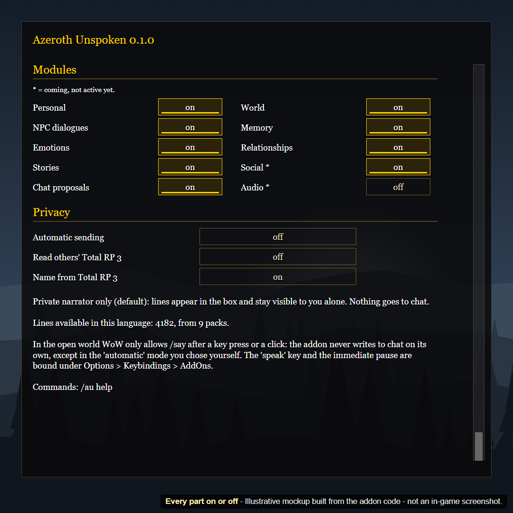</a>

**Title**

```text
Every part on or off
```

**Description** (202 characters)

```text
Each module has its own switch in the settings panel: personal lines, the world, NPC dialogues, memory, emotions, relationships, stories, chat proposals. Every option is also a slash command (/au help).
```

**Titolo**

```text
Ogni parte, accesa o spenta
```

**Descrizione** (220 caratteri)

```text
Ogni modulo ha il suo interruttore nel pannello delle impostazioni: frasi personali, il mondo, dialoghi con gli NPC, memoria, emozioni, relazioni, storie, proposte per la chat. Ogni opzione è anche un comando (/au help).
```

## 14-english-and-italian.png

<a href="14-english-and-italian.png">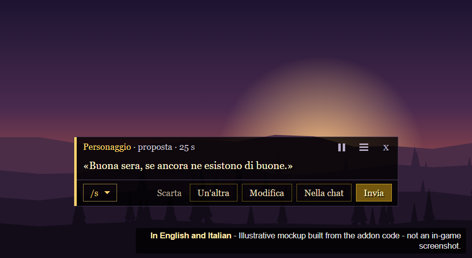</a>

**Title**

```text
In English and Italian
```

**Description** (122 characters)

```text
Every line and the whole interface exist in English and in Italian. Here, the narrator box and a chat proposal in Italian.
```

**Titolo**

```text
In inglese e in italiano
```

**Descrizione** (142 caratteri)

```text
Tutte le frasi e tutta l'interfaccia esistono in inglese e in italiano. Qui, il riquadro del narratore e una proposta per la chat in italiano.
```
