# Architettura di Azeroth Unspoken

Questo documento descrive come è fatto l'addon **oggi, su `main`** (versione 0.1.0; milestone M0–M3, step S1–S9), e dove si aggancia ciò che la [roadmap](../ROADMAP.md) prevede. Le parti non ancora presenti sono indicate come *previste*. Per le motivazioni delle scelte vedi le [ADR](adr/README.md); per la specifica di prodotto, il [GDD](Immersion_Director_GDD_v1.0.md) (§11 è l'architettura Lua).

## Indice

1. [Visione d'insieme](#1-visione-dinsieme)
2. [Moduli e responsabilità](#2-moduli-e-responsabilità)
3. [Flusso di un evento](#3-flusso-di-un-evento)
4. [Come si sceglie una frase](#4-come-si-sceglie-una-frase)
5. [Il Chat Gateway](#5-il-chat-gateway)
6. [Dati e SavedVariables](#6-dati-e-savedvariables)
7. [Punti di estensione](#7-punti-di-estensione)
8. [Cosa è previsto e non c'è ancora](#8-cosa-è-previsto-e-non-cè-ancora)
9. [Limiti noti](#9-limiti-noti)

## 1. Visione d'insieme

L'addon è una catena: il **client** emette un evento, un **bus** lo traduce in un formato uniforme, il **Director** decide se è il momento di parlare, il **motore** sceglie una frase intera dal **database** di pacchetti, il **Chat Gateway** decide dove può andare, e il **narratore privato** la mostra. Ogni API del client passa da **Compat**, che dice che cosa è disponibile, mancante o limitato.

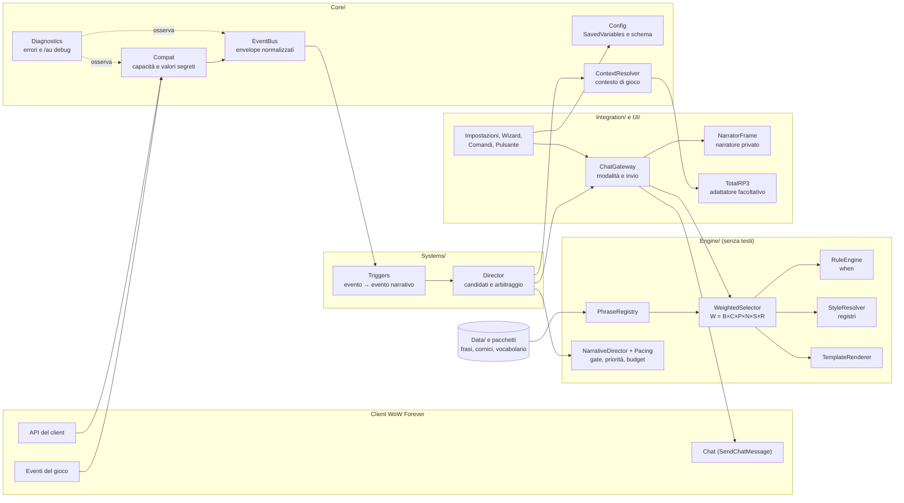

Principi che reggono tutto il resto:

- **Il motore non contiene testi** ([ADR 0001](adr/0001-engine-and-narrative-database-separated.md)).
- **Nessuna rete** ([ADR 0002](adr/0002-fully-offline-no-ai.md)).
- **Niente in chat senza un'azione del giocatore** ([ADR 0003](adr/0003-private-narrator-and-chat-gateway.md)).
- **Se una funzione del client manca, si spegne quella funzione, non l'addon** ([ADR 0005](adr/0005-compat-secret-values-and-defensive-events.md)).
- **Un errore in un modulo non ferma gli altri** ([ADR 0014](adr/0014-normalized-event-bus-and-isolated-modules.md)).

## 2. Moduli e responsabilità

I file si caricano nell'ordine del `.toc` (`AzerothUnspoken/AzerothUnspoken.toc`). Ogni file riceve `ADDON, NS = ...`: `NS` è lo spazio dei nomi dell'addon, esposto anche come globale `AzerothUnspoken`.

| Cartella / file | Responsabilità |
|---|---|
| **`Core/Bootstrap.lua`** | spazio dei nomi `NS`; `NS.Lower`/`NS.Upper` (minuscole e maiuscole sicure per l'UTF-8, da usare al posto di `string.lower`/`upper`); lingue (`RegisterLanguage`, `NS:L`, `NS:Lang`); `NS:Print`; registro dei moduli (`NS:RegisterModule`); su `ADDON_LOADED` esegue `NS:Initialize`: `Config:Load`, `Compat:Probe`, `EventBus:Start`, poi `OnInit` di ogni modulo, ciascuno isolato da `Diagnostics:Guard`; nomi dei tasti. |
| **`Core/Compat.lua`** | matrice delle capacità (`AVAILABLE`, `MISSING`, `RESTRICTED`); `Query`, `SafeCall`, `IsSecret`, `Readable`; registrazione protetta degli eventi; `GetBuildInfo` (riconosce Forever); restrizioni (`C_RestrictedActions`); identità segrete (`C_Secrets`); sorgente della chat e blocco della chat. |
| **`Core/Diagnostics.lua`** | `Guard` (esecuzione isolata con `xpcall`), registro degli errori (al massimo 30, raggruppati), rapporto `/au debug`, matrice per gruppo. |
| **`Core/Config.lua`** | predefiniti, `Merge`, `Validate`, migrazioni per `schemaVersion`, `Get`/`Set` per percorso, preset dei moduli, modalità e canali del Chat Gateway. Imposta `NS.db` e `NS.cdb`. |
| **`Core/EventBus.lua`** | sorgenti WoW → tipi normalizzati; envelope; deduplicazione; coda anti-cascata; `Publish`, `Subscribe`, `Recent`. |
| **`Core/ContextResolver.lua`** | `NS:BuildContext(extra)`: costruisce il contesto su cui si valutano le condizioni (personaggio, luogo, ora, gruppo, istanza, bersaglio, incantesimo; `ctx.place` prima della memoria, `ctx.other` dopo le relazioni), classifica gli incantesimi, registra le zone e le parole chiave dei pacchetti. |
| **`Engine/PhraseRegistry.lua`** | `RegisterPack`; registra frasi, cornici, vocabolario e traduzioni; indici per evento e per id; speaker provvisorio; statistiche. |
| **`Engine/RuleEngine.lua`** | `Match(when, ctx)`: le condizioni dichiarative (valori, elenchi, `not`, `any`, `func`, intervalli), quelle di memoria (`firstVisit`, `repeatVisit`, `lastVisitBad`, `visitsMin`, `daysSinceLastVisit`, `remembered`), di relazione e le sotto-tabelle `other` e `place` (S6c, `Engine.MatchSub`, `Engine.SUB_FIELDS`). |
| **`Engine/StyleResolver.lua`** | registri adatti al momento (GDD §5.2): ammessi per evento, preferiti da zona, profondità e voce; affinità di una frase (parte del fattore `S`); compatibilità tra cornice e frase. |
| **`Engine/Traits.lua`** | il modello dei tratti (GDD §7.1): definizioni (`choice`, `scale` con fasce, `set`), profili con i soli tratti impostati, `Sanitize`, `Merge` (priorità tra le fonti), tag di affinità (`Evaluate`, `CheckTag`), nomi localizzati. Non conosce il personaggio: lo riusano Character Soul (S5), interlocutore (S6c) e relazioni (S6b). |
| **`Engine/WeightedSelector.lua`** | idoneità, peso `W = B × C × P × N × S × R` (`Engine.Factors`, `Engine:Weight`, agganci `Engine:SetWeightHook`), anti-ripetizione, memoria degli usi, guardie degli eventi (`Engine:SetEventGuard`), `PickEntry`/`Pick`. |
| **`Engine/Pacing.lua`** | pause (momento, globale, categoria, evento) e budget per categoria degli interventi spontanei; stato solo in memoria. |
| **`Engine/NarrativeDirector.lua`** | priorità del §10, gate di opportunità guidato dall'intensità, sospensione (schermate invasive, combattimento impegnativo), dado, ordine dei candidati; agganci del ritmo e dell'impegno. |
| **`Engine/TemplateRenderer.lua`** | segnaposto, genere, vocabolario, cornici. Se manca un dato, la frase è scartata. |
| **`Integration/TotalRP3.lua`** | adattatore facoltativo ([ADR 0004](adr/0004-total-rp-3-optional-with-adapter.md)): il nome del profilo e, con consenso, i tratti psicologici pubblici del **proprio** profilo mappati sui tratti del Soul ([ADR 0016](adr/0016-character-soul-opt-in-traits-and-total-rp-3-with-consent.md)). |
| **`Integration/ChatGateway.lua`** | modalità, proposte, canali, invio solo da azione del giocatore, anti-flood, `AzerothUnspoken_Speak`; `Reroll` ("Un'altra": sostituisce la proposta con un'altra frase per lo stesso evento e contesto, senza inviare né spendere il budget del Director). |
| **`Systems/Personality.lua`** | il Character Soul: otto tratti opt-in, archetipi, profilo effettivo (scelta > Total RP 3 > dati di gioco > neutro), fattore `P` del peso, preferenze di registro, condizione `soul`, `ctx.soul`, comando `/au anima`. |
| **`Systems/LivingMemory.lua`** | la Living Memory ([ADR 0017](adr/0017-living-memory-selective-memories-and-honest-recall.md)): ricordi, luoghi visitati e flag per personaggio (`cdb.memories`), momenti della sessione, compattazione a 500, permanenti, reset, migrazioni, `ctx.memory`, eventi di richiamo con guardia (`RegisterRecall`), esportazione testuale, comando `/au diario`. |
| **`Systems/Relationships.lua`** | le relazioni ([ADR 0018](adr/0018-multi-axis-relations-automatic-npcs-and-user-chosen-players.md)): sette assi indipendenti, etichette e disposizione derivate dai dati, NPC calcolati dall'`npcID` (dialogo, quest, mercante, volo, addestratore, locanda) con rendimenti decrescenti, tetto giornaliero e decadimento, giocatori scelti dall'utente con proposte, `ctx.relation` e simili, fattore `R`, registro per familiarità, evento `relation_npc`, comando `/au relazioni`. |
| **`Systems/Place.lua`** | il luogo ([ADR 0019](adr/0019-interlocutor-and-place-ordered-sources-and-places-by-mapid.md)): `ctx.place` (zona, uiMapID, continente, tag, territorio, capitale, istanza, scontro con un boss, ruolo nel gruppo, campo di battaglia), `Place:Lookup` sui dati di `Data/Places.lua`, `Place.Key` (chiave stabile della memoria), fattore `C` dei tag `place.` e delle frasi brevi, ritmo per tipo di istanza, impegno durante i boss, evento `encounter_end`, comando `/au luogo`. |
| **`Systems/Interlocutor.lua`** | l'interlocutore ([ADR 0019](adr/0019-interlocutor-and-place-ordered-sources-and-places-by-mapid.md)): `ctx.other` (dati di gioco, ruolo, personalità con i tratti di S5, azioni recenti, relazione), fonti in ordine (utente > TRP3 pubblico con consenso > `Data/NPCs.lua` > ruolo da interazioni affidabili > tendenza debole > neutro), fattore `C` dei tag `other.`, registro per modo di parlare e ruolo, eventi `npc_meet` e `other_action`, comando `/au chi`. |
| **`Systems/NPCAlive.lua`** | NPC Alive ([ADR 0020](adr/0020-simulated-dialogue-and-real-dialogue-npc-alive.md)): i dialoghi ambientali con un NPC. Macchina a stati `idle → offered → opened → choice → response → ended` con transizioni verificate, identità (NPC specifico del registro curato o archetipo dall'interazione in corso; mai se incerta o segreta), copioni (`NS:RegisterDialogues`: nodi, risposte, flag), battute dalle regole del motore, effetti locali (flag, relazione, ricordo), offerta automatica che scade, interruzioni (combattimento, morte, zona, altro NPC, quest), tasto `AzerothUnspoken_NPCDialogue`, comando `/au npc`. |
| **`Systems/StoryArcs.lua`** | gli archi narrativi ([ADR 0021](adr/0021-story-arcs-micro-stories-without-game-effects.md)): micro-storie personali, **non quest**, senza ricompense né effetti sul gioco. Stati `LOCKED → DISCOVERED → REFLECTED → RESOLVED` (più stati propri), passi con evento (`zone`, `death`, `level`, `npc`, `flag`, `player`), condizioni del RuleEngine, attesa e scelta del giocatore; al massimo 1–2 archi attivi, sospendere/saltare/disattivare (anche tutti); stato in `cdb.arcs` con migrazione; battute dal Narrative Director (`arc_open`, `arc_step`, `arc_resolve`, una alla volta, rimandate se il momento non è buono); chiusura con un ricordo permanente `story`. Comando `/au storie`. |
| **`Systems/Director.lua`** | il Narrative Director degli eventi spontanei: `Offer` (candidato), `Resolve` (al massimo un intervento per momento), `Evaluate` (il gate, punto di aggancio di S2), pausa immediata, riepilogo per `/au debug`. |
| **`Systems/Triggers.lua`** | abbonato al bus: trasforma gli eventi normalizzati in eventi narrativi (`battle`, `victory`, `lowhp`, `death`, `rez`, `levelup`, `zone`, `attack`, `heal`, `buff`, `travel`, `rezother`) e li offre al Director; tiene le probabilità e le pause proprie di ogni evento. |
| **`UI/Widgets.lua`** | piccoli componenti condivisi dell'interfaccia. |
| **`UI/NarratorFrame.lua`** | il narratore privato: riquadro, durata, opacità, cronologia, editor, pulsanti, pausa. |
| **`UI/SpeakButton.lua`** | il pulsante "pronuncia" e il tasto: gesto che conferma il Chat Gateway. |
| **`UI/ProfileFrame.lua`** | la finestra del profilo: archetipo, tratti, argomenti da evitare, consenso a Total RP 3, profilo neutro. |
| **`UI/JournalFrame.lua`** | il diario: schede (ricordi, luoghi, flag, sessione, storie; altre con `RegisterTab`), cancellazione selettiva, permanenza, reset con conferma, finestra di esportazione copiabile. |
| **`UI/DialogueFrame.lua`** | la finestra dei dialoghi ambientali: etichetta «dialogo ambientale dell'addon», ruolo e nome, battuta, da una a tre risposte, chiusura; si mette dove non copre le finestre di Blizzard (`BLIZZARD_FRAMES`, `GetRect`), non è in `UISpecialFrames`, non scrive in chat. Nessuna logica di dialogo: disegna `NPCAlive:View()`. |
| **`UI/RelationsFrame.lua`** | la finestra Relazioni: tabella ordinabile e filtrabile, persone proposte, dettaglio con cursori, nota, tag ed etichetta; due schede nel diario. |
| **`UI/Wizard.lua`** | procedura guidata del primo avvio (6 passi, 7 con Total RP 3). |
| **`UI/SettingsFrame.lua`** | pannello delle impostazioni (`Settings.RegisterCanvasLayoutCategory`, con ripiego su `InterfaceOptions_AddCategory`). |
| **`UI/Commands.lua`** | `/au` e `/unspoken`. |
| **`Data/<lingua>/Interface.lua`** | testi dell'interfaccia (`itIT`, `enUS`). |
| **`Data/Relationships.lua`** | assi, etichette, disposizione, registro e incrementi degli NPC delle relazioni, in IT ed EN (dati, non codice). |
| **`Data/Places.lua`**, **`Data/NPCs.lua`** | tag e temi di zone, sottozone, capitali, dungeon, incursioni e campi di battaglia (nome del client inglese, uiMapID non ancora verificati); registro curato degli NPC per `npcID` e tendenze deboli di classe (S6c). |
| **`Data/Dialogues.lua`**, **`Data/Arcs.lua`** | la struttura dei dialoghi ambientali (copioni per archetipo: nodi e risposte) e degli archi narrativi (stati, passi, scelte); le battute sono regole del motore (`Data/RegistryDialogues.lua`, `Data/RegistryArcs.lua`) e i testi stanno in `Data/<lingua>/`. |
| **`Data/*.lua`** | pacchetti di frasi di base (schema v2, 14 pacchetti, 1.005 intenzioni e 2.109 varianti per lingua): `Vocabulary`, `Frames`, le regole `Registry{Combat,Spells,Life,Exploration,Social,Classes,Soul,Memory,Relations,Context,Dialogues,Arcs}` e i testi per lingua in `Data/itIT/` e `Data/enUS/`. |
| **`Bindings.xml`** | quattro tasti: `AZEROTHUNSPOKEN_SPEAK` (conferma), `AZEROTHUNSPOKEN_REROLL` (un'altra frase), `AZEROTHUNSPOKEN_PAUSE` (pausa immediata), `AZEROTHUNSPOKEN_NPC` (dialogo ambientale). |
| **`AzerothUnspoken_Example/`** | pacchetto di esempio, addon separato con `## Dependencies: AzerothUnspoken`. |
| **`Tests/`** | test fuori dal gioco (lupa) e client simulato ([ADR 0007](adr/0007-offline-tests-with-lupa-and-mock.md)). |

Direzione delle dipendenze: `Core` non conosce `Engine`, `Systems` né `UI`; `Engine` usa `Core` ma non conosce il Gateway né l'interfaccia; `Integration` e `Systems` usano `Core` ed `Engine`; `UI` usa tutto. Un modulo si trova con `NS.NomeModulo` (ad esempio `NS.Gateway`, `NS.Director`, `NS.Narrator`).

### Come i sistemi si agganciano al motore

I sistemi di M1–M3 (personalità, memoria, relazioni, interlocutore, luogo, NPC Alive, archi) **non modificano** il motore né il Director: si agganciano a punti previsti. Il motore resta una catena unica; ogni sistema le dà dati (`ctx.*`) e le dice come pesare, quando tacere e quando una frase ha diritto di parlare.

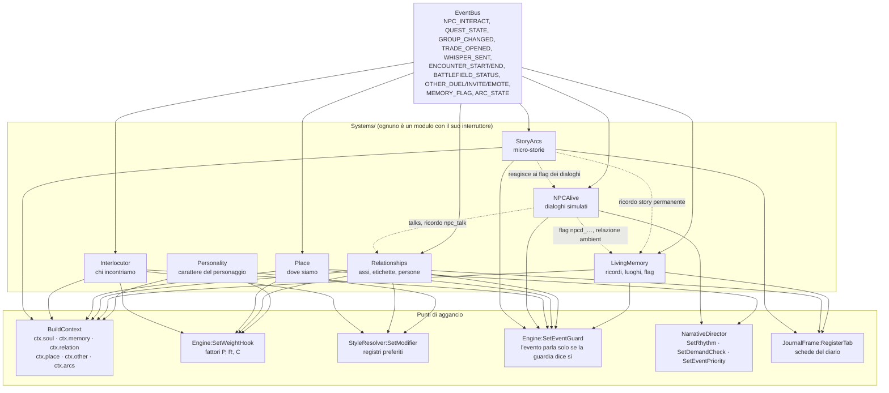

| Aggancio | Chi lo usa | A che cosa serve |
|---|---|---|
| `ctx.soul` | Personality | il profilo effettivo: scelta > Total RP 3 > dati di gioco > neutro |
| `ctx.memory` | LivingMemory | prima visita, ritorno, visita finita male, flag: **solo da ricordi veri** |
| `ctx.relation` (e `rel`, `disposition`, `isKnown`) | Relationships | il rapporto con la persona dell'interazione |
| `ctx.other`, `ctx.otherTraits` | Interlocutor | chi abbiamo davanti, con la fonte di ogni dato |
| `ctx.place` | Place | zona, mappa, territorio, istanza, scontro, ruolo nel gruppo |
| `ctx.arcs` | StoryArcs | gli archi in corso e conclusi, e la battuta che sta per uscire |
| fattore `P` | Personality (`soul`) | affinità morbida e filtri rigidi dei tag `tratto:valore`, `req:`, `not:`, `topic:` |
| fattore `R` | Relationships (`relations`) | tag con ambito `rel.` |
| fattore `C` | Place (`place`), Interlocutor (`other`) | tag con ambito `place.` e `other.`, frasi brevi in campo di battaglia |
| modificatore di registro | Personality, Relationships, Interlocutor | il temperamento, la familiarità, il modo di parlare spostano i registri preferiti |
| guardia dell'evento | memoria (`memory_return`…), relazioni (`relation_npc`), interlocutore (`npc_meet`, `other_action`), luogo (`encounter_end`), NPC Alive (`npcd_*`), archi (`arc_*`) | un evento che cita un fatto non parla se il fatto non c'è |
| `SetRhythm` / `SetDemandCheck` | Place, NPC Alive | più sobrio in incursione e contro i boss, silenzio durante un dialogo |
| `SetEventPriority` | memoria, relazioni, archi | richiamo di memoria o evento eccezionale nel §10 del GDD |
| `RegisterTab` | LivingMemory, Relationships, StoryArcs | le schede del diario (ricordi, luoghi, flag, sessione, relazioni, persone, storie) |

Per questo i sistemi si possono spegnere uno per uno dal pannello (`modules.*`): senza `memory` nessun richiamo, senza `relations` nessun fattore `R`, e così via, mentre il narratore di base continua a funzionare.

## 3. Flusso di un evento

Il percorso completo, dal client alla frase mostrata (e, solo dopo un gesto, alla chat):

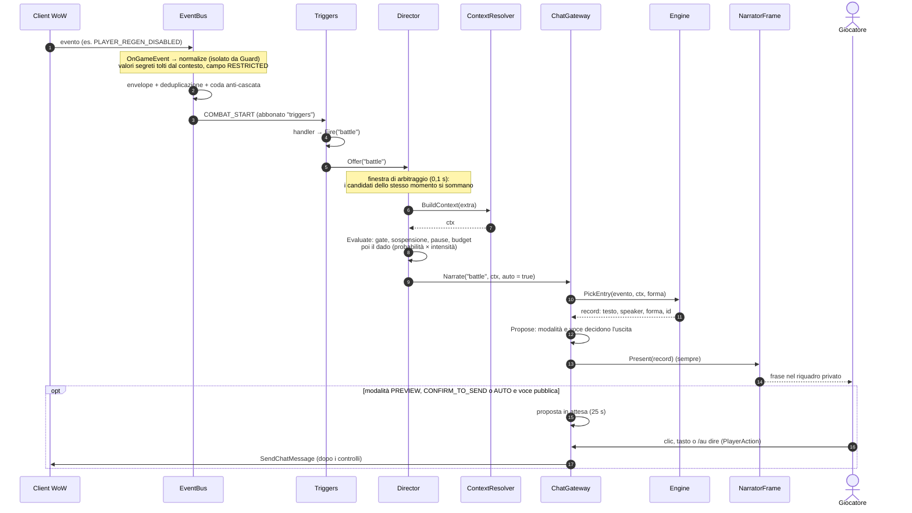

I passaggi, in parole:

1. **Client → bus.** `Core/EventBus.lua` registra gli eventi del client tramite `Compat:RegisterEvent` (con controllo di validità, dentro un `pcall`). Ogni sorgente (`EventBus:AddSource`) ha una funzione `normalize` che produce un tipo, un contesto e opzioni (chiave di deduplicazione, campi attesi). La funzione gira dentro `Diagnostics:Guard`.
2. **Envelope.** `NewEnvelope` crea `{ type, timestamp, source, context, fields }`. I valori segreti non entrano nel contesto e il loro campo è `RESTRICTED`; i campi attesi ma assenti sono `MISSING`.
3. **Deduplicazione e coda.** Un doppione (stesso tipo e chiave entro la finestra) si scarta e si conta. Un evento pubblicato mentre se ne consegna un altro va in coda (al massimo 32; oltre 5 secondi di età si scarta).
4. **Consegna.** Ai gestori del tipo e a quelli di `"*"`, ciascuno in `Guard`.
5. **Triggers.** I gestori in `Systems/Triggers.lua` mantengono un po' di stato (inizio del combattimento, zona precedente, bersagli degli incantesimi) e chiamano `Fire(evento, extra)`, cioè `Director:Offer`; alcuni ritardano con `C_Timer.After` per lasciare che il gioco aggiorni lo stato.
6. **Narrative Director.** I candidati arrivati entro la finestra di arbitraggio si risolvono insieme, in ordine di priorità; per ognuno il Director costruisce il contesto, chiede il gate (`Evaluate`) e tira il dado. Il primo che produce una frase vince, gli altri tacciono ([dettagli sotto](#il-narrative-director)).
7. **Contesto.** `NS:BuildContext(extra)` raccoglie i dati del momento. Con l'identità del bersaglio segreta non si legge né si confronta alcun dato del bersaglio (resta `targetSecret`); ogni lettura passa da `SafeCall`; il nome del personaggio può venire da Total RP 3.
8. **Gateway e motore.** `Gateway:Narrate` sceglie la forma (parlata o emote) e chiede a `Engine:PickEntry` una frase ([sezione 4](#4-come-si-sceglie-una-frase)). Se non c'è nessuna frase adatta, **non succede nulla**: il silenzio è valido.
9. **Uscita.** `Gateway:Propose` mostra sempre la frase nel narratore. Solo se la modalità lo prevede e la voce può andare in chat, crea anche una **proposta** ([sezione 5](#5-il-chat-gateway)).

**Richieste esplicite.** `/au saluto`, `/au evento`, `/au incanta` e il tasto "pronuncia" non passano dal Narrative Director: chiamano `NS:Trigger`/`Gateway:Narrate` direttamente, anche in pausa e a intensità 0 (GDD §4.2). Non consumano budget, ma aprono il "momento": per qualche secondo nessuna frase spontanea le segue. Restano comunque soggetti alle regole del Gateway: mai un invio in chat senza un'azione del giocatore.

### Il Narrative Director

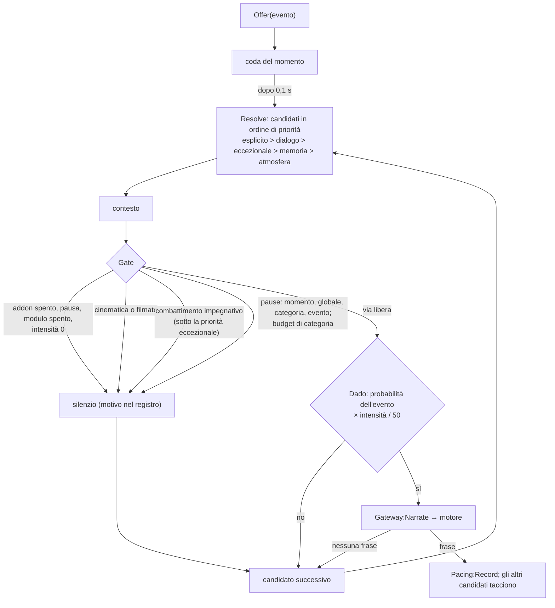

| Controllo | Regola | Chi lo salta |
|---|---|---|
| Momento | 4 s tra due interventi qualsiasi (anche espliciti) | nessuno |
| Pausa globale | `pacing.globalCooldownSeconds` (45) × (1,5 − intensità/100) | eventi eccezionali |
| Pausa di categoria | `Pacing.CATEGORY_COOLDOWN` (combattimento 15 s, esplorazione 30 s...) × lo stesso fattore | eventi eccezionali |
| Pausa dell'evento | `NS.EVENT_COOLDOWN` × lo stesso fattore | nessuno |
| Budget | `Pacing.BUDGET` per categoria in 10 minuti (combattimento 6...) × intensità/50 | eventi eccezionali |
| Schermate invasive | `InCinematic`, `IsInCinematicScene`, `CinematicFrame`/`MovieFrame` visibili | nessuno |
| Combattimento impegnativo | in combattimento con boss, in incursione, élite in istanza (`pacing.suppressInHighDemand`) | eventi eccezionali |
| Pausa della frase (id) | `cooldown` della regola e finestra anti-ripetizione, nel motore | nessuno (vale anche per gli espliciti) |

Il registro delle ultime decisioni (`Director.log`) e il budget usato compaiono in `/au debug` alla riga **Narrative Director**. La motivazione delle scelte è nell'[ADR 0015](adr/0015-narrative-director-one-intervention-per-moment.md).

## 4. Come si sceglie una frase

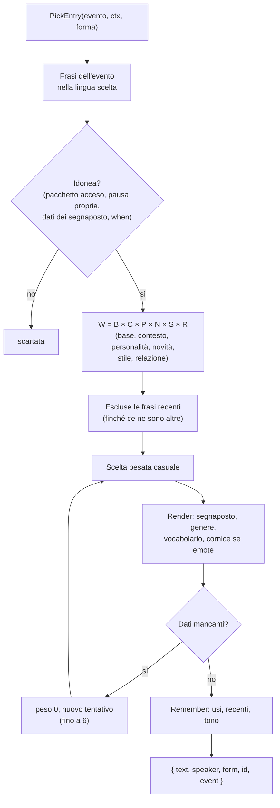

- **Peso** (`Engine.Factors`, GDD §10): `B` = `weight`; `C` = 1 + 0,35 × condizioni (più gli agganci `C` di S6c); `P` = personalità (Character Soul): affinità morbida dei tag `tratto:valore` (×1,6 / ×0,6), voce interiore e ironia; 0 esclude la frase per `req:`, `not:` e `topic:`; neutra (1) col profilo neutro ([dettagli](#il-character-soul)); `N` = ÷ (1 + 0,3 × usi recenti), ×0,6 se il registro è quello dell'ultima frase dell'evento; `S` = profondità (×0,3 se diversa) × affinità di registro del StyleResolver (×0,5 fuori dall'evento, +25% per ogni preferenza di zona, profondità e voce); `R` = relazione con la persona dell'interazione ([vedi sotto](#le-relazioni)): i tag con ambito `rel.` come affinità morbida o filtro rigido (0 esclude), neutra senza persona. `Engine:Weight(frase, evento, ctx)` restituisce la scomposizione.
- **Carattere**: i tratti pesano le frasi e, per i tag rigidi, le escludono; vedi [il Character Soul](#il-character-soul).
- **Stile**: i registri pesano e non escludono, quindi il ripiego neutro è automatico. In forma emote, una cornice con registri accoglie solo frasi di registro uguale o vicino (`StyleResolver:Compatible`).
- **Condizioni** (`when`): vedi [PACK_FORMAT.md](../AzerothUnspoken/PACK_FORMAT.md). Più condizioni → frase più specifica → peso maggiore.
- **Memoria**: `NS.cdb.memory` (`uses`, `last`, `recent`, `lastTone`), per personaggio. Gli usi si attenuano a ogni accesso (`DecayMemory`, ×0,75). La finestra delle frasi recenti è circa il 60% di quelle disponibili, al massimo `pacing.recentPhraseWindow` (30).
- **Voce (`speaker`)**: `narrator`, `inner`, `character`, `npc`; ogni regola la dichiara (se manca si deduce da `form`: `say` → `character`, `emote` → `narrator`, con un avviso del validatore). Una frase parlata inserita in una cornice è `narrator`. Le voci `inner` e `npc` non diventano mai proposte per la chat.
- Il silenzio è un esito valido: se nessuna frase è idonea, il motore restituisce `nil`.

### Il Character Soul

`Systems/Personality.lua` dà al personaggio una voce propria (GDD §7.1, [ADR 0016](adr/0016-character-soul-opt-in-traits-and-total-rp-3-with-consent.md)). Tutto è facoltativo: senza scelte il profilo è **neutro** e il narratore resta com'era.

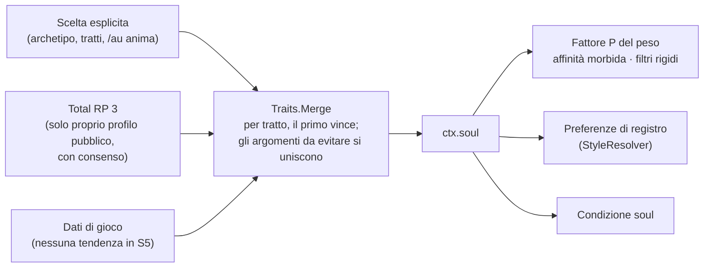

- **Tratti**: temperamento, morale, curiosità (scala), fede, motivazione, ironia (scala), voce interiore e argomenti da evitare (insieme). Archetipi pronti più il profilo neutro; scegliere un archetipo copia i suoi tratti, modificarne uno rende il profilo "personalizzato". Il cambio vale subito: le frasi successive usano il nuovo profilo.
- **Tag sulle frasi** (campo `tags`): `tratto:valore` affinità morbida (×1,6 se combacia, ×0,6 se il profilo ha un altro valore, mai zero); `req:tratto:valore` (la frase afferma qualcosa del personaggio: esce solo se il profilo lo dice), `not:tratto:valore` e `topic:argomento` sono filtri **rigidi** (fattore 0). I tag senza due punti restano descrittivi. Il validatore controlla i tag di affinità.
- **Priorità** (GDD §8), tratto per tratto: scelta esplicita > Total RP 3 > dati di gioco > valori neutri; il riepilogo (`/au anima lista`) dice la fonte di ogni tratto.
- **Total RP 3**: solo con il consenso `personality.trp3` e il modulo `totalRP3` acceso; legge solo `characteristics/PS` del proprio profilo e non scrive mai. Se l'API manca o cambia, il livello sparisce e le scelte restano (capacità `integration:totalRP3:traits`).
- **Riuso**: `Engine/Traits.lua` non conosce il giocatore. S6c lo usa per `ctx.other` (ambito di tag `other.`) e per i tag del luogo (ambito `place.`), S6b per gli assi delle relazioni.
- **Interfaccia**: `/au anima` apre `UI/ProfileFrame.lua` (archetipo, tratti, argomenti, consenso, profilo neutro); `/au anima lista | neutro | archetipo <id> | trp3 on|off | <tratto> <valore> | evita <argomento>`.

### La Living Memory

`Systems/LivingMemory.lua` dà al personaggio una continuità tra le sessioni (GDD §7.4, [ADR 0017](adr/0017-living-memory-selective-memories-and-honest-recall.md)). Solo momenti significativi, mai ogni clic, mai testo di chat.

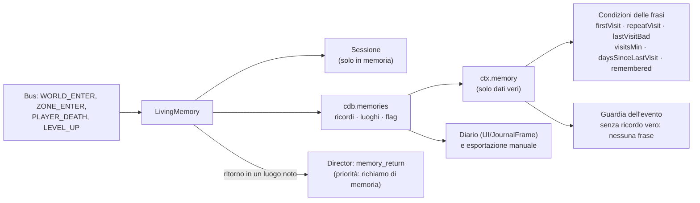

- **Cosa si ricorda**: prima visita a una zona (di più se è una capitale), ritorno dopo un giorno, visita finita male (morte o fuga), morti, livelli (ogni dieci un traguardo). I luoghi tengono i conteggi (visite, morti, esito) separati dai ricordi: compattare i ricordi non fa dimenticare un luogo.
- **Limiti**: 500 ricordi ordinari (compattazione dei meno significativi fino a 450), 200 permanenti, 300 luoghi, 60 momenti di sessione. Reset a cinque bersagli, sempre con conferma.
- **Richiamo onesto**: le condizioni di memoria leggono `ctx.memory`; gli eventi di richiamo (`memory_return`) hanno una guardia nel motore e il validatore esige una condizione di memoria sulle loro frasi. Il richiamo ha la priorità del §10 e batte l'atmosfera di zona nello stesso momento.
- **Privacy**: nessuna sorgente di chat, nessun testo libero; `Record` e `Sanitize` ammettono solo i campi previsti.

### Le relazioni

`Systems/Relationships.lua` tiene il rapporto con le persone ([ADR 0018](adr/0018-multi-axis-relations-automatic-npcs-and-user-chosen-players.md)). Gli assi sono scale di `Engine/Traits.lua` (ambito `rel`); etichette, disposizione, registro e incrementi sono dati in `Data/Relationships.lua`.

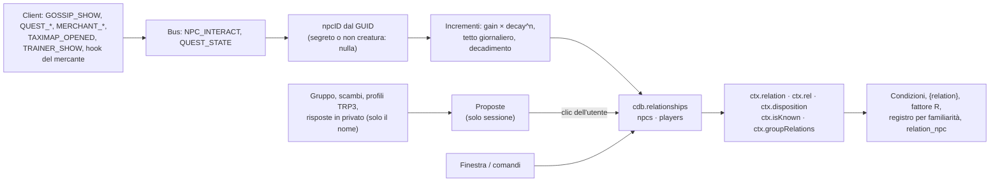

- **Assi**: `familiarity`, `fear` e `attraction` 0…100; `trust`, `respect`, `affection`, `loyalty` −100…100. L'attrazione è facoltativa (spenta di base).
- **Etichetta derivata**: la prima regola, per priorità, che vale; un'etichetta scelta a mano ha la precedenza. **Disposizione**: media pesata −100…100 in nove fasce.
- **NPC** automatici (`relations.npcAuto`); **giocatori** solo con un'azione dell'utente (`R:AddPlayer(nome, "user")`) o con l'opzione esplicita «registra automaticamente».
- **Privacy**: nessun testo di chat o di whisper (della risposta in privato si legge solo il nome), nulla in rete, le proposte non si salvano.
- **Interfaccia**: `/au relazioni` apre `UI/RelationsFrame.lua`; il diario ha le schede *Relazioni* e *Persone incontrate*.

### NPC Alive

`Systems/NPCAlive.lua` e `UI/DialogueFrame.lua` ([ADR 0020](adr/0020-simulated-dialogue-and-real-dialogue-npc-alive.md)) sono i dialoghi ambientali: un micro-dialogo **simulato** con un NPC identificabile, in una finestra separata, mai in chat.

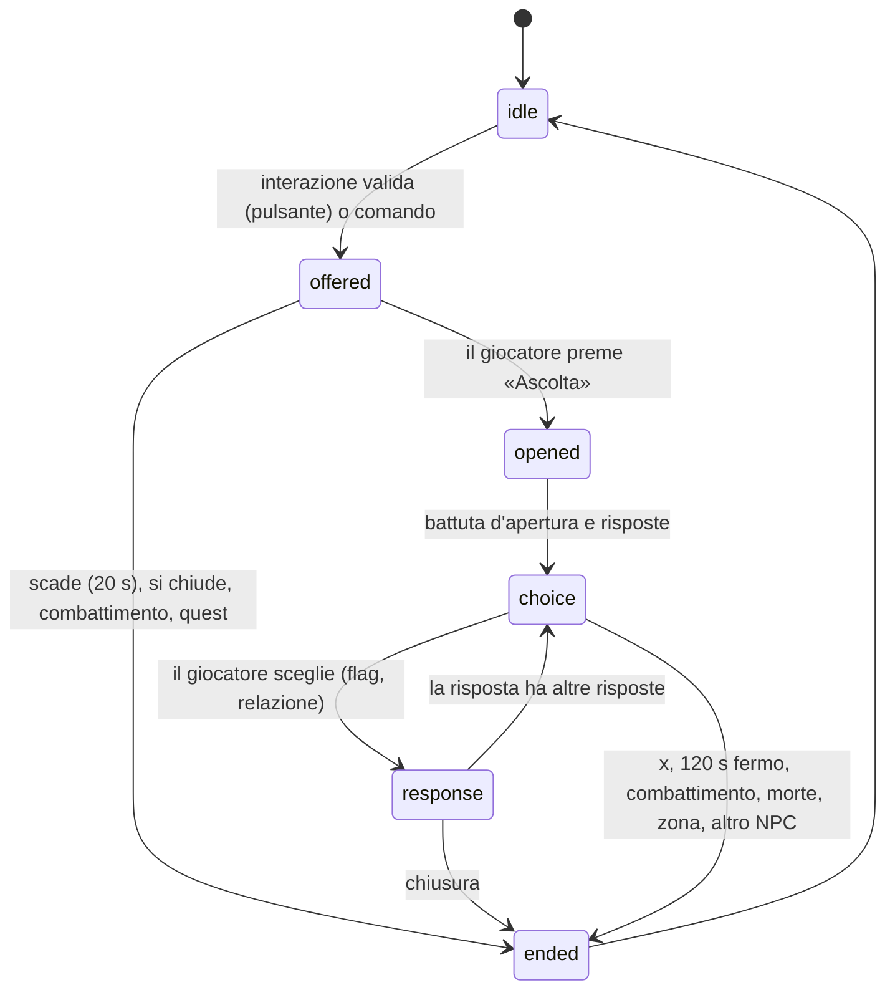

- **Identità**: l'`npcID` dal GUID. *Specifico*: è in `Data/NPCs.lua` (o l'utente gli ha dato un ruolo). *Archetipo*: il ruolo lo prova l'interazione in corso (mercante, volo, addestramento, locandiere che fissa la dimora) o una già avvenuta con lo stesso NPC; il solo gossip non basta. Giocatori, creature ostili, NPC morti, identità segreta e GUID illeggibili: nessun dialogo.
- **Copioni** (`Data/Dialogues.lua`): per archetipo (`innkeeper`, `merchant`, `guard`, `flightmaster`, `trainer`) o per `npc:<npcID>` (con `extends`), nodi con l'evento delle battute e le risposte che offrono; ogni risposta ha un'etichetta IT/EN neutra, il nodo di arrivo, un flag narrativo e una fonte di relazione. Controllati da `NPCAlive:Check()` e dal validatore (`badDialogue`).
- **Voce** (`Data/RegistryDialogues.lua`, testi `Dialogues.lua`): regole del motore con `speaker = "npc"` ed eventi `npcd_<ruolo>_<nodo>`: scelte da `Engine:PickEntry` con il contesto dell'interlocutore (modo di parlare, temperamento) e della relazione (`isKnown`); escono solo dentro un dialogo (guardia sull'evento); anti-ripetizione come per ogni frase. Durante un dialogo il narratore spontaneo tace (`SetRhythm`).
- **Effetti**: un flag narrativo `npcd_<archetipo>_<nome>` (memoria di S6, mai una quest), un po' di relazione (`ambient`, `ambient_talk`), un ricordo `npc_talk` se si è risposto (senza testo né nome). L'NPC di prova (`/au npc prova`) non scrive nulla.
- **Finestra**: etichetta sempre visibile, posizione che evita le finestre di Blizzard visibili e si corregge se una si apre sotto, trascinabile e azzerabile; non chiama né nasconde nulla di Blizzard.
- **Comandi**: `/au npc` (alias `dialogo`, `parla`; `prova [burbero|gioviale|caloroso|formale|laconico]`, `chiudi`, `ruolo <ruolo>`, `offerta on|off`, `stato`), tasto «Dialogo ambientale con l'NPC».

### Story Arcs

`Systems/StoryArcs.lua` ([ADR 0021](adr/0021-story-arcs-micro-stories-without-game-effects.md)) tiene le micro-storie personali: **non sono quest del server**, non danno ricompense, non toccano gli NPC veri. La struttura degli archi è dato (`Data/Arcs.lua`, `NS:RegisterArcs`), le battute sono regole di tre eventi (`arc_open`, `arc_step`, `arc_resolve`), i testi sono per lingua.

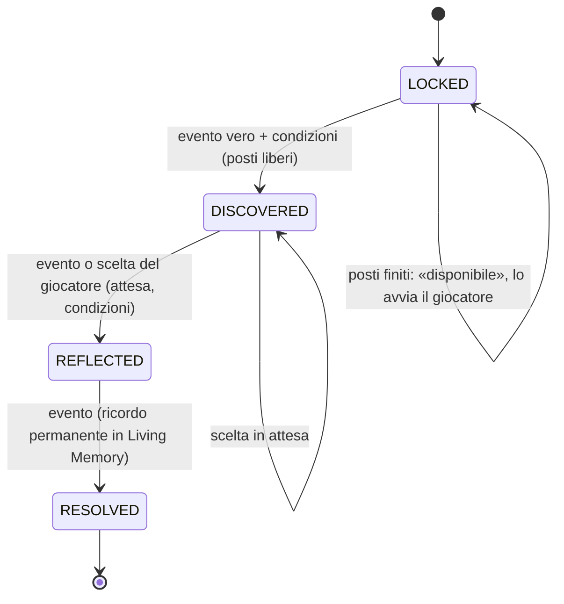

Gli stati propri di un arco (ad esempio `JOURNEY` in «Le tre porte») stanno tra `LOCKED` e `RESOLVED`; da uno stato si va solo al successivo.

- **Eventi**: `SA:Fire(evento)` è abbonato al bus: `ZONE_ENTER`/`WORLD_ENTER` (valutazione dopo due secondi), `PLAYER_DEATH`, `LEVEL_UP`, `NPC_INTERACT` (non le quest), `MEMORY_FLAG` (un flag nuovo messo da un sistema dell'addon, ad esempio i dialoghi ambientali; non quelli a mano, né quelli automatici della memoria, né gli `arc_…` degli archi stessi). Solo gli archi con un passo da quello stato e per quell'evento costruiscono il contesto. Un evento muove un arco di un solo passo.
- **Scelte**: un passo con `choose` aspetta il giocatore (`pending`); il diario o `/au storie scegli` applicano il passo con l'**id di opzione**. I passi `player` non hanno un evento: si offrono quando condizioni e attesa valgono.
- **Posti e modi**: `arcs.maxActive` (1–2); modo `active`, `suspended`, `skipped` o `off`; `waiting` per un arco la cui apertura è arrivata a posti finiti. Il modulo `storyArcs` spegne tutto.
- **Battute**: `QueueBeat` mette la battuta in `SA.owed`; `Flush` la offre al Director (`Director:Offer(evento, extra, onResult)`, priorità «eccezionale», una sola alla volta, almeno 90 s dalla precedente) solo in un momento tranquillo; la guardia dell'evento esige `ctx.arc.beat`, quindi `/au evento` non le produce. Lo stato avanza anche se la battuta tace.
- **Dati**: `cdb.arcs = { version, items = { [id] = { state, mode, since, t, choices, subject, pending, waiting, memoryId, ended } }, stats }`, schema 6, `SA.migrations` interne, `SA:Sanitize`. La chiusura registra un ricordo `story` permanente (solo id e luogo).
- **Condizioni** (`Engine/RuleEngine.lua`): sotto-tabella `arc = { id, state, from, choice, withSubject }`, `arcDone`, `capitalsVisitedMin`.
- **Diario** (`UI/JournalFrame.lua`): scheda «Storie» con in corso, disponibili, concluse, saltate e il dettaglio con il racconto e le scelte fatte. **Comando** `/au storie`.

### Interlocutore e luogo

`Systems/Interlocutor.lua` e `Systems/Place.lua` dicono **chi incontriamo** e **dove siamo** ([ADR 0019](adr/0019-interlocutor-and-place-ordered-sources-and-places-by-mapid.md)).

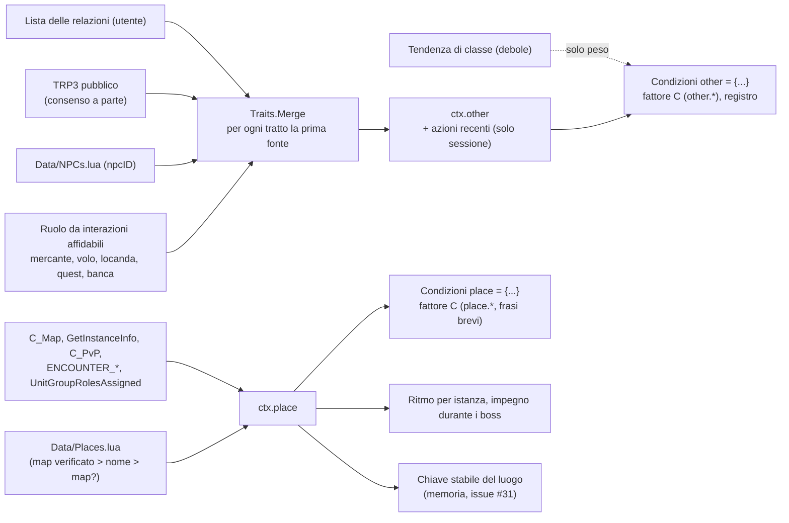

- **Azioni**: solo da eventi affidabili (dialogo, quest, mercante, scambio, gruppo, duello, invito, emote standard rivolte a noi, bersaglio), mai dal log di combattimento; restano in memoria per la sessione.
- **Segreti**: con l'identità segreta `ctx.other = { secret = true }`; un valore segreto del luogo vale «non lo so».
- **Eventi**: `npc_meet`, `other_action`, `encounter_end`, ognuno con una guardia nel motore.
- **Comandi**: `/au luogo` (alias `dove`, `place`, `where`) e `/au chi` (alias `who`, `interlocutore`, `other`; `trp3 on|off` per il consenso a leggere il profilo pubblico Total RP 3 degli altri, e `tratto <tratto> <valore>` per correggere a mano un tratto dell'interlocutore).

## 5. Il Chat Gateway

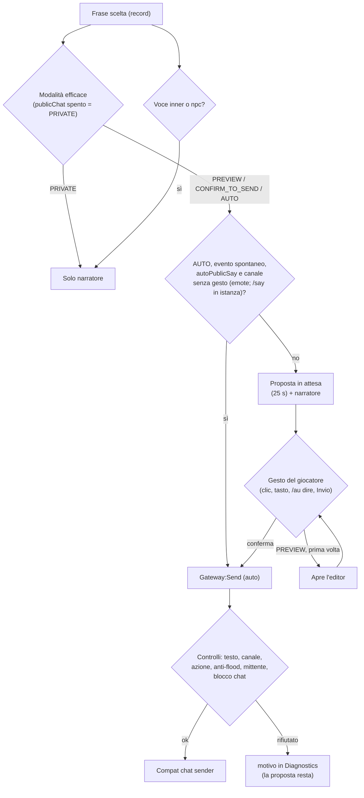

Regole fisse, verificate dai test (`Tests/TestChatGateway.lua`):

- L'invio da gesto passa solo da `Gateway:PlayerAction(fn)`. Fuori da quell'ambito `Gateway:Send` rifiuta tutto tranne `EMOTE` e, in istanza, `SAY` e `YELL` (`needs_action`).
- Le voci `inner` e `npc` non diventano mai proposte.
- Anti-flood: `floodSeconds` (4), `maxPerMinute` (6), `autoMaxPerMinute` (2); testo di al massimo `Config.CHAT_LIMITS[canale]` byte (255; la stessa tabella è letta dal validatore); proposta in attesa `pendingSeconds` (25), e una nuova sostituisce la vecchia. Con l'editor aperto la proposta non scade e una frase spontanea non la sostituisce.
- Il testo inviato è adattato al canale (`Gateway:TextFor`: emote fuori da `/e` con il nome, parlato in `/e` con «dice: «…»»). In alternativa all'invio, `Gateway:CopyToChat` mette la proposta nella casella della chat standard (`Compat:OpenChatWith`).
- L'invio automatico si attiva solo con due gesti (avviso e conferma entro 10 secondi, `Gateway:SelectAuto`) e non è nel ciclo delle modalità del pannello.
- Canali: `SAY`, `EMOTE`, `YELL`, `PARTY`, `RAID`, `GUILD`, `INSTANCE_CHAT`, con controllo di disponibilità.
- **Ipotesi non ancora misurata in gioco**: quali canali il client accetta senza gesto ([G1](G1_checklist.md), SP-05).

## 6. Dati e SavedVariables

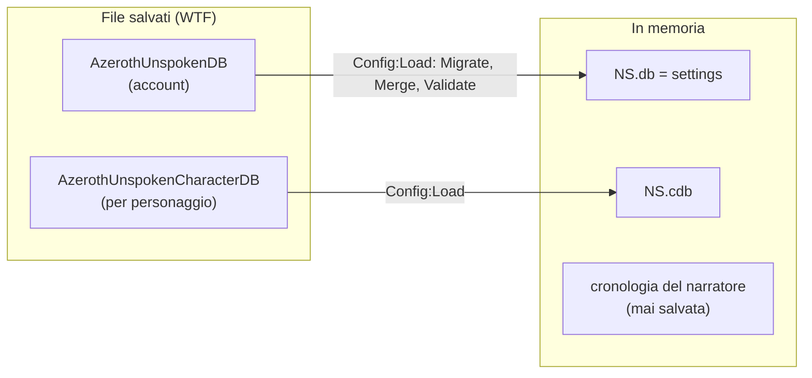

| Variabile | Contenuto |
|---|---|
| `AzerothUnspokenDB` | `schemaVersion` (oggi 6) e `settings`: `locale`, `preset`, `intensity`, `proseDepth`, `modules`, `output`, `chat`, `privacy`, `pacing`, `enabled`, `chance`, `ignored`, `disabledPacks`, `relations` (`npcAuto`, `attraction`, `autoRegisterPlayers`, `proposePlayers`), `interlocutor` (`trp3Others`: consenso a leggere il profilo pubblico Total RP 3 degli altri), `npcAlive` (`autoOffer`), `arcs` (`maxActive`), `ui` (pulsante, wizard fatto, `narrator`: durata, opacità, dimensione, blocco, cronologia; `dialogue`: dimensione, opacità, blocco, posizione). |
| `AzerothUnspokenCharacterDB` | `schemaVersion`, `memory` (usi, ultime frasi, tono), `personality` (`version`, `archetype`, `traits`, `trp3`: scelte esplicite del Character Soul e consenso a Total RP 3) `relationships` (relazioni: `version`, `npcs` per `npcID`, `players` per «Nome-Reame»; vedi sopra), `memories` (Living Memory: `version`, `nextId`, `entries`, `places`, `flags`, `stats`, vedi sopra) `arcs` (Story Arcs: `version`, `items` per arco con stato, modo, scelte e momento, `stats`; vedi sopra) e, per gli step futuri, `history` (oggi vuoto). |

Ogni dato per personaggio ha anche una **versione propria** (`personality.version`, `memories.version`, `relationships.version`, `arcs.version`), con migrazioni e pulizia (`Sanitize`) nel proprio modulo. Una versione più nuova di quella conosciuta (si è tornati a un addon più vecchio) si legge ma **non si riscrive**.

| Dato | Versione dello schema | Dove vive la migrazione |
|---|---|---|
| `AzerothUnspokenDB` / `AzerothUnspokenCharacterDB` | `Config.SCHEMA_VERSION` = 6 | `Config.migrations.global[n]` e `.character[n]` |
| `cdb.personality` | 1 | `Personality:Sanitize` |
| `cdb.memories` | 2 (chiave dei luoghi per uiMapID, #31) | `LM.migrations[n]` |
| `cdb.relationships` | 1 | `R:Sanitize` |
| `cdb.arcs` | 1 | `SA.migrations`, `SA:Sanitize` |

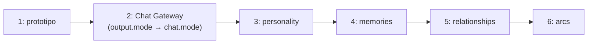

- I predefiniti sono in `Config.defaults` e `Config.characterDefaults`; le regole di validità in `Config.rules`.
- Le migrazioni sono `Config.migrations.global[n]` e `.character[n]` ([ADR 0006](adr/0006-savedvariables-and-schema-versions.md)).
- **Non si salva mai il contenuto della chat**, né le battute dei dialoghi, né i testi degli archi (solo gli id delle scelte); delle relazioni con i giocatori si salvano solo quelli scelti dall'utente. I campi `privacy.*` (`socialOptIn`, `shareMemories`, `acceptSceneInvites`) esistono già, spenti, per il futuro modulo Social.
- Il resto dello stato (pausa immediata `NS.paused`, proposta in attesa, cronologia, registro degli errori, memoria dell'ultimo invio) vive solo in memoria.

## 7. Punti di estensione

### Per chi scrive pacchetti di frasi (stabile)

Un pacchetto è un addon separato con `## Dependencies: AzerothUnspoken`. L'API è descritta in [PACK_FORMAT.md](../AzerothUnspoken/PACK_FORMAT.md), i cui esempi sono provati dai test come pacchetti esterni. **Un pacchetto esterno chiama le funzioni dall'oggetto globale `AzerothUnspoken:`**; il `NS` della prima riga `local ADDON, NS = ...` è il namespace del pacchetto e non ha queste funzioni.

| Chiamata | A che cosa serve |
|---|---|
| `AzerothUnspoken:RegisterPack({ id, name, languages, registry, texts, events, styles, categories, conditions, frames, vocab })` | schema v2: regole (`registry`), testi per lingua con varianti (`texts`), eventi, registri, categorie e condizioni nuove, cornici e vocabolario |
| `AzerothUnspoken:AddTexts(lingua, { [id] = testi }, idPacchetto)` | testi (anche traduzioni e varianti in più) per id di questo o di altri pacchetti (`AddTranslations` è l'alias vecchio) |
| `AzerothUnspoken:RegisterEvent(nome, { category, chance, cooldown })` · `RegisterStyle` · `RegisterCategory` · `RegisterCondition` | eventi, registri, categorie e condizioni nuove |
| `AzerothUnspoken:RegisterLanguage(codice, { name, ui })` | aggiunge una lingua (testi dell'interfaccia) |
| `AzerothUnspoken:RegisterSpellKeywords({ kind = …, element = …, classElement = … })` | classifica gli incantesimi e ne crea di nuovi tipi (ognuno lancia l'evento omonimo) |
| `AzerothUnspoken:SetEventDefaults(evento, probabilità, pausa)` | probabilità e pausa predefinite di un evento nuovo |
| `AzerothUnspoken:RegisterZoneMoods({ ["Nome zona"] = "atmosfera" })` | atmosfera delle zone, per la condizione `mood` e per lo stile |
| `AzerothUnspoken:RegisterEventStyles(evento, { registri })` · `RegisterMoodStyles({ atmosfera = { registri } })` | registri ammessi per un evento e preferiti da un'atmosfera (StyleResolver) |
| `AzerothUnspoken:SetEventPriority(evento, "memory")` | priorità di un evento nel Narrative Director (`dialogue`, `exceptional`, `memory`, `ambient`) |
| `AzerothUnspoken.LivingMemory:RegisterRecall(evento, verifica)` | un evento di richiamo di memoria: priorità `memory`, modulo `memory` e guardia (senza un ricordo vero non parla) |
| `AzerothUnspoken.LivingMemory:RegisterKind(tipo, importanza)` · `:Record{ kind, zone, tags, … }` · `:SetFlag(nome)` | altri sistemi (archi, relazioni) registrano ricordi e flag |
| `AzerothUnspoken:RegisterRelationData({ axes, labels, disposition, … })` · `AzerothUnspoken.Relationships:RegisterRelationEvent(evento, verifica)` | etichette e assi di relazione nuovi (per id, sostituiscono); eventi che citano un rapporto, con guardia |
| `AzerothUnspoken:RegisterPlaces({ zones, subzones, instances, continents })` · `RegisterNPCs({ [npcID] = … })` · `RegisterTendencies({ class = … })` | luoghi, NPC e tendenze deboli per interlocutore e luogo (una chiave già registrata viene **sostituita**, [#69](https://github.com/Finland6738/azeroth-unspoken/issues/69)) |
| `AzerothUnspoken:RegisterDialogues({ scripts = { [chiave] = copione } })` | dialoghi ambientali: archetipo, o `npc:<npcID>` con `extends`; chiave esistente = sostituzione ([#69](https://github.com/Finland6738/azeroth-unspoken/issues/69)) |
| `AzerothUnspoken:RegisterArcs({ pack, arcs, texts })` · `AddArcTexts(lingua, mappa, idPacchetto)` | archi narrativi: stati, passi, scelte e testi |

Un pacchetto può anche usare `func = function(ctx) … end` nelle condizioni per regole scritte in Lua, con il contesto di `NS:BuildContext`.

### Per macro, altri addon e strumenti (in uso, senza garanzia di stabilità)

| Punto | Uso |
|---|---|
| `/au evento <nome>`, `/au incanta <incantesimo>`, `/au saluto`… | da macro o da altri addon con `SlashCmdList` |
| `AzerothUnspoken:Trigger(evento, extra)` (`NS:Trigger`) | lancia un evento narrativo; esce sempre da narratore e Chat Gateway, **mai in chat da solo** |
| `AzerothUnspoken_Speak()` | il gesto "pronuncia" (anche da tasto o macro) |
| `AzerothUnspoken.EventBus:Subscribe(tipo, proprietario, fn)` | osservare gli eventi normalizzati (envelope) |
| `AzerothUnspoken.EventBus:AddSource(eventoWoW, { normalize, unit })` | tradurre un nuovo evento del client; la registrazione passa da Compat |
| `AzerothUnspoken.Compat` (`caps`, `Query`, `SafeCall`, `Readable`, `IsSecret`) | usare le API del client in modo difensivo |
| `AzerothUnspoken.Gateway:Send(...)` | **fuori da `PlayerAction`** rifiuta tutto tranne emote (e `/say`/`/yell` nelle istanze): chi lo usa non aggira le regole |

Questi punti sono interni: possono cambiare tra una versione e l'altra finché la roadmap è aperta. Solo l'API dei pacchetti è pensata per durare, e i suoi cambiamenti saranno annunciati nel [CHANGELOG](../CHANGELOG.md).

### Per chi scrive un nuovo sistema nell'addon

1. Crea il file nella cartella giusta e aggiungilo al `.toc` **dopo** i moduli da cui dipende.
2. Registra il modulo con `NS:RegisterModule("nome")` e inizializzalo in `OnInit` (isolato da `Guard`).
3. Per ogni API del client nuova: controllala nel dump ([ADR 0010](adr/0010-forever-api-dump-as-reference.md)), passa da Compat e degrada con eleganza.
4. Per un nuovo evento del client aggiungi una sorgente al bus; non registrare eventi per conto tuo.
5. Per parlare, passa dal Director (se è spontaneo: `NS.Director:Offer(evento, extra)`) e dal Gateway (sempre).
   Per influire sulla scelta senza toccare il Director usa gli agganci: `Engine:SetWeightHook("C"|"P"|"R", nome, fn)` (fattori del peso), `StyleResolver:SetModifier(nome, fn)` (preferenze di registro), `NarrativeDirector:SetRhythm(nome, fn)` (moltiplicatori di probabilità e pause), `NarrativeDirector:SetDemandCheck(nome, fn)` (momento impegnativo), `Engine:SetEventGuard(evento, nome, fn)` (un evento parla solo se la guardia dice sì), `JournalFrame:RegisterTab(id, def)` (una scheda del diario).
6. Dati salvati nuovi: predefiniti in `Config.defaults`, regole in `Config.rules`, migrazione e test.
7. Annota con EmmyLua l'API pubblica e aggiungi le nuove globali a `.luarc.json` (vedi [CONTRIBUTING.md](../CONTRIBUTING.md)).

## 8. Cosa è previsto e non c'è ancora

Dalla [roadmap](../ROADMAP.md). Sul `main` attuale ci sono le milestone M0–M3: fondamenta, narratore e Chat Gateway (S1–S2), schema dati, Narrative Director, Character Soul, Living Memory, relazioni, interlocutore e luogo, contenuti Alpha (S3–S7, [vedi sopra](#il-character-soul)), NPC Alive (S8) e Story Arcs (S9). Manca:

| Step | Cosa aggiunge | Dove si aggancia |
|---|---|---|
| S10 (M4) | gioco sociale con messaggi addon, consenso e sicurezza; prova G4 con due client | nuovo modulo, `privacy.*`, `ARC_STATE`; **nulla di un arco, di un ricordo o di un NPC entra in un messaggio senza un consenso a parte** |
| S11 (M5) | contenuti fino a 1.000 intenzioni | pacchetti di frasi |
| S12 (M5) | accessibilità, profiling, manuale, privacy, troubleshooting, Definition of Done | trasversale |
| G1, G2, G3 | le prove in gioco dell'utente (SP-01…SP-05, vertical slice A, B e C, archi) | [checklist](G1_checklist.md), 92 passi |

## 9. Limiti noti

- **Nulla è stato provato nel client vero.** Tutto è verificato solo con il client simulato; la prova G1 è rimandata ([checklist](G1_checklist.md)).
- Nelle impostazioni hanno effetto i moduli `personal`, `world`, `memory`, `relations`, `npc`, `storyArcs`, `publicChat` e `totalRP3`; social e audio sono ancora segnaposto.
- Le probabilità e le pause per evento (`NS.DEFAULT_CHANCE`, `NS.EVENT_COOLDOWN`) vengono dal prototipo; i numeri del Narrative Director (budget, pause di categoria, bonus e penalità di stile) sono ipotesi da regolare con le prove in gioco ([G1](G1_checklist.md), passi 27–31).
- Il riconoscimento del combattimento impegnativo usa boss, incursione, élite in istanza e, da S6c, gli scontri con i boss (`ENCOUNTER_START`), che nel client vero non sono ancora stati provati.
- I dialoghi ambientali (S8) non sono stati provati nel client vero: né i nomi delle finestre di Blizzard che la finestra evita (`GossipFrame`, `MerchantFrame`...), né `GetRect`, né quali interazioni mettono davvero un NPC nell'unità `npc`; il registro curato ha pochi NPC (e i numeri non sono verificati). Vedi [G1](G1_checklist.md), G3.
- Gli archi narrativi (S9) non sono stati provati nel client vero: né che `C_Map` dia l'uiMapID della zona di partenza (il nome inglese è il ripiego), né le soglie di familiarità, livelli e attese dei passi, né l'aspetto della scheda «Storie» del diario.
- Gli uiMapID, gli instanceID e gli npcID dei dati (`Data/Places.lua`, `Data/NPCs.lua`) vengono da Classic Era e non sono verificati in Forever: i luoghi si riconoscono per nome finché non lo saranno (`/au luogo`).
- Le API della matrice delle capacità non sono state controllate nel client della build 70658: vedi `/au debug full` e [REFERENCES.md](REFERENCES.md).
