# Azeroth Unspoken Architecture

This document describes how the addon is built **today, on `main`** (version 0.1.0; milestones M0–M3, steps S1–S9), and where the things the [roadmap](../ROADMAP.md) plans will plug in. The parts that are not there yet are marked as *planned*. For the reasons behind the choices see the [ADRs](adr/README.md); for the product specification, the [GDD](Immersion_Director_GDD_v1.0.md) (in Italian; §11 is the Lua architecture).

## Contents

1. [Overview](#1-overview)
2. [Modules and responsibilities](#2-modules-and-responsibilities)
3. [Flow of an event](#3-flow-of-an-event)
4. [How a line is chosen](#4-how-a-line-is-chosen)
5. [The Chat Gateway](#5-the-chat-gateway)
6. [Data and SavedVariables](#6-data-and-savedvariables)
7. [Extension points](#7-extension-points)
8. [What is planned and not there yet](#8-what-is-planned-and-not-there-yet)
9. [Known limits](#9-known-limits)

## 1. Overview

The addon is a chain: the **client** emits an event, a **bus** translates it into a uniform format, the **Director** decides whether it is the moment to speak, the **engine** picks a whole line from the pack **database**, the **Chat Gateway** decides where it may go, and the **private narrator** shows it. Every client API goes through **Compat**, which says what is available, missing or restricted.

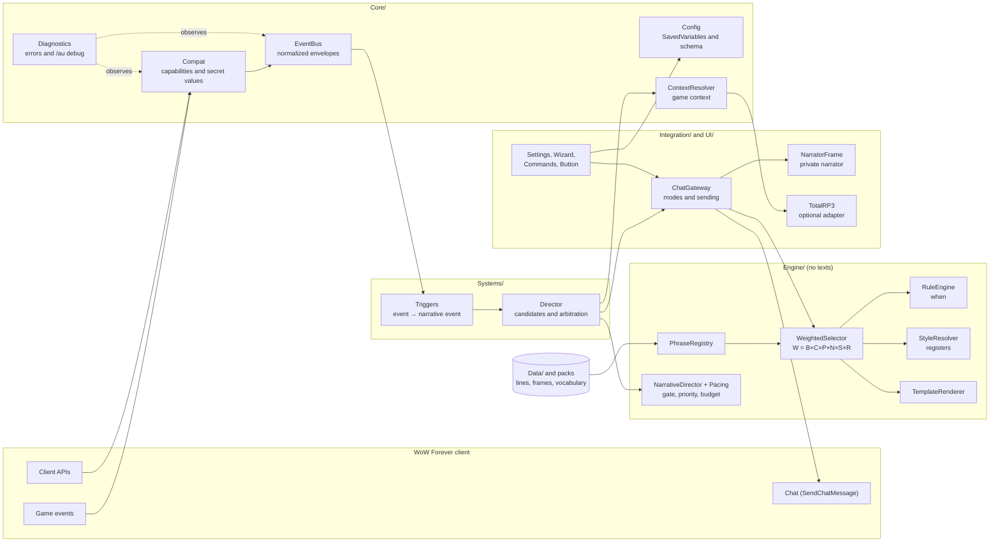

Principles that underpin everything else:

- **The engine contains no texts** ([ADR 0001](adr/0001-engine-and-narrative-database-separated.md)).
- **No network** ([ADR 0002](adr/0002-fully-offline-no-ai.md)).
- **Nothing in chat without a player action** ([ADR 0003](adr/0003-private-narrator-and-chat-gateway.md)).
- **If a client function is missing, that function is switched off, not the addon** ([ADR 0005](adr/0005-compat-secret-values-and-defensive-events.md)).
- **An error in one module does not stop the others** ([ADR 0014](adr/0014-normalized-event-bus-and-isolated-modules.md)).

## 2. Modules and responsibilities

Files are loaded in the order of the `.toc` (`AzerothUnspoken/AzerothUnspoken.toc`). Every file receives `ADDON, NS = ...`: `NS` is the addon's namespace, also exposed as the global `AzerothUnspoken`.

| Folder / file | Responsibility |
|---|---|
| **`Core/Bootstrap.lua`** | the `NS` namespace; `NS.Lower`/`NS.Upper` (UTF-8-safe lowercase and uppercase, to be used instead of `string.lower`/`upper`); languages (`RegisterLanguage`, `NS:L`, `NS:Lang`); `NS:Print`; the module registry (`NS:RegisterModule`); on `ADDON_LOADED` it runs `NS:Initialize`: `Config:Load`, `Compat:Probe`, `EventBus:Start`, then the `OnInit` of every module, each isolated by `Diagnostics:Guard`; key binding names. |
| **`Core/Compat.lua`** | the capability matrix (`AVAILABLE`, `MISSING`, `RESTRICTED`); `Query`, `SafeCall`, `IsSecret`, `Readable`; protected event registration; `GetBuildInfo` (recognizes Forever); restrictions (`C_RestrictedActions`); secret identities (`C_Secrets`); chat source and chat lockdown. |
| **`Core/Diagnostics.lua`** | `Guard` (isolated execution with `xpcall`), the error log (at most 30, grouped), the `/au debug` report, a matrix per group. |
| **`Core/Config.lua`** | defaults, `Merge`, `Validate`, migrations by `schemaVersion`, `Get`/`Set` by path, module presets, Chat Gateway modes and channels. Sets `NS.db` and `NS.cdb`. |
| **`Core/EventBus.lua`** | WoW sources → normalized types; envelopes; deduplication; anti-cascade queue; `Publish`, `Subscribe`, `Recent`. |
| **`Core/ContextResolver.lua`** | `NS:BuildContext(extra)`: builds the context on which conditions are evaluated (character, place, time, group, instance, target, spell; `ctx.place` before memory, `ctx.other` after relationships), classifies spells, registers the zones and keywords of the packs. |
| **`Engine/PhraseRegistry.lua`** | `RegisterPack`; registers lines, frames, vocabulary and translations; indexes by event and by id; provisional speaker; statistics. |
| **`Engine/RuleEngine.lua`** | `Match(when, ctx)`: the declarative conditions (values, lists, `not`, `any`, `func`, ranges), the memory ones (`firstVisit`, `repeatVisit`, `lastVisitBad`, `visitsMin`, `daysSinceLastVisit`, `remembered`), the relationship ones and the `other` and `place` sub-tables (S6c, `Engine.MatchSub`, `Engine.SUB_FIELDS`). |
| **`Engine/StyleResolver.lua`** | registers suited to the moment (GDD §5.2): allowed per event, preferred by zone, depth and voice; the affinity of a line (part of the `S` factor); compatibility between frame and line. |
| **`Engine/Traits.lua`** | the trait model (GDD §7.1): definitions (`choice`, `scale` with bands, `set`), profiles holding only the traits that are set, `Sanitize`, `Merge` (priority between sources), affinity tags (`Evaluate`, `CheckTag`), localized names. It knows nothing about the character: Character Soul (S5), interlocutor (S6c) and relationships (S6b) reuse it. |
| **`Engine/WeightedSelector.lua`** | eligibility, weight `W = B × C × P × N × S × R` (`Engine.Factors`, `Engine:Weight`, hooks via `Engine:SetWeightHook`), anti-repetition, memory of uses, event guards (`Engine:SetEventGuard`), `PickEntry`/`Pick`. |
| **`Engine/Pacing.lua`** | cooldowns (moment, global, category, event) and per-category budgets for spontaneous interventions; state in memory only. |
| **`Engine/NarrativeDirector.lua`** | the priorities of §10, an intensity-driven opportunity gate, suspension (intrusive screens, demanding combat), the die roll, candidate order; hooks for rhythm and demand. |
| **`Engine/TemplateRenderer.lua`** | placeholders, gender, vocabulary, frames. If a piece of data is missing, the line is discarded. |
| **`Integration/TotalRP3.lua`** | optional adapter ([ADR 0004](adr/0004-total-rp-3-optional-with-adapter.md)): the profile name and, with consent, the public psychological traits of the player's **own** profile, mapped onto the Soul traits ([ADR 0016](adr/0016-character-soul-opt-in-traits-and-total-rp-3-with-consent.md)). |
| **`Integration/ChatGateway.lua`** | modes, proposals, channels, sending only from a player action, anti-flood, `AzerothUnspoken_Speak`; `Reroll` ("Another": replaces the proposal with another line for the same event and context, without sending or spending the Director's budget). |
| **`Systems/Personality.lua`** | the Character Soul: eight opt-in traits, archetypes, effective profile (choice > Total RP 3 > game data > neutral), the `P` factor of the weight, register preferences, the `soul` condition, `ctx.soul`, the `/au soul` command. |
| **`Systems/LivingMemory.lua`** | the Living Memory ([ADR 0017](adr/0017-living-memory-selective-memories-and-honest-recall.md)): memories, visited places and flags per character (`cdb.memories`), session moments, compaction to 500, permanent ones, reset, migrations, `ctx.memory`, recall events with a guard (`RegisterRecall`), text export, the `/au journal` command. |
| **`Systems/Relationships.lua`** | the relationships ([ADR 0018](adr/0018-multi-axis-relations-automatic-npcs-and-user-chosen-players.md)): seven independent axes, labels and disposition derived from the data, NPCs computed from the `npcID` (dialogue, quest, vendor, flight, trainer, inn) with diminishing returns, a daily cap and decay, players chosen by the user with suggestions, `ctx.relation` and the like, the `R` factor, register by familiarity, the `relation_npc` event, the `/au relationships` command. |
| **`Systems/Place.lua`** | the place ([ADR 0019](adr/0019-interlocutor-and-place-ordered-sources-and-places-by-mapid.md)): `ctx.place` (zone, uiMapID, continent, tags, territory, capital, instance, boss encounter, role in the group, battleground), `Place:Lookup` on the data in `Data/Places.lua`, `Place.Key` (stable memory key), the `C` factor of `place.` tags and short lines, rhythm by instance type, demand during bosses, the `encounter_end` event, the `/au place` command. |
| **`Systems/Interlocutor.lua`** | the interlocutor ([ADR 0019](adr/0019-interlocutor-and-place-ordered-sources-and-places-by-mapid.md)): `ctx.other` (game data, role, personality with the S5 traits, recent actions, relationship), sources in order (user > public TRP3 with consent > `Data/NPCs.lua` > role from reliable interactions > weak tendency > neutral), the `C` factor of `other.` tags, register by manner of speaking and role, the `npc_meet` and `other_action` events, the `/au who` command. |
| **`Systems/NPCAlive.lua`** | NPC Alive ([ADR 0020](adr/0020-simulated-dialogue-and-real-dialogue-npc-alive.md)): ambient dialogues with an NPC. State machine `idle → offered → opened → choice → response → ended` with verified transitions, identity (a specific NPC from the curated registry or an archetype from the current interaction; never if uncertain or secret), scripts (`NS:RegisterDialogues`: nodes, replies, flags), lines from the engine rules, local effects (flag, relationship, memory), an automatic offer that expires, interruptions (combat, death, zone, another NPC, quest), the `AzerothUnspoken_NPCDialogue` key binding, the `/au talk` command. |
| **`Systems/StoryArcs.lua`** | the story arcs ([ADR 0021](adr/0021-story-arcs-micro-stories-without-game-effects.md)): personal micro-stories, **not quests**, with no rewards and no effects on the game. States `LOCKED → DISCOVERED → REFLECTED → RESOLVED` (plus custom states), steps with an event (`zone`, `death`, `level`, `npc`, `flag`, `player`), RuleEngine conditions, waiting and player choice; at most 1–2 active arcs, suspend/skip/disable (also all of them); state in `cdb.arcs` with migration; lines from the Narrative Director (`arc_open`, `arc_step`, `arc_resolve`, one at a time, postponed if the moment is not good); closing with a permanent `story` memory. The `/au stories` command. |
| **`Systems/Director.lua`** | the Narrative Director of spontaneous events: `Offer` (candidate), `Resolve` (at most one intervention per moment), `Evaluate` (the gate, S2's hook point), immediate pause, summary for `/au debug`. |
| **`Systems/Triggers.lua`** | subscriber to the bus: turns normalized events into narrative events (`battle`, `victory`, `lowhp`, `death`, `rez`, `levelup`, `zone`, `attack`, `heal`, `buff`, `travel`, `rezother`) and offers them to the Director; holds the probabilities and cooldowns specific to each event. |
| **`UI/Widgets.lua`** | small shared interface components. |
| **`UI/NarratorFrame.lua`** | the private narrator: panel, duration, opacity, history, editor, buttons, pause. |
| **`UI/SpeakButton.lua`** | the "Speak" button and the key binding: the gesture that confirms the Chat Gateway. |
| **`UI/ProfileFrame.lua`** | the profile window: archetype, traits, topics to avoid, Total RP 3 consent, neutral profile. |
| **`UI/JournalFrame.lua`** | the Journal: tabs (memories, places, flags, session, stories; more via `RegisterTab`), selective deletion, permanence, reset with confirmation, a copyable export window. |
| **`UI/DialogueFrame.lua`** | the ambient dialogue window: the label "addon ambient dialogue", role and name, line, one to three replies, close; it places itself where it does not cover Blizzard's windows (`BLIZZARD_FRAMES`, `GetRect`), is not in `UISpecialFrames`, and does not write to chat. No dialogue logic: it draws `NPCAlive:View()`. |
| **`UI/RelationsFrame.lua`** | the Relationships window: sortable and filterable table, suggested people, detail with sliders, note, tags and label; two tabs in the Journal. |
| **`UI/Wizard.lua`** | first-run setup wizard (6 steps, 7 with Total RP 3). |
| **`UI/SettingsFrame.lua`** | settings panel (`Settings.RegisterCanvasLayoutCategory`, falling back to `InterfaceOptions_AddCategory`). |
| **`UI/Commands.lua`** | `/au` and `/unspoken` ([ADR 0023](adr/0023-english-first-addon-and-english-command-names.md)). One table (`Commands.list`) maps each English command name, and its English short forms, to a handler; `/au help` is built from it, with the descriptions in the interface language. An unknown word gets a "did you mean" hint (`Commands.Suggest`, with the old Italian words in `Commands.HINTS`, which never run anything). |
| **`Core/Keywords.lua`** | the registry of command keywords (`NS.Keywords.Register`): every table of words a command accepts (channels, depths, modes, reset targets, traits, axes...) is registered here, and a test fails if one is not English or if two commands collide. `NS.Keywords.OnOff` reads `on|off|yes|no|1|0`. |
| **`Data/<language>/Interface.lua`** | interface texts (`itIT`, `enUS`). |
| **`Data/Relationships.lua`** | axes, labels, disposition, register and increments of the NPCs of the relationships, in IT and EN (data, not code). |
| **`Data/Places.lua`**, **`Data/NPCs.lua`** | tags and themes of zones, subzones, capitals, dungeons, raids and battlegrounds (English client name, uiMapIDs not yet verified); curated registry of NPCs by `npcID` and weak class tendencies (S6c). |
| **`Data/Dialogues.lua`**, **`Data/Arcs.lua`** | the structure of the ambient dialogues (scripts by archetype: nodes and replies) and of the story arcs (states, steps, choices); the lines are engine rules (`Data/RegistryDialogues.lua`, `Data/RegistryArcs.lua`) and the texts live in `Data/<language>/`. |
| **`Data/*.lua`** | base phrase packs (schema v2, 14 packs, 1,005 intentions and 2,109 variants per language): `Vocabulary`, `Frames`, the `Registry{Combat,Spells,Life,Exploration,Social,Classes,Soul,Memory,Relations,Context,Dialogues,Arcs}` rules and the per-language texts in `Data/itIT/` and `Data/enUS/`. |
| **`Bindings.xml`** | four key bindings: `AZEROTHUNSPOKEN_SPEAK` (confirm), `AZEROTHUNSPOKEN_REROLL` (another line), `AZEROTHUNSPOKEN_PAUSE` (immediate pause), `AZEROTHUNSPOKEN_NPC` (ambient dialogue). |
| **`AzerothUnspoken_Example/`** | example pack, a separate addon with `## Dependencies: AzerothUnspoken`. |
| **`Tests/`** | offline tests (lupa) and a mock client ([ADR 0007](adr/0007-offline-tests-with-lupa-and-mock.md)). |

Direction of dependencies: `Core` knows nothing about `Engine`, `Systems` or `UI`; `Engine` uses `Core` but knows nothing about the Gateway or the interface; `Integration` and `Systems` use `Core` and `Engine`; `UI` uses everything. A module is found with `NS.ModuleName` (for example `NS.Gateway`, `NS.Director`, `NS.Narrator`).

### How the systems hook into the engine

The systems of M1–M3 (personality, memory, relationships, interlocutor, place, NPC Alive, arcs) **do not modify** the engine or the Director: they attach to planned points. The engine remains a single chain; each system gives it data (`ctx.*`) and tells it how to weigh, when to stay silent and when a line has the right to speak.

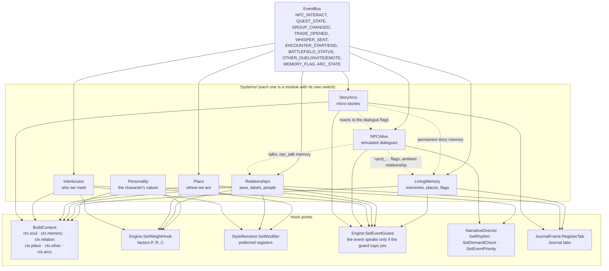

| Hook | Used by | What it is for |
|---|---|---|
| `ctx.soul` | Personality | the effective profile: choice > Total RP 3 > game data > neutral |
| `ctx.memory` | LivingMemory | first visit, return, visit that ended badly, flags: **only from real memories** |
| `ctx.relation` (and `rel`, `disposition`, `isKnown`) | Relationships | the relationship with the person of the interaction |
| `ctx.other`, `ctx.otherTraits` | Interlocutor | who we have in front of us, with the source of each piece of data |
| `ctx.place` | Place | zone, map, territory, instance, encounter, role in the group |
| `ctx.arcs` | StoryArcs | the arcs in progress and concluded, and the line about to come out |
| `P` factor | Personality (`soul`) | soft affinity and hard filters of the `trait:value`, `req:`, `not:`, `topic:` tags |
| `R` factor | Relationships (`relations`) | tags with the `rel.` scope |
| `C` factor | Place (`place`), Interlocutor (`other`) | tags with the `place.` and `other.` scope, short lines in battlegrounds |
| register modifier | Personality, Relationships, Interlocutor | temperament, familiarity and manner of speaking shift the preferred registers |
| event guard | memory (`memory_return`…), relationships (`relation_npc`), interlocutor (`npc_meet`, `other_action`), place (`encounter_end`), NPC Alive (`npcd_*`), arcs (`arc_*`) | an event that cites a fact does not speak if the fact is not there |
| `SetRhythm` / `SetDemandCheck` | Place, NPC Alive | more sober in raids and against bosses, silence during a dialogue |
| `SetEventPriority` | memory, relationships, arcs | memory recall or exceptional event in §10 of the GDD |
| `RegisterTab` | LivingMemory, Relationships, StoryArcs | the Journal tabs (memories, places, flags, session, relationships, people, stories) |

This is why the systems can be switched off one by one from the panel (`modules.*`): without `memory` no recall, without `relations` no `R` factor, and so on, while the base narrator keeps working.

## 3. Flow of an event

The complete path, from the client to the line shown (and, only after a gesture, to chat):

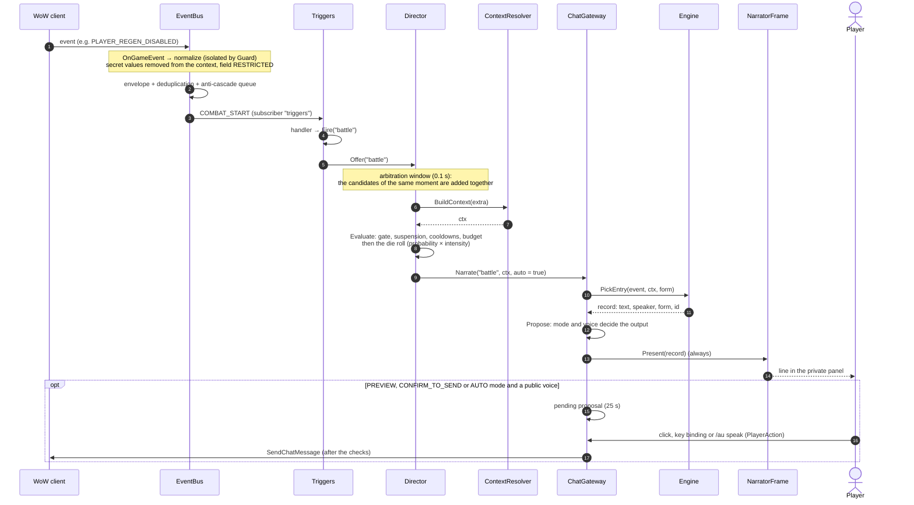

The steps, in words:

1. **Client → bus.** `Core/EventBus.lua` registers the client events through `Compat:RegisterEvent` (with a validity check, inside a `pcall`). Every source (`EventBus:AddSource`) has a `normalize` function that produces a type, a context and options (deduplication key, expected fields). The function runs inside `Diagnostics:Guard`.
2. **Envelope.** `NewEnvelope` creates `{ type, timestamp, source, context, fields }`. Secret values do not enter the context and their field is `RESTRICTED`; fields that are expected but absent are `MISSING`.
3. **Deduplication and queue.** A duplicate (same type and key within the window) is discarded and counted. An event published while another is being delivered goes into a queue (at most 32; older than 5 seconds, it is discarded).
4. **Delivery.** To the handlers of the type and to those of `"*"`, each in `Guard`.
5. **Triggers.** The handlers in `Systems/Triggers.lua` keep a little state (start of combat, previous zone, spell targets) and call `Fire(event, extra)`, that is `Director:Offer`; some delay with `C_Timer.After` to let the game update its state.
6. **Narrative Director.** The candidates that arrive within the arbitration window are resolved together, in priority order; for each one the Director builds the context, asks for the gate (`Evaluate`) and rolls the die. The first that produces a line wins, the others stay silent ([details below](#the-narrative-director)).
7. **Context.** `NS:BuildContext(extra)` gathers the data of the moment. With the target's identity secret, no target data is read or compared (it stays `targetSecret`); every read goes through `SafeCall`; the character's name may come from Total RP 3.
8. **Gateway and engine.** `Gateway:Narrate` chooses the form (speech or emote) and asks `Engine:PickEntry` for a line ([section 4](#4-how-a-line-is-chosen)). If no line fits, **nothing happens**: silence is valid.
9. **Output.** `Gateway:Propose` always shows the line in the narrator. Only if the mode provides for it and the voice may go to chat does it also create a **proposal** ([section 5](#5-the-chat-gateway)).

**Explicit requests.** `/au greet`, `/au event`, `/au cast` and the "Speak" button do not go through the Narrative Director: they call `NS:Trigger`/`Gateway:Narrate` directly, even when paused and at intensity 0 (GDD §4.2). They consume no budget, but they open the "moment": for a few seconds no spontaneous line follows them. They are still subject to the Gateway's rules: never a send to chat without a player action.

### The Narrative Director

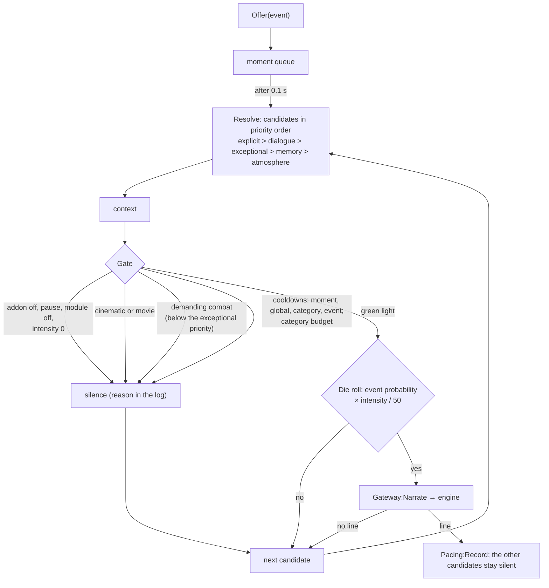

| Check | Rule | Who skips it |
|---|---|---|
| Moment | 4 s between any two interventions (explicit ones too) | nobody |
| Global cooldown | `pacing.globalCooldownSeconds` (45) × (1.5 − intensity/100) | exceptional events |
| Category cooldown | `Pacing.CATEGORY_COOLDOWN` (combat 15 s, exploration 30 s...) × the same factor | exceptional events |
| Event cooldown | `NS.EVENT_COOLDOWN` × the same factor | nobody |
| Budget | `Pacing.BUDGET` per category in 10 minutes (combat 6...) × intensity/50 | exceptional events |
| Intrusive screens | `InCinematic`, `IsInCinematicScene`, `CinematicFrame`/`MovieFrame` visible | nobody |
| Demanding combat | in combat with a boss, in a raid, elite in an instance (`pacing.suppressInHighDemand`) | exceptional events |
| Line cooldown (id) | the rule's `cooldown` and the anti-repetition window, in the engine | nobody (it also applies to explicit ones) |

The log of the latest decisions (`Director.log`) and the budget used appear in `/au debug` on the **Narrative Director** row. The reasoning behind the choices is in [ADR 0015](adr/0015-narrative-director-one-intervention-per-moment.md).

## 4. How a line is chosen

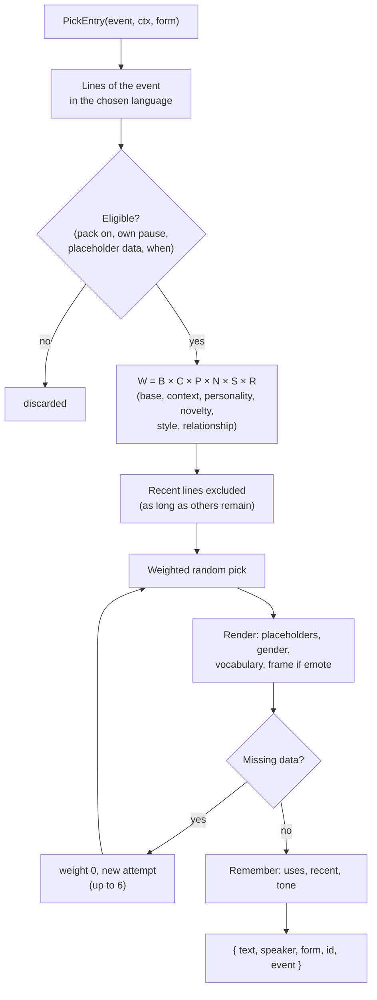

- **Weight** (`Engine.Factors`, GDD §10): `B` = `weight`; `C` = 1 + 0.35 × conditions (plus the `C` hooks of S6c); `P` = personality (Character Soul): soft affinity of the `trait:value` tags (×1.6 / ×0.6), inner voice and irony; 0 excludes the line via `req:`, `not:` and `topic:`; neutral (1) with the neutral profile ([details](#the-character-soul)); `N` = ÷ (1 + 0.3 × recent uses), ×0.6 if the register is the same as that of the last line of the event; `S` = depth (×0.3 if different) × register affinity of the StyleResolver (×0.5 outside the event, +25% for each zone, depth and voice preference); `R` = relationship with the person of the interaction ([see below](#relationships)): tags with the `rel.` scope as soft affinity or hard filter (0 excludes), neutral without a person. `Engine:Weight(line, event, ctx)` returns the breakdown.
- **Character**: traits weight the lines and, for hard tags, exclude them; see [the Character Soul](#the-character-soul).
- **Style**: registers weight and do not exclude, so the neutral fallback is automatic. In emote form, a frame with registers accepts only lines of the same or a close register (`StyleResolver:Compatible`).
- **Conditions** (`when`): see [PACK_FORMAT.md](../AzerothUnspoken/PACK_FORMAT.md). More conditions → more specific line → greater weight.
- **Memory**: `NS.cdb.memory` (`uses`, `last`, `recent`, `lastTone`), per character. Uses fade at every access (`DecayMemory`, ×0.75). The window of recent lines is about 60% of those available, at most `pacing.recentPhraseWindow` (30).
- **Voice (`speaker`)**: `narrator`, `inner`, `character`, `npc`; each rule declares it (if missing it is inferred from `form`: `say` → `character`, `emote` → `narrator`, with a validator warning). A spoken line placed in a frame is `narrator`. The `inner` and `npc` voices never become proposals for the chat.
- Silence is a valid outcome: if no line is eligible, the engine returns `nil`.

### The Character Soul

`Systems/Personality.lua` gives the character a voice of its own (GDD §7.1, [ADR 0016](adr/0016-character-soul-opt-in-traits-and-total-rp-3-with-consent.md)). Everything is optional: with no choices the profile is **neutral** and the narrator stays as it was.

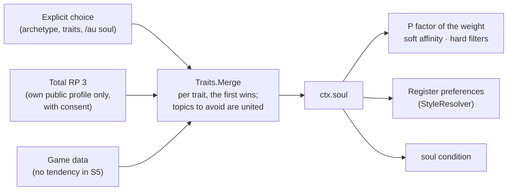

- **Traits**: temperament, morale, curiosity (scale), faith, motivation, irony (scale), inner voice and topics to avoid (a set). Ready-made archetypes plus the neutral profile; choosing an archetype copies its traits, changing one makes the profile "custom". A change takes effect immediately: the next lines use the new profile.
- **Tags on lines** (`tags` field): `trait:value` soft affinity (×1.6 if it matches, ×0.6 if the profile has a different value, never zero); `req:trait:value` (the line asserts something about the character: it comes out only if the profile says so), `not:trait:value` and `topic:topic` are **hard** filters (factor 0). Tags without a colon stay descriptive. The validator checks the affinity tags.
- **Priority** (GDD §8), trait by trait: explicit choice > Total RP 3 > game data > neutral values; the summary (`/au soul list`) says the source of each trait.
- **Total RP 3**: only with the `personality.trp3` consent and the `totalRP3` module on; it reads only `characteristics/PS` of your own profile and never writes. If the API is missing or changes, the layer disappears and the choices remain (capability `integration:totalRP3:traits`).
- **Reuse**: `Engine/Traits.lua` knows nothing about the player. S6c uses it for `ctx.other` (tag scope `other.`) and for place tags (scope `place.`), S6b for the relationship axes.
- **Interface**: `/au soul` opens `UI/ProfileFrame.lua` (archetype, traits, topics, consent, neutral profile); `/au soul list | neutro | archetipo <id> | trp3 on|off | <trait> <value> | evita <topic>`.

### Living Memory

`Systems/LivingMemory.lua` gives the character continuity across sessions (GDD §7.4, [ADR 0017](adr/0017-living-memory-selective-memories-and-honest-recall.md)). Only significant moments, never every click, never chat text.

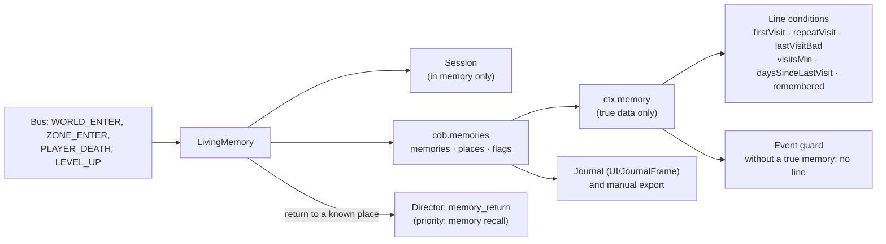

- **What is remembered**: first visit to a zone (more so if it is a capital), return after a day, a visit that ended badly (death or flight), deaths, levels (a milestone every ten). Places keep their counts (visits, deaths, outcome) separate from the memories: compacting the memories does not make a place forgotten.
- **Limits**: 500 ordinary memories (compaction of the least significant down to 450), 200 permanent, 300 places, 60 session moments. Reset has five targets, always with confirmation.
- **Honest recall**: memory conditions read `ctx.memory`; recall events (`memory_return`) have a guard in the engine and the validator requires a memory condition on their lines. Recall has the priority of §10 and beats the zone atmosphere in the same moment.
- **Privacy**: no chat source, no free text; `Record` and `Sanitize` admit only the expected fields.

### Relationships

`Systems/Relationships.lua` keeps the relationship with people ([ADR 0018](adr/0018-multi-axis-relations-automatic-npcs-and-user-chosen-players.md)). The axes are scales of `Engine/Traits.lua` (scope `rel`); labels, disposition, register and increments are data in `Data/Relationships.lua`.

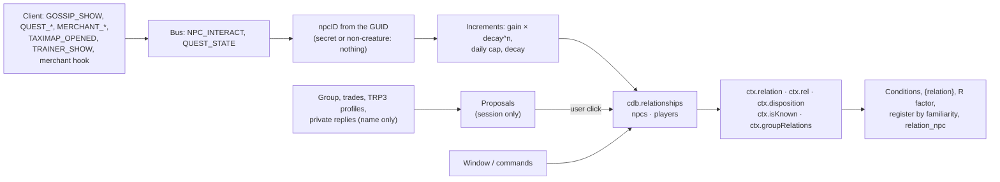

- **Axes**: `familiarity`, `fear` and `attraction` 0…100; `trust`, `respect`, `affection`, `loyalty` −100…100. Attraction is optional (off by default).
- **Derived label**: the first rule, by priority, that holds; a label chosen by hand takes precedence. **Disposition**: weighted average −100…100 in nine bands.
- **NPCs** are automatic (`relations.npcAuto`); **players** only with a user action (`R:AddPlayer(name, "user")`) or with the explicit option "register automatically".
- **Privacy**: no chat or whisper text (of a private reply only the name is read), nothing over the network, proposals are not saved.
- **Interface**: `/au relationships` opens `UI/RelationsFrame.lua`; the journal has the *Relationships* and *People met* tabs.

### NPC Alive

`Systems/NPCAlive.lua` and `UI/DialogueFrame.lua` ([ADR 0020](adr/0020-simulated-dialogue-and-real-dialogue-npc-alive.md)) are the ambient dialogues: a **simulated** micro-dialogue with an identifiable NPC, in a separate window, never in chat.

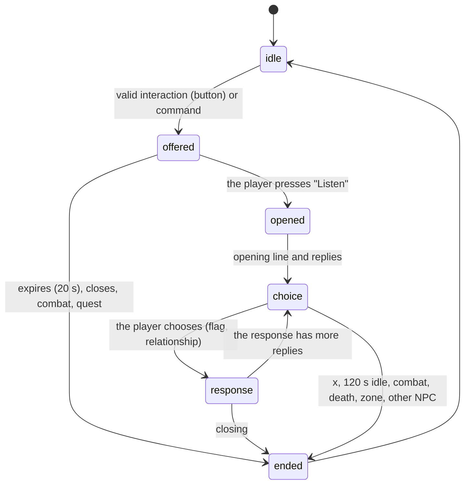

- **Identity**: the `npcID` from the GUID. *Specific*: it is in `Data/NPCs.lua` (or the user gave it a role). *Archetype*: the role is proven by the current interaction (merchant, flight, training, innkeeper setting the home) or one already done with the same NPC; gossip alone is not enough. Players, hostile creatures, dead NPCs, secret identity and unreadable GUIDs: no dialogue.
- **Scripts** (`Data/Dialogues.lua`): per archetype (`innkeeper`, `merchant`, `guard`, `flightmaster`, `trainer`) or per `npc:<npcID>` (with `extends`), nodes with the event of the lines and the replies they offer; each reply has a neutral IT/EN label, the target node, a narrative flag and a relationship source. Checked by `NPCAlive:Check()` and by the validator (`badDialogue`).
- **Voice** (`Data/RegistryDialogues.lua`, texts `Dialogues.lua`): engine rules with `speaker = "npc"` and events `npcd_<role>_<node>`: chosen by `Engine:PickEntry` with the context of the interlocutor (way of speaking, temperament) and of the relationship (`isKnown`); they come out only inside a dialogue (guard on the event); anti-repetition as for every line. During a dialogue the spontaneous narrator is silent (`SetRhythm`).
- **Effects**: a narrative flag `npcd_<archetype>_<name>` (S6 memory, never a quest), a bit of relationship (`ambient`, `ambient_talk`), an `npc_talk` memory if the player replied (without text or name). The test NPC (`/au talk test`) writes nothing.
- **Window**: always-visible label, position that avoids the visible Blizzard windows and corrects itself if one opens underneath, draggable and resettable; it neither calls nor hides anything of Blizzard's.
- **Commands**: `/au talk` (`test [gruff|jovial|warm|formal|terse|neutral]`, `close`, `role <role>`, `offer on|off`, `status`), key binding "Ambient dialogue with the NPC (open/close)".

### Story Arcs

`Systems/StoryArcs.lua` ([ADR 0021](adr/0021-story-arcs-micro-stories-without-game-effects.md)) keeps the personal micro-stories: they are **not server quests**, give no rewards, and do not touch real NPCs. The structure of the arcs is data (`Data/Arcs.lua`, `NS:RegisterArcs`), the lines are rules of three events (`arc_open`, `arc_step`, `arc_resolve`), the texts are per language.

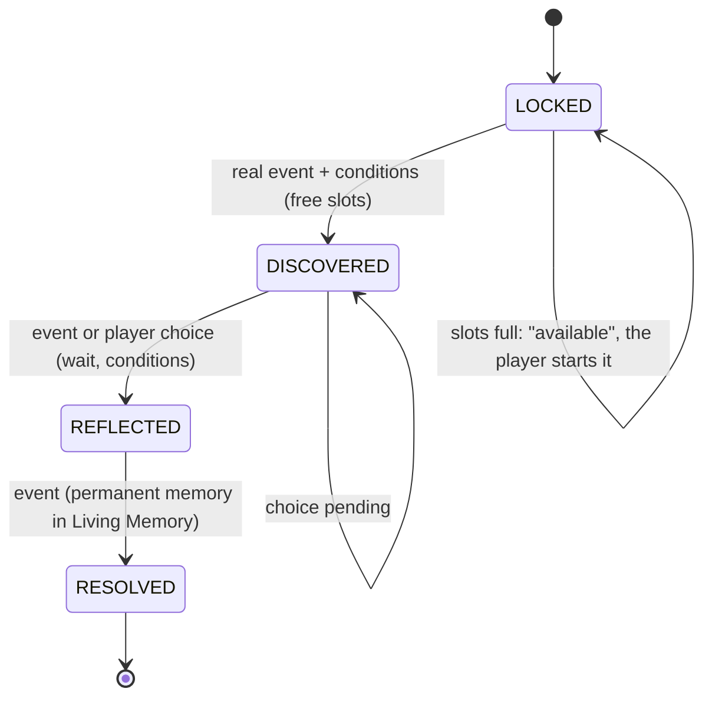

An arc's own states (for example `JOURNEY` in "The Three Doors") sit between `LOCKED` and `RESOLVED`; from one state you only go to the next.

- **Events**: `SA:Fire(event)` is subscribed to the bus: `ZONE_ENTER`/`WORLD_ENTER` (evaluation after two seconds), `PLAYER_DEATH`, `LEVEL_UP`, `NPC_INTERACT` (not quests), `MEMORY_FLAG` (a new flag set by a system of the addon, for example the ambient dialogues; not hand-set ones, nor the automatic ones of the memory, nor the `arc_…` ones of the arcs themselves). Only the arcs with a step from that state and for that event build the context. One event moves an arc by a single step.
- **Choices**: a step with `choose` waits for the player (`pending`); the journal or `/au stories choose` apply the step with the **option id**. `player` steps have no event: they are offered when conditions and wait hold.
- **Slots and modes**: `arcs.maxActive` (1–2); mode `active`, `suspended`, `skipped` or `off`; `waiting` for an arc whose opening arrived with slots full. The `storyArcs` module turns everything off.
- **Lines**: `QueueBeat` puts the line in `SA.owed`; `Flush` offers it to the Director (`Director:Offer(event, extra, onResult)`, "exceptional" priority, one at a time, at least 90 s after the previous one) only in a quiet moment; the event guard requires `ctx.arc.beat`, so `/au event` does not produce them. The state advances even if the line stays silent.
- **Data**: `cdb.arcs = { version, items = { [id] = { state, mode, since, t, choices, subject, pending, waiting, memoryId, ended } }, stats }`, schema 6, internal `SA.migrations`, `SA:Sanitize`. Closing records a permanent `story` memory (only id and place).
- **Conditions** (`Engine/RuleEngine.lua`): sub-table `arc = { id, state, from, choice, withSubject }`, `arcDone`, `capitalsVisitedMin`.
- **Journal** (`UI/JournalFrame.lua`): "Stories" tab with in progress, available, concluded, skipped, and the detail with the story and the choices made. **Command** `/au stories`.

### Interlocutor and place

`Systems/Interlocutor.lua` and `Systems/Place.lua` say **whom we meet** and **where we are** ([ADR 0019](adr/0019-interlocutor-and-place-ordered-sources-and-places-by-mapid.md)).

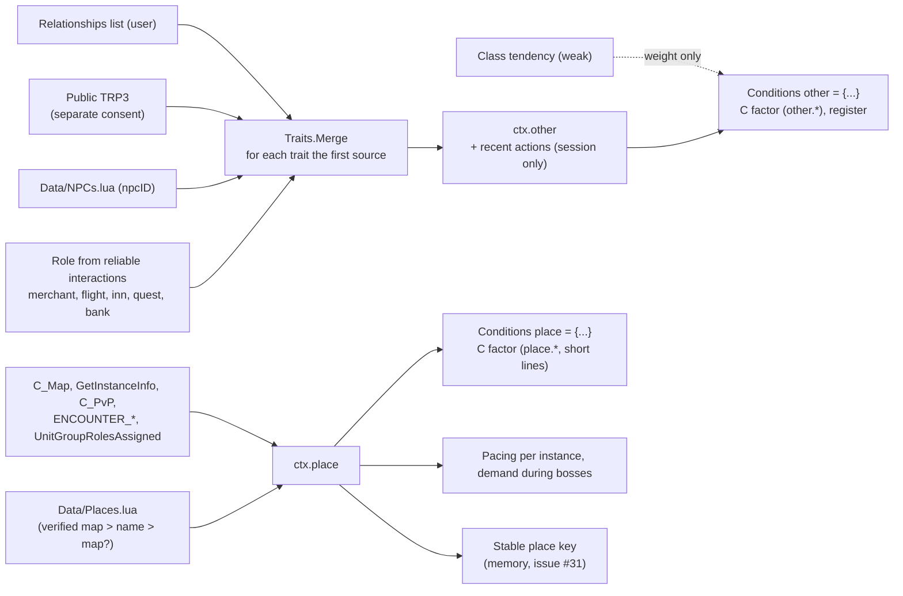

- **Actions**: only from reliable events (dialogue, quest, merchant, trade, group, duel, invitation, standard emotes aimed at us, target), never from the combat log; they stay in memory for the session.
- **Secrets**: with a secret identity `ctx.other = { secret = true }`; a secret place value means "I don't know".
- **Events**: `npc_meet`, `other_action`, `encounter_end`, each with a guard in the engine.
- **Commands**: `/au place` and `/au who` (`trp3 on|off` for consent to read other people's public Total RP 3 profile, and `trait <trait> <value>` to correct an interlocutor's trait by hand).

## 5. The Chat Gateway

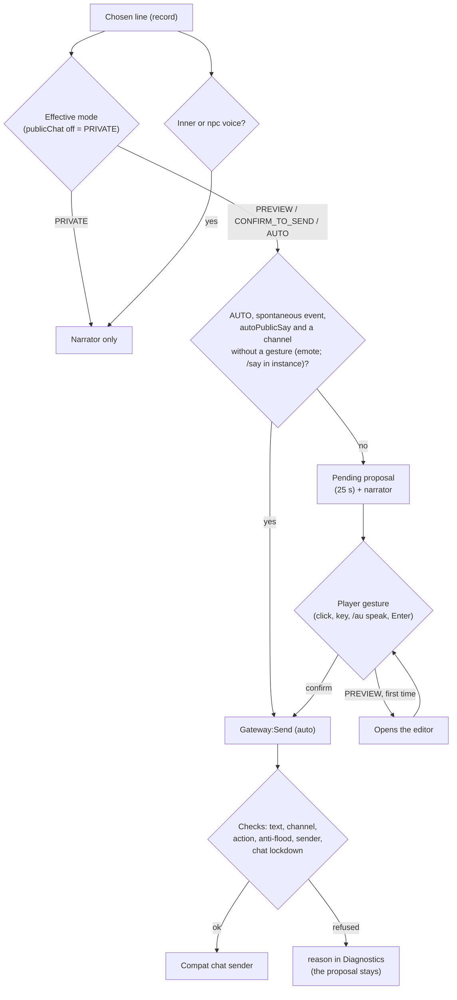

Fixed rules, verified by the tests (`Tests/TestChatGateway.lua`):

- Sending by gesture goes only through `Gateway:PlayerAction(fn)`. Outside that scope `Gateway:Send` refuses everything except `EMOTE` and, in an instance, `SAY` and `YELL` (`needs_action`).
- The `inner` and `npc` voices never become proposals.
- Anti-flood: `floodSeconds` (4), `maxPerMinute` (6), `autoMaxPerMinute` (2); text of at most `Config.CHAT_LIMITS[channel]` bytes (255; the same table is read by the validator); pending proposal `pendingSeconds` (25), and a new one replaces the old one. With the editor open the proposal does not expire and a spontaneous line does not replace it.
- The text sent is adapted to the channel (`Gateway:TextFor`: emote outside `/e` with the name, spoken line in `/e` with "dice: «…»"). As an alternative to sending, `Gateway:CopyToChat` puts the proposal in the standard chat box (`Compat:OpenChatWith`).
- Automatic sending is activated only with two gestures (warning and confirmation within 10 seconds, `Gateway:SelectAuto`) and is not in the panel's mode cycle.
- Channels: `SAY`, `EMOTE`, `YELL`, `PARTY`, `RAID`, `GUILD`, `INSTANCE_CHAT`, with an availability check.
- **Hypothesis not yet measured in game**: which channels the client accepts without a gesture ([G1](G1_checklist.md) (in Italian), SP-05).

## 6. Data and SavedVariables

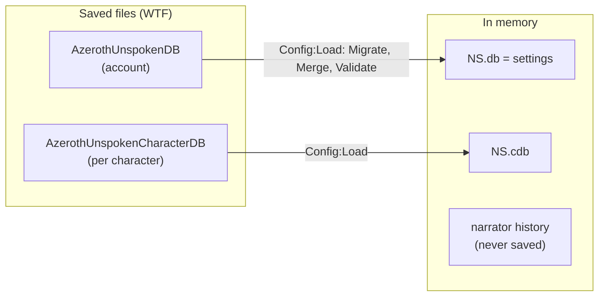

| Variable | Content |
|---|---|
| `AzerothUnspokenDB` | `schemaVersion` (currently 6) and `settings`: `locale`, `preset`, `intensity`, `proseDepth`, `modules`, `output`, `chat`, `privacy`, `pacing`, `enabled`, `chance`, `ignored`, `disabledPacks`, `relations` (`npcAuto`, `attraction`, `autoRegisterPlayers`, `proposePlayers`), `interlocutor` (`trp3Others`: consent to read other people's public Total RP 3 profile), `npcAlive` (`autoOffer`), `arcs` (`maxActive`), `ui` (button, wizard done, `narrator`: duration, opacity, size, lock, history; `dialogue`: size, opacity, lock, position). |
| `AzerothUnspokenCharacterDB` | `schemaVersion`, `memory` (uses, last lines, tone), `personality` (`version`, `archetype`, `traits`, `trp3`: explicit Character Soul choices and consent to Total RP 3) `relationships` (relationships: `version`, `npcs` by `npcID`, `players` by "Name-Realm"; see above), `memories` (Living Memory: `version`, `nextId`, `entries`, `places`, `flags`, `stats`, see above) `arcs` (Story Arcs: `version`, `items` by arc with state, mode, choices and moment, `stats`; see above) and, for future steps, `history` (empty today). |

Every per-character datum also has its **own version** (`personality.version`, `memories.version`, `relationships.version`, `arcs.version`), with migrations and cleanup (`Sanitize`) in its own module. A version newer than the one known (you went back to an older addon) is read but **not rewritten**.

| Datum | Schema version | Where the migration lives |
|---|---|---|
| `AzerothUnspokenDB` / `AzerothUnspokenCharacterDB` | `Config.SCHEMA_VERSION` = 6 | `Config.migrations.global[n]` and `.character[n]` |
| `cdb.personality` | 1 | `Personality:Sanitize` |
| `cdb.memories` | 2 (place key by uiMapID, #31) | `LM.migrations[n]` |
| `cdb.relationships` | 1 | `R:Sanitize` |
| `cdb.arcs` | 1 | `SA.migrations`, `SA:Sanitize` |

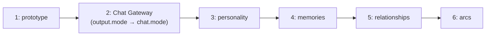

- Defaults are in `Config.defaults` and `Config.characterDefaults`; validity rules in `Config.rules`.
- Migrations are `Config.migrations.global[n]` and `.character[n]` ([ADR 0006](adr/0006-savedvariables-and-schema-versions.md)).
- **Chat content is never saved**, nor the lines of the dialogues, nor the arcs' texts (only the ids of the choices); of the relationships with players only those chosen by the user are saved. The `privacy.*` fields (`socialOptIn`, `shareMemories`, `acceptSceneInvites`) already exist, switched off, for the future Social module.
- The rest of the state (immediate pause `NS.paused`, pending proposal, history, error log, memory of the last send) lives in memory only.

## 7. Extension points

### For phrase pack authors (stable)

A pack is a separate addon with `## Dependencies: AzerothUnspoken`. The API is described in [PACK_FORMAT.md](../AzerothUnspoken/PACK_FORMAT.md), whose examples are tested by the tests as external packs. **An external pack calls the functions from the global `AzerothUnspoken:` object**; the `NS` in the first line `local ADDON, NS = ...` is the pack's own namespace and does not have these functions.

| Call | What it is for |
|---|---|
| `AzerothUnspoken:RegisterPack({ id, name, languages, registry, texts, events, styles, categories, conditions, frames, vocab })` | schema v2: rules (`registry`), texts per language with variants (`texts`), events, registers, new categories and conditions, frames and vocabulary |
| `AzerothUnspoken:AddTexts(language, { [id] = texts }, packId)` | texts (also translations and extra variants) for ids of this or of other packs (`AddTranslations` is the old alias) |
| `AzerothUnspoken:RegisterEvent(name, { category, chance, cooldown })` · `RegisterStyle` · `RegisterCategory` · `RegisterCondition` | new events, registers, categories and conditions |
| `AzerothUnspoken:RegisterLanguage(code, { name, ui })` | adds a language (interface texts) |
| `AzerothUnspoken:RegisterSpellKeywords({ kind = …, element = …, classElement = … })` | classifies spells and creates new kinds (each one fires the event of the same name) |
| `AzerothUnspoken:SetEventDefaults(event, probability, pause)` | default probability and pause of a new event |
| `AzerothUnspoken:RegisterZoneMoods({ ["Zone name"] = "atmosphere" })` | atmosphere of the zones, for the `mood` condition and for style |
| `AzerothUnspoken:RegisterEventStyles(event, { registers })` · `RegisterMoodStyles({ atmosphere = { registers } })` | registers allowed for an event and preferred by an atmosphere (StyleResolver) |
| `AzerothUnspoken:SetEventPriority(event, "memory")` | priority of an event in the Narrative Director (`dialogue`, `exceptional`, `memory`, `ambient`) |
| `AzerothUnspoken.LivingMemory:RegisterRecall(event, check)` | a memory recall event: `memory` priority, `memory` module and guard (without a true memory it does not speak) |
| `AzerothUnspoken.LivingMemory:RegisterKind(kind, importance)` · `:Record{ kind, zone, tags, … }` · `:SetFlag(name)` | other systems (arcs, relationships) register memories and flags |
| `AzerothUnspoken:RegisterRelationData({ axes, labels, disposition, … })` · `AzerothUnspoken.Relationships:RegisterRelationEvent(event, check)` | new relationship labels and axes (by id, they replace); events that cite a relationship, with a guard |
| `AzerothUnspoken:RegisterPlaces({ zones, subzones, instances, continents })` · `RegisterNPCs({ [npcID] = … })` · `RegisterTendencies({ class = … })` | places, NPCs and weak tendencies for interlocutor and place (an already registered key is **replaced**, [#69](https://github.com/Finland6738/azeroth-unspoken/issues/69)) |
| `AzerothUnspoken:RegisterDialogues({ scripts = { [key] = script } })` | ambient dialogues: archetype, or `npc:<npcID>` with `extends`; existing key = replacement ([#69](https://github.com/Finland6738/azeroth-unspoken/issues/69)) |
| `AzerothUnspoken:RegisterArcs({ pack, arcs, texts })` · `AddArcTexts(language, map, packId)` | narrative arcs: states, steps, choices and texts |

A pack can also use `func = function(ctx) … end` in conditions for rules written in Lua, with the context of `NS:BuildContext`.

### For macros, other addons and tools (in use, no stability guarantee)

| Point | Use |
|---|---|
| `/au event <name>`, `/au cast <spell>`, `/au greet`… | from macros or other addons with `SlashCmdList` |
| `AzerothUnspoken:Trigger(event, extra)` (`NS:Trigger`) | fires a narrative event; it always goes out through the narrator and the Chat Gateway, **never to chat on its own** |
| `AzerothUnspoken_Speak()` | the "speak" gesture (also from a key or macro) |
| `AzerothUnspoken.EventBus:Subscribe(type, owner, fn)` | observe the normalized events (envelope) |
| `AzerothUnspoken.EventBus:AddSource(wowEvent, { normalize, unit })` | translate a new client event; registration goes through Compat |
| `AzerothUnspoken.Compat` (`caps`, `Query`, `SafeCall`, `Readable`, `IsSecret`) | use the client APIs defensively |
| `AzerothUnspoken.Gateway:Send(...)` | **outside `PlayerAction`** it refuses everything except emotes (and `/say`/`/yell` in instances): whoever uses it does not bypass the rules |

These points are internal: they may change from one version to the next while the roadmap is open. Only the pack API is meant to last, and its changes will be announced in the [CHANGELOG](../CHANGELOG.md).

### For those writing a new system inside the addon

1. Create the file in the right folder and add it to the `.toc` **after** the modules it depends on.
2. Register the module with `NS:RegisterModule("name")` and initialize it in `OnInit` (isolated by `Guard`).
3. For every new client API: check it in the dump ([ADR 0010](adr/0010-forever-api-dump-as-reference.md)), go through Compat and degrade gracefully.
4. For a new client event add a source to the bus; do not register events on your own.
5. To speak, go through the Director (if it is spontaneous: `NS.Director:Offer(event, extra)`) and the Gateway (always).
   To influence the choice without touching the Director use the hooks: `Engine:SetWeightHook("C"|"P"|"R", name, fn)` (weight factors), `StyleResolver:SetModifier(name, fn)` (register preferences), `NarrativeDirector:SetRhythm(name, fn)` (probability and pause multipliers), `NarrativeDirector:SetDemandCheck(name, fn)` (demanding moment), `Engine:SetEventGuard(event, name, fn)` (an event speaks only if the guard says yes), `JournalFrame:RegisterTab(id, def)` (a journal tab).
6. New saved data: defaults in `Config.defaults`, rules in `Config.rules`, migration and tests.
7. Annotate the public API with EmmyLua and add the new globals to `.luarc.json` (see [CONTRIBUTING.md](../CONTRIBUTING.md)).

## 8. What is planned and not there yet

From the [roadmap](../ROADMAP.md). The current `main` has milestones M0–M3: foundations, narrator and Chat Gateway (S1–S2), data schema, Narrative Director, Character Soul, Living Memory, relationships, interlocutor and place, Alpha content (S3–S7, [see above](#the-character-soul)), NPC Alive (S8) and Story Arcs (S9). Missing:

| Step | What it adds | Where it hooks in |
|---|---|---|
| S10 (M4) | social play with addon messages, consent and safety; G4 test with two clients | new module, `privacy.*`, `ARC_STATE`; **nothing of an arc, a memory or an NPC goes into a message without a separate consent** |
| S11 (M5) | content up to 1,000 intentions | phrase packs |
| S12 (M5) | accessibility, profiling, manual, privacy, troubleshooting, Definition of Done | cross-cutting |
| G1, G2, G3 | the user's in-game tests (SP-01…SP-05, vertical slice A, B and C, arcs) | [checklist](G1_checklist.md) (in Italian), 92 steps |

## 9. Known limits

- **Nothing has been tested in the real client.** Everything is verified only with the simulated client; the G1 test is postponed ([checklist](G1_checklist.md)).
- In the settings the `personal`, `world`, `memory`, `relations`, `npc`, `storyArcs`, `publicChat` and `totalRP3` modules take effect; social and audio are still placeholders.
- The per-event probabilities and pauses (`NS.DEFAULT_CHANCE`, `NS.EVENT_COOLDOWN`) come from the prototype; the Narrative Director's numbers (budget, category pauses, style bonuses and penalties) are hypotheses to tune with in-game tests ([G1](G1_checklist.md), steps 27–31).
- The recognition of demanding combat uses bosses, raid, elites in an instance and, since S6c, boss encounters (`ENCOUNTER_START`), which have not yet been tested in the real client.
- The ambient dialogues (S8) have not been tested in the real client: neither the names of the Blizzard windows that the window avoids (`GossipFrame`, `MerchantFrame`...), nor `GetRect`, nor which interactions actually put an NPC in the `npc` unit; the curated registry has few NPCs (and the numbers are not verified). See [G1](G1_checklist.md), G3.
- The story arcs (S9) have not been tested in the real client: neither that `C_Map` gives the uiMapID of the starting zone (the English name is the fallback), nor the thresholds of familiarity, levels and waits of the steps, nor the look of the journal's "Stories" tab.
- The uiMapIDs, instanceIDs and npcIDs of the data (`Data/Places.lua`, `Data/NPCs.lua`) come from Classic Era and are not verified in Forever: places are recognized by name until they are (`/au place`).
- The APIs of the capability matrix have not been checked in the client of build 70658: see `/au debug full` and [REFERENCES.md](REFERENCES.md).
