# Azeroth Unspoken Architecture

This document describes how the addon is built **today, on `main`** (version 0.1.0; milestones M0–M3, steps S1–S9), and where the things the [roadmap](../ROADMAP.md) plans will plug in. The parts that are not there yet are marked as *planned*. For the reasons behind the choices see the [ADRs](adr/README.md); for the product specification, the [GDD](Immersion_Director_GDD_v1.0.md) (in Italian; §11 is the Lua architecture).

## Contents

1. [Overview](#1-overview)
2. [Modules and responsibilities](#2-modules-and-responsibilities)
3. [Flow of an event](#3-flow-of-an-event)
4. [How a line is chosen](#4-how-a-line-is-chosen)
5. [The Chat Gateway](#5-the-chat-gateway)
6. [Data and SavedVariables](#6-data-and-savedvariables)
7. [Extension points](#7-extension-points)
8. [What is planned and not there yet](#8-what-is-planned-and-not-there-yet)
9. [Known limits](#9-known-limits)

## 1. Overview

The addon is a chain: the **client** emits an event, a **bus** translates it into a uniform format, the **Director** decides whether it is the moment to speak, the **engine** picks a whole line from the pack **database**, the **Chat Gateway** decides where it may go, and the **private narrator** shows it. Every client API goes through **Compat**, which says what is available, missing or restricted.

Principles that underpin everything else:

- **The engine contains no texts** ([ADR 0001](adr/0001-engine-and-narrative-database-separated.md)).
- **No network** ([ADR 0002](adr/0002-fully-offline-no-ai.md)).
- **Nothing in chat without a player action** ([ADR 0003](adr/0003-private-narrator-and-chat-gateway.md)).
- **If a client function is missing, that function is switched off, not the addon** ([ADR 0005](adr/0005-compat-secret-values-and-defensive-events.md)).
- **An error in one module does not stop the others** ([ADR 0014](adr/0014-normalized-event-bus-and-isolated-modules.md)).

## 2. Modules and responsibilities

Files are loaded in the order of the `.toc` (`AzerothUnspoken/AzerothUnspoken.toc`). Every file receives `ADDON, NS = ...`: `NS` is the addon's namespace, also exposed as the global `AzerothUnspoken`.

| Folder / file | Responsibility |
|---|---|
| **`Core/Bootstrap.lua`** | the `NS` namespace; `NS.Lower`/`NS.Upper` (UTF-8-safe lowercase and uppercase, to be used instead of `string.lower`/`upper`); languages (`RegisterLanguage`, `NS:L`, `NS:Lang`); `NS:Print`; the module registry (`NS:RegisterModule`); on `ADDON_LOADED` it runs `NS:Initialize`: `Config:Load`, `Compat:Probe`, `EventBus:Start`, then the `OnInit` of every module, each isolated by `Diagnostics:Guard`; key binding names. |
| **`Core/Compat.lua`** | the capability matrix (`AVAILABLE`, `MISSING`, `RESTRICTED`); `Query`, `SafeCall`, `IsSecret`, `Readable`; `After` and `Ticker` (the client's timers: a missing or raising `C_Timer` gives `false`/`nil`, never an error, #166); protected event registration; `GetBuildInfo` (recognizes Forever); restrictions (`C_RestrictedActions`); secret identities (`C_Secrets`); chat source and chat lockdown. |
| **`Core/Diagnostics.lua`** | `Guard` (isolated execution with `xpcall`), the error log (at most 30, grouped), the `/au debug` report, a matrix per group. |
| **`Core/Profiler.lua`** | `/au prof` (R0, #81): wraps `Engine:PickEntry` and `NS:BuildContext` once at start-up and times them with `debugprofilestop` (the last 512 samples per measure, for p50/p95/max); reads the addon memory through `UpdateAddOnMemoryUsage`/`GetAddOnMemoryUsage` (a sample 10 s after login and one per `/au prof`, 24 kept); keeps the **Director counters of the whole session**, which `Director` feeds through `Profiler:Outcome` for every resolved candidate (spoken, and each silence reason: `chance`, `no_phrase`, `outranked`, `paused`, `module:*`, `cooldown:*`, `budget:*`...), per event, per category and per hour of the session. Only numbers and fixed identifiers are kept (a key with any other character, or beyond 64 distinct keys, is counted as `other`): never the text of a line or a name (ADR 0017). Nothing is saved. The report is plain English text with no colour codes, and `/au prof copy` shows it in the export box. `/au debug` shows one summary line. |
| **`Core/Probe.lua`** | `/au probe` (R0, #82): checks through Compat the APIs of the vision features (weather, day and night, `C_AddOns.LoadAddOn`, `UnitPosition`, area POIs, `C_QuestLog`, `C_Reputation`, `UnitReaction`, `UnitOnTaxi`, resting, `C_Secrets`, the restriction states) and prints `AVAILABLE`/`MISSING`/`RESTRICTED` with a sample. The first run registers listeners for 14 events for the session (`EVENT_PROBES`: weather, `DIEL_CYCLE_CHANGED`, resting, the zone events, exploration, area POIs, quests, reputation, taxi) and counts them with the payload and what the API says at that moment. It shows only numbers and flags: text returned by the client appears as its length, and coordinates, names and GUIDs never. Every step is guarded: a probe that raises or answers with something unexpected is shown as `RESTRICTED` and does not stop the report (#166). Nothing is saved. Other files add to it through `Probe.AddEvent` (an event with a sample called with its arguments), `Probe.ITEMS` (an item may also return free `lines`) and `Probe.resetHooks`. |
| **`Core/ProbeCombat.lua`** | The N0 probes of `/au probe` (#212, [ADR 0035](adr/0035-attacks-kills-and-deaths-without-the-combat-log.md), proposed): reads on the target (`UnitThreatSituation`, `UnitIsDead`, `UnitIsTapDenied`, `UnitClassification`, `UnitIsQuestBoss`, `UnitCreatureType`, `UnitFactionGroup`, the npcID, `CheckInteractDistance`, a candidate "named" verdict) and 12 session listeners (`PLAYER_REGEN_DISABLED/ENABLED`, `PLAYER_ENTER_COMBAT`, `UNIT_SPELLCAST_SENT`, `UNIT_COMBAT`, the threat events, `UNIT_DIED`, `PARTY_KILL`, `PLAYER_DEAD`, the nameplate events). It keeps, in memory only and bounded, the last 3 fights and 2 deaths: who struck first, the engaged units (by GUID, only to compare), the units attacking the player, the friendly nameplates around, whether the target died and by whose hand. The report shows numbers, flags and client tokens from fixed lists, never a name or a GUID. |
| **`Core/Packs.lua`** | language and regional packs (#85, #101, [ADR 0025](adr/0025-language-and-regional-packs-loaded-on-demand.md)): the catalog of the folders loaded on demand (built-in names, plus installed addons whose `.toc` declares `X-AzerothUnspoken-Language` or `X-AzerothUnspoken-Region`); at start-up it loads with `C_AddOns.LoadAddOn` (through Compat) **only the language folder of the chosen language**, with English as the fallback and a message once per problem; `NS:TextLang()` is the language of the phrase texts (the interface follows `NS:Lang()` at once, the phrases after `/reload`, offered with a button). On `WORLD_ENTER`/`ZONE_ENTER` it follows the continent: it drops the regions left (`Engine:DropPack`) and enters the new one (rules folder and texts folder of the phrase language, then the builders registered with `RegisterRegionalPack` and `RegisterRegionalTexts`). In combat every step waits for `COMBAT_END`. `/au packs` lists the folders and their state. A failure that cannot change in a session (`MISSING`, `DISABLED`, `CORRUPT`, `INTERFACE_VERSION`, `DEP_*`, `NO_API`) is remembered and not tried again on the next region change, any other gets `Packs.MAX_ATTEMPTS` (3) tries; a folder that loads but registers nothing (counted by `Packs:WatchRegistrations`, which wraps the `NS:Add*` and `NS:Register*` functions once) is reported once as `packs_empty` (#166). `Packs:Claim(kind, key, pack, override)` is the one place that decides who owns a script, NPC, place or arc key (refuse, or replace with a notice); `Packs:CheckKeys()` gives the validator its `keyCollision` and `keyOverride` problems ([ADR 0033](adr/0033-keys-shared-between-packs-refused-unless-overridden.md)). |
| **`Core/Consent.lua`** | consents that cannot be given by mistake (#178): `Consent:Register(id, { text, accept })`, `Step`, `Confirm`, `Cancel`, `State`. Turning a consent ON takes two steps: the first shows the whole warning in a `StaticPopup` (or in chat when there is none) and changes nothing; the second counts only after `MIN_DELAY` (2 s; the dialog's button is disabled until then) and inside `WINDOW` (30 s), so a double-click cannot pass. Used by automatic sending (`Gateway:SelectAuto`), the shared list (`Relationships:StartSharing`), proximity (`Relationships:ChangeSetting`) and reading others' Total RP 3 (`Interlocutor:ChangeTRP3Consent`). Windows ask `Consent:OnChange` to redraw when a question opens or expires. |
| **`Core/Config.lua`** | defaults, `Merge`, `Validate`, migrations by `schemaVersion`, `Get`/`Set` by path, module presets, Chat Gateway modes and channels. Sets `NS.db` and `NS.cdb`. |
| **`Core/EventBus.lua`** | WoW sources → normalized types; envelopes; deduplication; anti-cascade queue; `Publish`, `Subscribe`, `Recent`. |
| **`Core/ContextResolver.lua`** | `NS:BuildContext(extra)`: builds the context on which conditions are evaluated (character, place, time, group, instance, target, spell; `ctx.place` before memory, `ctx.other` after relationships), classifies spells, registers the zones and keywords of the packs. |
| **`Engine/PhraseRegistry.lua`** | `RegisterPack`; registers lines, frames, vocabulary and translations in the compact in-memory format (variants as strings, shared tables, no source tables kept; #84; shared rule shapes and conditions, #138); indexes by id, by event (`byEvent`) and by event, form and place (`Engine.index`, `Engine:Candidates`; #83); provisional speaker; statistics. See [ADR 0024](adr/0024-selection-index-compact-registry-and-bounded-memory.md). |
| **`Engine/RuleEngine.lua`** | `Match(when, ctx)`: the declarative conditions (values, lists, `not`, `any`, `func`, ranges), the memory ones (`firstVisit`, `repeatVisit`, `lastVisitBad`, `visitsMin`, `daysSinceLastVisit`, `remembered`), the relationship ones and the `other` and `place` sub-tables (S6c, `Engine.MatchSub`, `Engine.SUB_FIELDS`). |
| **`Engine/StyleResolver.lua`** | registers suited to the moment (GDD §5.2): allowed per event, preferred by zone, depth and voice; the affinity of a line (part of the `S` factor); compatibility between frame and line. |
| **`Engine/Traits.lua`** | the trait model (GDD §7.1): definitions (`choice`, `scale` with bands, `set`), profiles holding only the traits that are set, `Sanitize`, `Merge` (priority between sources), affinity tags (`Evaluate`, `CheckTag`), localized names. It knows nothing about the character: Character Soul (S5), interlocutor (S6c) and relationships (S6b) reuse it. |
| **`Engine/WeightedSelector.lua`** | eligibility over the candidates of the index, weight `W = B × C × P × N × S × R × E` (`Engine.Factors`, `Engine:Weight`, hooks via `Engine:SetWeightHook`), the memo of one pick (`Engine.MEMO`, #157), anti-repetition, bounded memory of uses (#86), event guards (`Engine:SetEventGuard`), `PickEntry`/`Pick`. |
| **`Engine/Pacing.lua`** | cooldowns (moment, global, category, event) and per-category budgets for spontaneous interventions; state in memory only. #118: categories with their own pacing (`Engine.CATEGORY_DEFS`, `RegisterCategory(id, def)`), the literary category and its setting (`Frequency`, `LiteraryClosed`), the set of categories that wait (`Closed`). |
| **`Engine/NarrativeDirector.lua`** | the priorities of §10, an intensity-driven opportunity gate, suspension (intrusive screens, demanding combat), the die roll, candidate order; hooks for rhythm and demand. |
| **`Engine/TemplateRenderer.lua`** | placeholders, gender, vocabulary, frames. If a piece of data is missing, the line is discarded. |
| **`Integration/TotalRP3.lua`** | optional adapter ([ADR 0004](adr/0004-total-rp-3-optional-with-adapter.md)): the profile name and, with consent, the public psychological traits of the player's **own** profile, mapped onto the Soul traits ([ADR 0016](adr/0016-character-soul-opt-in-traits-and-total-rp-3-with-consent.md)). |
| **`Integration/ChatGateway.lua`** | modes, proposals, channels, sending only from a player action, anti-flood, `AzerothUnspoken_Speak`; `Reroll` ("Another": replaces the proposal with another line for the same event and context, without sending or spending the Director's budget). |
| **`Systems/Personality.lua`** | the Character Soul: ten opt-in intensities from 0 to 100 (R4) plus irony, inner voice and topics to avoid, archetypes as presets, the migration of S5 profiles, effective profile (choice > Total RP 3 > game data > neutral), the `P` factor of the weight, register preferences, the `soul` condition, `ctx.soul`, the `/au soul` command. |
| **`Systems/Emotion.lua`** | the emotional state (R4): ten emotions raised by appraisal rules in `Data/Emotions.lua`, modulated by the personality and fading by half-life; `ctx.emotion`, the `E` factor, a register preference, persistence of slow strong emotions, `/au emotion`. A module that can be switched off. |
| **`Systems/LivingMemory.lua`** | the Living Memory ([ADR 0017](adr/0017-living-memory-selective-memories-and-honest-recall.md)): memories, visited places and flags per character (`cdb.memories`), session moments, compaction to 500, permanent ones, reset, migrations, `ctx.memory`, recall events with a guard (`RegisterRecall`), text export, the `/au journal` command. |
| **`Systems/Relationships.lua`** | the relationships ([ADR 0018](adr/0018-multi-axis-relations-automatic-npcs-and-user-chosen-players.md)): seven independent axes, labels and disposition derived from the data, NPCs computed from the `npcID` (dialogue, quest, vendor, flight, trainer, inn) with diminishing returns, a daily cap and decay, players chosen by the user with suggestions and, for each, a `user` block (what the user chose, written only by user actions) apart from a `seen` block (what the addon observed: encounters by type, last facts), feelings in words, `ctx.relation` and the like, the `R` factor, register by familiarity, the `relation_npc` and `relation_player` events, optional proximity recognition by nameplate and mouseover (session only, writes nothing), an optional list shared by the account's characters, the NPC temperament (a multiplier on the gains), the first meeting and the visible levels (N2, [ADR 0036](adr/0036-npc-temperament-visible-levels-and-the-first-meeting.md)), romance with a humanoid NPC of the opposite sex and the private vow (N3, [ADR 0037](adr/0037-romance-with-npcs-opposite-sex-and-the-vow.md)), the `/au relationships` command ([ADR 0026](adr/0026-player-records-user-choices-apart-from-observations.md), [ADR 0030](adr/0030-proximity-session-proposal-and-account-shared-list.md)). |
| **`Systems/Hostility.lua`** | Hostility (N1, #213, [ADR 0041](adr/0041-hostility-grudges-betrayal-witnesses-and-guest-right.md)): watches the fights with the recipe of [ADR 0035](adr/0035-attacks-kills-and-deaths-without-the-combat-log.md) (unconfirmed in game) and turns an attack the character started into a grudge of a named NPC (`rec.foe`, Hated, the "Eternal grudge" ceiling), the word of witnesses to the town, a betrayal mark (`town.betray`, `town.host`), an enemy city (`town.foe`) and guest-right (`relationships.home`); extends `NS.Relationships` |
| **`Systems/Place.lua`** | the place ([ADR 0019](adr/0019-interlocutor-and-place-ordered-sources-and-places-by-mapid.md)): `ctx.place` (zone, uiMapID, continent, tags, territory, capital, instance, boss encounter, role in the group, battleground), `Place:Lookup` on the data in `Data/Places.lua`, `Place.Key` (stable memory key), the `C` factor of `place.` tags and short lines, rhythm by instance type, demand during bosses, the `encounter_end` event, the `/au place` command. |
| **`Systems/Interlocutor.lua`** | the interlocutor ([ADR 0019](adr/0019-interlocutor-and-place-ordered-sources-and-places-by-mapid.md)): `ctx.other` (game data, role, personality with the S5 traits, recent actions, relationship), sources in order (user > public TRP3 with consent > `Data/NPCs.lua` > role from reliable interactions > weak tendency > neutral), the `C` factor of `other.` tags, register by manner of speaking and role, the `npc_meet` and `other_action` events, the `/au who` command. |
| **`Systems/NPCAlive.lua`** | NPC Alive ([ADR 0020](adr/0020-simulated-dialogue-and-real-dialogue-npc-alive.md)): ambient dialogues with an NPC. State machine `idle → offered → opened → choice → response → ended` with verified transitions, identity (a specific NPC from the curated registry or an archetype from the current interaction; never if uncertain or secret), scripts (`NS:RegisterDialogues`: nodes, replies, flags), lines from the engine rules, local effects (flag, relationship, memory), an automatic offer that expires, interruptions (combat, death, zone, another NPC, quest), the `AzerothUnspoken_NPCDialogue` key binding, the `/au talk` command. |
| **`Systems/StoryArcs.lua`** | the story arcs ([ADR 0021](adr/0021-story-arcs-micro-stories-without-game-effects.md)): personal micro-stories, **not quests**, with no rewards and no effects on the game. States `LOCKED → DISCOVERED → REFLECTED → RESOLVED` (plus custom states), steps with an event (`zone`, `death`, `level`, `npc`, `flag`, `player`), RuleEngine conditions, waiting and player choice; at most 1–2 active arcs, suspend/skip/disable (also all of them); state in `cdb.arcs` with migration; lines from the Narrative Director (`arc_open`, `arc_step`, `arc_resolve`, one at a time, postponed if the moment is not good); closing with a permanent `story` memory. The `/au stories` command. |
| **`Systems/World.lua`** | the world the client describes ([ADR 0028](adr/0028-world-variables-weather-day-subzones-quests-reputation-rest-and-flight.md)): `ctx.weather`, `ctx.isDay` and the calibrated `ctx.time`, `ctx.landmark`, `ctx.quest`, `ctx.repStanding`, `ctx.onFlight`, `ctx.journey`; its own sources (`WEATHER_CHANGED`, `DIEL_CYCLE_CHANGED`, `ZONE_CHANGED`, `PLAYER_UPDATE_RESTING`, `PLAYER_CONTROL_LOST`/`GAINED`, `QUEST_LOG_UPDATE`, `UPDATE_FACTION`) and the events `weather_change`, `dawn`, `dusk`, `subzone_enter`, `landmark`, `quest_progress`, `quest_complete`, `reputation_change`, `rest_enter`, `journey`, each debounced and offered to the Director; `NS:RegisterLandmarks`; session state only. |
| **`Systems/Director.lua`** | the Narrative Director of spontaneous events: `Offer` (candidate), `Resolve` (at most one intervention per moment), `Evaluate` (the gate, S2's hook point), immediate pause, summary for `/au debug`. |
| **`Systems/Triggers.lua`** | subscriber to the bus: turns normalized events into narrative events (`battle`, `victory`, `lowhp`, `death`, `rez`, `levelup`, `zone`, `attack`, `heal`, `buff`, `travel`, `rezother`) and offers them to the Director; holds the probabilities and cooldowns specific to each event. |
| **`UI/Widgets.lua`** | small shared interface components. |
| **`UI/NarratorFrame.lua`** | the private narrator: panel, duration (base plus reading time per UTF-8 character), background opacity (the text is never faded; the frame alpha is only the fade-out, skipped with "reduce motion"), history, editor, buttons, pause. While the Gateway holds a proposal the box shows it: other lines go to the history and wait in `Narrator.held` until it is resolved (#176). #126: the text is in a scroll frame (`frame.scroll`, child `frame.body`) as tall as the text up to `MAX_LINES`; a text with line breaks appears one line at a time (`RevealTimes`, `UpdateVerses`), the wheel scrolls it only when it overflows (`Scroll`); the history writes one message per line. |
| **`UI/SpeakButton.lua`** | the "Speak" button and the key binding: the gesture that confirms the Chat Gateway. |
| **`UI/ProfileFrame.lua`** | the profile window: archetype, traits, topics to avoid, Total RP 3 consent, neutral profile. |
| **`UI/JournalFrame.lua`** | the Journal: tabs (memories, places, flags, session, stories; more via `RegisterTab`), selective deletion, permanence, reset with confirmation, a copyable export window. |
| **`UI/DialogueFrame.lua`** | the ambient dialogue window: the label "addon ambient dialogue", role and name, line, one to three replies, close; it places itself where it does not cover Blizzard's windows (`BLIZZARD_FRAMES`, `GetRect`), is not in `UISpecialFrames`, and does not write to chat. No dialogue logic: it draws `NPCAlive:View()`. |
| **`UI/RelationsFrame.lua`** | the Relationships window: sortable and filterable table, suggested people, detail with sliders, note, tags and label; two tabs in the Journal. |
| **`UI/Wizard.lua`** | first-run guide (#188): 7 steps, 8 with Total RP 3 (welcome with a live narrator sample and the language, preset, intensity, style, modules, Total RP 3, what may reach chat with a test of the narrator, keys, button and settings). Cards (`W.Card`), progress dots, every step skippable (Skip, the close box, Esc), Enter is Next. Pages are built once and every text is set again on each render. It states the real defaults from `Config.defaults` (`Wizard:DefaultsLine`). It opens after `PLAYER_ENTERING_WORLD`, outside combat. |
| **`UI/Windows.lua`** | layering of the windows (#181): the wizard, journal, relationships and soul windows are registered here (`Windows:Register`): HIGH strata (below the client's dialogs), `SetToplevel`, raised on a click and on opening, cascaded when one opens on top of another. Whenever one opens, closes or is dragged the narrator steps out from under it (`Narrator:Avoid`: below the window, else above it, else touching it), without touching its saved place; when no free place exists (a window as tall as the screen) the box is raised above the window while it carries a proposal or a test line. The ambient dialogue window treats the narrator box as a rectangle to avoid. |
| **`UI/SettingsFrame.lua`** | settings panel (`Settings.RegisterCanvasLayoutCategory`, falling back to `InterfaceOptions_AddCategory`). |
| **`UI/Commands.lua`** | `/au` and `/unspoken` ([ADR 0023](adr/0023-english-first-addon-and-english-command-names.md)). One table (`Commands.list`) maps each English command name, and its English short forms, to a handler; `/au help` is built from it, with the descriptions in the interface language. An unknown word gets a "did you mean" hint (`Commands.Suggest`, with the old Italian words in `Commands.HINTS`, which never run anything). |
| **`Core/Keywords.lua`** | the registry of command keywords (`NS.Keywords.Register`): every table of words a command accepts (channels, depths, modes, reset targets, traits, axes...) is registered here, and a test fails if one is not English or if two commands collide. `NS.Keywords.OnOff` reads `on|off|yes|no|1|0`. |
| **`Data/<language>/Interface.lua`** | interface texts (`itIT`, `enUS`). |
| **`Data/Relationships.lua`** | axes, labels, disposition, register and increments of the NPCs of the relationships, the temperament (by role, personality and race) and the rules of the level notices, in IT and EN (data, not code). |
| **`Data/Landmarks.lua`** | named places inside subzones (`NS:RegisterLandmarks`): id, zone, subzone, tags and, where reliable, map coordinates and radius; validated at load and by `/au validate` (R3b). |
| **`Data/Places.lua`**, **`Data/NPCs.lua`** | tags and themes of zones, subzones, capitals, dungeons, raids and battlegrounds (English client name, uiMapIDs not yet verified); curated registry of NPCs by `npcID` (with their race and, where curated, `warmth` and `forget`) and weak class tendencies (S6c). |
| **`Data/Dialogues.lua`**, **`Data/Arcs.lua`** | the structure of the ambient dialogues (scripts by archetype: nodes and replies) and of the story arcs (states, steps, choices); the lines are engine rules (`Data/RegistryDialogues.lua`, `Data/RegistryArcs.lua`) and the texts live in the language packs (`AzerothUnspoken_<language>/`). |
| **`Data/*.lua`** | base phrase packs (schema v2, 19 base packs): `Vocabulary`, `Frames` and the `Registry{Combat,Spells,Life,Exploration,Social,Classes,Soul,Emotions,Memory,Relations,Context,World,Situations,Monologues,Dialogues,Arcs}` rules, plus the packs `base_direction`, `base_npcs` and `base_places`; `Data/itIT/` and `Data/enUS/` keep only the **interface strings** of each language (`Interface.lua`, `*UI.lua`). |
| **`AzerothUnspoken_enUS/`**, **`AzerothUnspoken_itIT/`** | language packs (LoadOnDemand, `## X-AzerothUnspoken-Language`): the phrase texts of the base packs in one language (`Combat.lua` ... `Arcs.lua`, the former `Data/<language>/` files). `Core/Packs.lua` loads only the chosen one. |
| **`AzerothUnspoken_Kalimdor/`**, **`AzerothUnspoken_EasternKingdoms/`** and their `_enUS`/`_itIT` folders | regional packs (LoadOnDemand, `## X-AzerothUnspoken-Region`): the rules of the lines bound to a zone of the continent (`kalimdor_exploration`, 11 rules; `eastern_exploration`, 6) and their texts per language, as builders that `Core/Packs.lua` runs when the character enters the continent and again after a return. 1,174 intentions in all with the base packs. |
| **`Bindings.xml`** | four key bindings: `AZEROTHUNSPOKEN_SPEAK` (confirm), `AZEROTHUNSPOKEN_REROLL` (another line), `AZEROTHUNSPOKEN_PAUSE` (immediate pause), `AZEROTHUNSPOKEN_NPC` (ambient dialogue). |
| **`AzerothUnspoken_Example/`** | example pack, a separate addon with `## Dependencies: AzerothUnspoken`. |
| **`AzerothUnspoken_Versi/`** | verses pack (step L0, issue #115): 15 literary pieces in English and Italian (inscriptions, remembered verses, inn rhymes, road songs, sayings, a hymn, a lament), private voices only, and the manual event `lore_test`. A separate addon on the same API: no engine change. |
| **`Tests/`** | offline tests (lupa) and a mock client ([ADR 0007](adr/0007-offline-tests-with-lupa-and-mock.md)). |

Direction of dependencies (**no load-time dependency**: a few `Core` files call `Engine`, `Systems` or `UI` at run time, for example `Core/Packs.lua`, `Core/Profiler.lua`, `Core/Probe.lua` and `Core/Diagnostics.lua`, always after everything is loaded): `Core` does not depend on `Engine`, `Systems` or `UI` when it loads; `Engine` uses `Core` but knows nothing about the Gateway or the interface; `Integration` and `Systems` use `Core` and `Engine`; `UI` uses everything. A module is found with `NS.ModuleName` (for example `NS.Gateway`, `NS.Director`, `NS.Narrator`).

### How the systems hook into the engine

The systems of M1–M3 (personality, memory, relationships, interlocutor, place, NPC Alive, arcs) **do not modify** the engine or the Director: they attach to planned points. The engine remains a single chain; each system gives it data (`ctx.*`) and tells it how to weigh, when to stay silent and when a line has the right to speak.

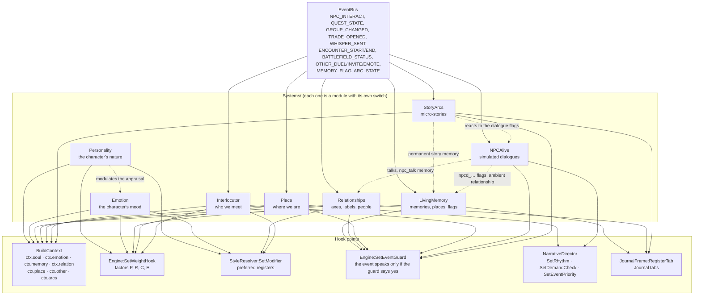

| Hook | Used by | What it is for |
|---|---|---|
| `ctx.soul` | Personality | the effective profile: choice > Total RP 3 > game data > neutral |
| `ctx.emotion` | Emotion | the emotions above 0.05 and the dominant one; nil with the module off |
| `ctx.memory` | LivingMemory | first visit, return, visit that ended badly, flags: **only from real memories** |
| `ctx.relation` (and `rel`, `disposition`, `isKnown`) | Relationships | the relationship with the person of the interaction |
| `ctx.other`, `ctx.otherTraits` | Interlocutor | who we have in front of us, with the source of each piece of data |
| `ctx.place` | Place | zone, map, territory, instance, encounter, role in the group |
| `ctx.arcs` | StoryArcs | the arcs in progress and concluded, and the line about to come out |
| `P` factor | Personality (`soul`) | soft affinity (graded by intensity) and hard filters of the `trait:value`, `trait>=n`, `req:`, `not:`, `topic:` tags |
| `E` factor | Emotion (`emotion`) | a line of the dominant emotion (`emo:` tag, or an old tag that implies one) weighs more, a clashing one less |
| `R` factor | Relationships (`relations`) | tags with the `rel.` scope |
| `C` factor | Place (`place`), Interlocutor (`other`) | tags with the `place.` and `other.` scope, short lines in battlegrounds |
| register modifier | Personality, Emotion, Relationships, Interlocutor | temperament, the dominant emotion, familiarity and manner of speaking shift the preferred registers |
| event guard | memory (`memory_return`…), relationships (`relation_npc`, `relation_player`), interlocutor (`npc_meet`, `other_action`), place (`encounter_end`), NPC Alive (`npcd_*`), arcs (`arc_*`) | an event that cites a fact does not speak if the fact is not there |
| `SetRhythm` / `SetDemandCheck` | Place, NPC Alive | more sober in raids and against bosses, silence during a dialogue |
| `SetEventPriority` | memory, relationships, arcs | memory recall or exceptional event in §10 of the GDD |
| `RegisterTab` | LivingMemory, Relationships, StoryArcs | the Journal tabs (memories, places, flags, session, relationships, people, stories) |

This is why the systems can be switched off one by one from the panel (`modules.*`): without `memory` no recall, without `relations` no `R` factor, and so on, while the base narrator keeps working.

## 3. Flow of an event

The complete path, from the client to the line shown (and, only after a gesture, to chat):

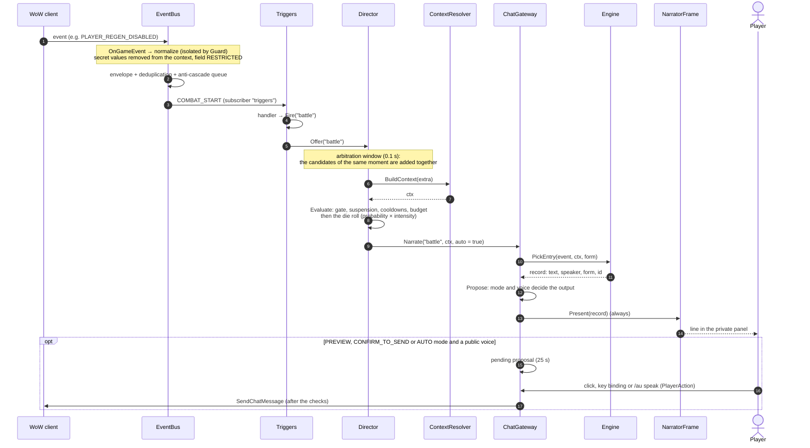

The steps, in words:

1. **Client → bus.** `Core/EventBus.lua` registers the client events through `Compat:RegisterEvent` (with a validity check, inside a `pcall`). Every source (`EventBus:AddSource`) has a `normalize` function that produces a type, a context and options (deduplication key, expected fields). The function runs inside `Diagnostics:Guard`.
2. **Envelope.** `NewEnvelope` creates `{ type, timestamp, source, context, fields }`. Secret values do not enter the context and their field is `RESTRICTED`; fields that are expected but absent are `MISSING`.
3. **Deduplication and queue.** A duplicate (same type and key within the window) is discarded and counted. An event published while another is being delivered goes into a queue (at most 32; older than 5 seconds, it is discarded).
4. **Delivery.** To the handlers of the type and to those of `"*"`, each in `Guard`.
5. **Triggers.** The handlers in `Systems/Triggers.lua` keep a little state (start of combat, previous zone, spell targets) and call `Fire(event, extra)`, that is `Director:Offer`; some delay with `C_Timer.After` to let the game update its state.
6. **Narrative Director.** The candidates that arrive within the arbitration window are resolved together, in priority order; for each one the Director builds the context, asks for the gate (`Evaluate`) and rolls the die. The first that produces a line wins, the others stay silent ([details below](#the-narrative-director)).
7. **Context.** `NS:BuildContext(extra)` gathers the data of the moment. With the target's identity secret, no target data is read or compared (it stays `targetSecret`); every read goes through `SafeCall`; the character's name may come from Total RP 3.
8. **Gateway and engine.** `Gateway:Narrate` chooses the form (speech or emote) and asks `Engine:PickEntry` for a line ([section 4](#4-how-a-line-is-chosen)). If no line fits, **nothing happens**: silence is valid.
9. **Output.** `Gateway:Propose` always shows the line in the narrator. Only if the mode provides for it and the voice may go to chat does it also create a **proposal** ([section 5](#5-the-chat-gateway)).

**Explicit requests.** `/au greet`, `/au event`, `/au cast` and the "Speak" button do not go through the Narrative Director: they call `NS:Trigger`/`Gateway:Narrate` directly, even when paused and at intensity 0 (GDD §4.2). They consume no budget, but they open the "moment": for a few seconds no spontaneous line follows them. They are still subject to the Gateway's rules: never a send to chat without a player action.

### The Narrative Director

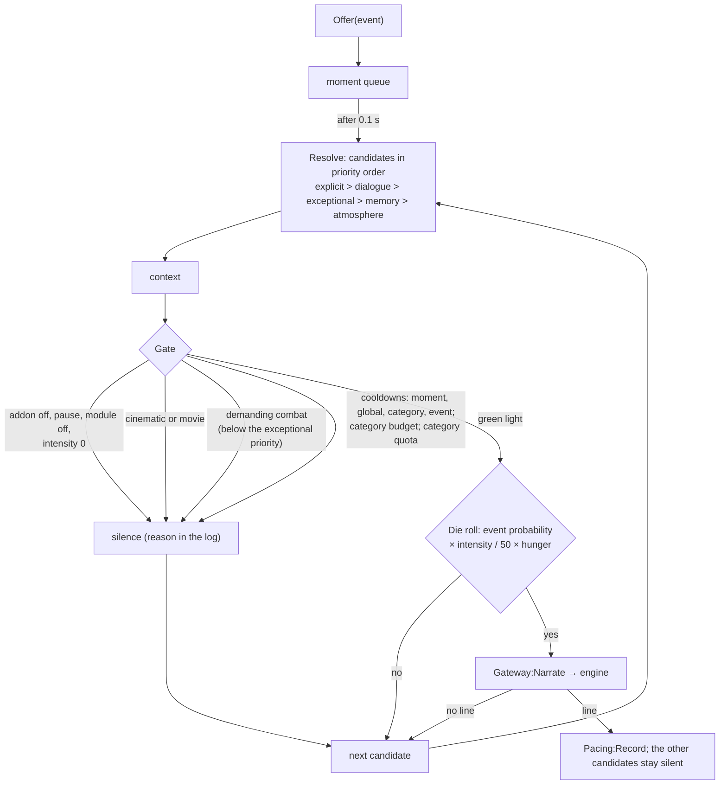

| Check | Rule | Who skips it |
|---|---|---|
| Moment | 4 s between any two interventions (explicit ones too) | nobody |
| Global cooldown | `pacing.globalCooldownSeconds` (45) × (1.5 − intensity/100) | exceptional events |
| Category cooldown | `Pacing.CATEGORY_COOLDOWN` (combat 15 s, exploration 30 s...) × the same factor; a category declared with its pacing (`Engine.CATEGORY_DEFS`, #118) uses its own `cooldown`, never under `minCooldown` | exceptional events |
| Event cooldown | `NS.EVENT_COOLDOWN` × the same factor | nobody |
| Budget | `Pacing.BUDGET` per category in 10 minutes (combat 6...) × intensity/50; a declared category uses its own `budget` in its own `window` | exceptional events |
| Category of the phrase (#118) | the categories of `Engine.CATEGORY_DEFS` pace their **phrases** on any event: `Pacing:Closed` puts those that wait (pause, budget, and for `lore` the setting `literary.frequency` and a fight) in `ctx.closed` and `Engine:Eligible` leaves their phrases out; `Pacing:RecordPhrase` starts the pause (a request) and spends the budget (spontaneous). `lore`: 1 in 25 minutes, pause 20, floor 10 ([ADR 0042](adr/0042-literary-forms-category-pacing-line-breaks-and-long-reading.md)) | nobody; `never` and a fight close `lore` for requests too |
| Quota (#91) | `Engine.QUOTAS` (data, `Data/Themes.lua`): a category at most `share` of the last `window` interventions, explicit ones included, of the last `span` seconds (combat 40% of 10 in 15 minutes); reason `quota:<category>` | exceptional events |
| Intrusive screens | `InCinematic`, `IsInCinematicScene`, `CinematicFrame`/`MovieFrame` visible | nobody |
| Demanding combat | in combat with a boss, in a raid, elite in an instance (`pacing.suppressInHighDemand`) | exceptional events |
| Line cooldown (id) | the rule's `cooldown` and the anti-repetition window, in the engine | nobody (it also applies to explicit ones) |

**Hunger** (#91, `Engine.HUNGER`, data): a category silent for a while multiplies the chance of its events, up to its `factor` after `after` seconds (exploration ×2 after 10 minutes, reflection ×1.5 after 15), and goes first among candidates of the same priority. Quotas and hunger are in [ADR 0029](adr/0029-specificity-tiers-themes-motifs-and-category-quotas.md).

The log of the latest decisions (`Director.log`) and the budget used appear in `/au debug` on the **Narrative Director** row. The reasoning behind the choices is in [ADR 0015](adr/0015-narrative-director-one-intervention-per-moment.md).

#### Composite situations and monologues

See [ADR 0032](adr/0032-monologues-of-whole-phrases-and-composite-situations.md).

**Composite situations** (#100). `Director:Offer` also notes every event offered in `Director.recent` (the last 300 seconds, at most 24, names and times only, never saved). When a candidate has passed the gate and the die, `Director:Compose` looks for the situations it leads (`Engine.SITUATIONS`, data in `Data/Themes.lua` or a pack's `situations = {}`): its `with` events (all) and `withAny` events (one) offered in this moment or within `within` seconds, and its `when` conditions on the candidate's context. Their ids go in `ctx.situation`. `Gateway:PickRecord` then tries first only the lines with the condition `situation` (`Engine:PickEntry(event, ctx, form, true)`, both forms, no related-event fallback) and, with none that fits, the ordinary pick. Still one line: the offers the composite line was written for are marked `merged` (once per situation), a candidate of the same moment is logged `merged` instead of `outranked`, and the record carries `situation`.

**Monologues** (#99). A rule with `kind = "monologue"` and `parts` (2-3 ids of whole phrases with `chainable`) is a candidate like any line: `Engine:Eligible` admits it when its conditions hold and `Engine:MonologueUsable` finds every part chainable, enabled, out of its cooldown, matching its own conditions and with a usable variant; a `chainable = "only"` phrase is never a candidate alone. `Engine:RenderMonologue` renders one variant of each part (`MonologueOrder`: as written, or the parts after the first shuffled with `order = "free"`) and joins them; each part counts as used. The Director sees one record, so a monologue spends one gate, one die, one slot of budget and quota and one moment of pacing. Only the narrator and the inner voice have monologues, so they never reach chat. `Engine.R1_COMPAT` switches both features off; `/au prof` counts them.

## 4. How a line is chosen

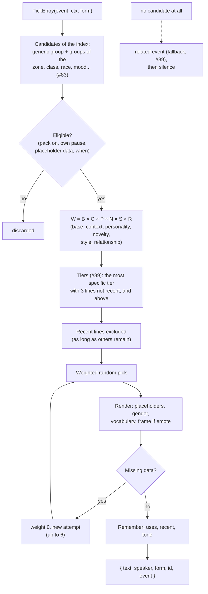

- **Weight** (`Engine.Factors`, GDD §10): `W = B × C × P × N × S × R × E`. `B` = `weight`; `C` = 1 + 0.35 × conditions (plus the `C` hooks of S6c); `P` = personality (Character Soul): soft affinity of the `trait:value` tags (×1.6 / ×0.6), inner voice and irony; 0 excludes the line via `req:`, `not:` and `topic:`; neutral (1) with the neutral profile ([details](#the-character-soul)); `N` = ÷ (1 + 0.3 × recent uses), ×0.6 if the register is the same as that of the last line of the event, and the novelty of the session (#90, `Engine.ThemeNovelty`): ÷ (1 + 1.5 × presences of its theme in the last 6 interventions), ÷ (1 + 0.8 × presences of its motifs), ×0.35 if it would be the third line in a row in the same voice; `S` = depth (×0.3 if different) × register affinity of the StyleResolver (×0.5 outside the event, +25% for each zone, depth and voice preference); `R` = relationship with the person of the interaction ([see below](#relationships)): tags with the `rel.` scope as soft affinity or hard filter (0 excludes), neutral without a person; `E` = the emotional state ([see above](#the-emotional-state)): ×1.6 for a line of the dominant emotion, down to ×0.15 for a clashing one, 1 when calm or with the module off. `Engine:Weight(line, event, ctx)` returns the breakdown.
- **Specificity tiers** (#89, `Engine.Tier`, `Engine.TierPool`): each rule has a tier, deduced from its conditions or written as `tier` (0 generic, 1 situation or region, 2 zone, 3 subzone, 4 landmark). Among the eligible lines the pick keeps the most specific tier that, together with the tiers above it, still has `Engine.TIER_MIN` (3) lines not used recently; when those are used the pool widens one tier at a time down to the generic lines. An event with no line at all tries its related event (`fallback`, at most three steps; the record says `via`), then stays silent. See [ADR 0029](adr/0029-specificity-tiers-themes-motifs-and-category-quotas.md).
- **Themes and motifs** (#90): a rule declares one `theme` and up to three `motifs` from the closed vocabularies of `Data/Themes.lua`. The memory of the session (`Engine.lines`: theme, motifs, voice, frame and first two words of the last 12 interventions, fading in 30 minutes) is **never saved**. It weighs `N`, keeps a variant from opening like the last 8 interventions, and weighs down a frame used in the last 8 interventions for any event; a frame with `themes` tells only phrases of those themes.
- **Character**: traits weight the lines and, for hard tags, exclude them; see [the Character Soul](#the-character-soul).
- **Style**: registers weight and do not exclude, so the neutral fallback is automatic. In emote form, a frame with registers accepts only lines of the same or a close register (`StyleResolver:Compatible`). The main register of a rule is its first one, read with `Engine.Tone(p)` (no longer a field of the rule).
- **Conditions** (`when`): see [PACK_FORMAT.md](../AzerothUnspoken/PACK_FORMAT.md). More conditions → more specific line → greater weight; a place condition also raises the tier.
- **Monologues and composite situations** (#99, #100, [ADR 0032](adr/0032-monologues-of-whole-phrases-and-composite-situations.md)): a monologue is a candidate like any line and renders a variant of each of its parts; it weighs ×0.2 while another monologue is among the last 6 interventions. With `ctx.situation` set by the Director, `PickEntry(event, ctx, form, true)` keeps only the lines whose conditions ask one of those situations (the flag `situational`); outside it they are never eligible. See [the Narrative Director](#composite-situations-and-monologues).
- **R1 compatibility**: `Engine.R1_COMPAT = true` turns off tiers, fallback, the novelty of the session, quotas, hunger, monologues and composite situations; the offline tools use it to measure before and after (`Tests/trace_picks.py --r1`, `Tests/bench_m2.py --r1`).
- **Candidates** (`Engine:Candidates`, #83): each rule is registered in the generic group of its event and form or, if its conditions ask for a zone, subzone, map, class, race, mood, creature type or time of day (the first of `Engine.INDEX_DIMENSIONS`), in the group of each value. A pick reads the generic group and the groups its context opens, merged in registration order: the same rules, in the same order, as a scan of all the lines of the event. Rules with `chance`, `func` or a condition of a pack stay generic, so the random sequence does not change. The index does not depend on the language, so language and regional packs (#85, #101) add their rules to it.
- **In-memory format** (#84): a variant is a plain string unless it needs more (an empty text, a depth of its own, a text of another pack); read it with `Engine.VariantText`, `VariantOk`, `VariantDepth`, `VariantPack` or `VariantView`. Rules share their lists of events, registers, tags and depths. `RegisterPack` does not keep the pack's source tables.
- **Shapes and shared conditions** (#138): a rule table holds `id`, `text`, `when`, `ord`, `styles`, `tags`, `theme` and `motifs` (and `impure` when true); the fields that repeat across rules (pack, events, voice, form, category, depth, weight, cooldown, specificity, tier, the monologue fields) are in its **shape**, an interned table that is its metatable, so `p.speaker` reads as before. A write to one of those fields gives that rule a copy of its shape (copy on write); `pairs(p)` shows only the rule's own fields. Rules with the same conditions share one `when` table. `Engine.ShapeOf(p)` returns the shape; `Engine:DropPack` releases the shapes and conditions of the pack.
- **Memo of one pick** (#157, `Engine.MEMO`): during a pick nothing that the weight reads changes, so `Eligible` answers each shared table of pure conditions once and, in a pick that weighs at least `Engine.MEMO_MIN` (128) rules, `ScoreMemo` computes the factors once per shape, registers, tags, theme and motifs (C, P, R, E only when every hook of the factor is *pure*, see below), with the operations of `Score` in the same order: the same weights, so the same picks. The union of the index groups is cached per event, form and context keys until the index changes. `Engine.MEMO = false` switches all of it off; `Tests/TestScale.lua` runs the same seeded picks both ways and requires the same trace.
- **Memory**: `NS.cdb.memory` (`uses`, `last`, `variant`, `recent`, `lastTone`), per character, bounded (#86): `uses` fade at every login (`DecayMemory`, ×0.75) and keep at most `Engine.USES_MAX` (512) entries, `variant` (last variant used) only for phrases in `uses`, `last` only for entries with a running cooldown. The window of recent lines is about 60% of those available, at most `pacing.recentPhraseWindow` (30). No text is saved.
- **Voice (`speaker`)**: `narrator`, `inner`, `character`, `npc`; each rule declares it (if missing it is inferred from `form`: `say` → `character`, `emote` → `narrator`, with a validator warning). A spoken line placed in a frame is `narrator`. The `inner` and `npc` voices never become proposals for the chat.
- Silence is a valid outcome: if no line is eligible, the engine returns `nil`.

### The Character Soul

`Systems/Personality.lua` gives the character a voice of its own (GDD §7.1, [ADR 0016](adr/0016-character-soul-opt-in-traits-and-total-rp-3-with-consent.md)). Everything is optional: with no choices the profile is **neutral** and the narrator stays as it was.

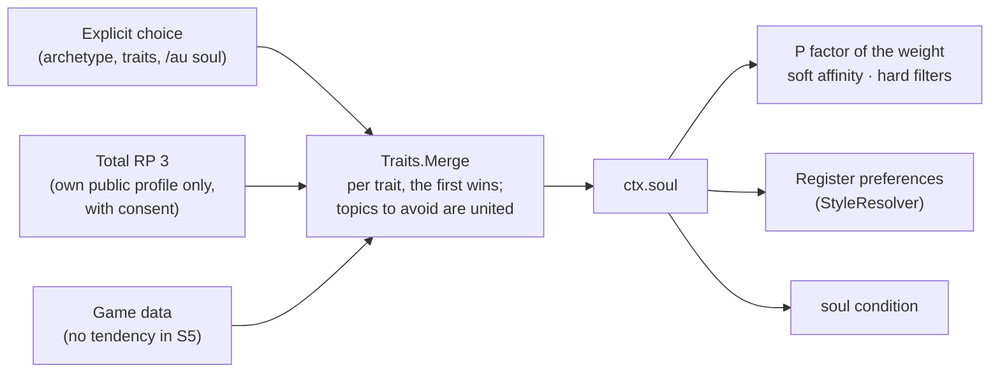

- **Traits** (R4, [ADR 0031](adr/0031-intensity-traits-emotional-state-and-the-tone-of-a-return.md)): ten intensities from 0 to 100 that can coexist: `idealism` (cynical <-> idealist), `concreteness` (dreamer <-> pragmatic), `optimism` (pessimist <-> optimist), `altruism`, `stoicism`, `ambition`, `spirituality`, `patriotism`, `curiosity`, `vengefulness`; plus irony (a scale), inner voice and topics to avoid (a set). Archetypes are **presets**: choosing one fills the sliders, editing one makes the profile "custom (from ...)". A change takes effect immediately. A saved S5 profile (version 1) is converted once (`Personality:Migrate`): each old choice becomes intensities that still satisfy it.
- **Old choices, derived.** `temperament`, `morality`, `faith`, `motivation` are no longer saved for the character but stay as tag vocabulary: each value is a rule on an axis (`temperament:stoic` = `stoicism >= 67`), read from the axes when the profile has not chosen it. The interlocutor (S6c) still chooses temperament and morality.
- **Tags on lines** (`tags` field): `trait:value` and `axis>=n` / `axis<=n` soft affinity, **graded**: ×1.6 inside the band or past the threshold, ×0.6 at 20 points or more away, in between near the edge; never zero. `req:trait:value`, `req:axis>=n` (the line asserts something about the character: it comes out only if the profile says so), `not:...` and `topic:topic` are **hard** filters (factor 0). A line that only a strong trait may say uses the conditions `traitMin` / `traitMax` instead, so it is not even a candidate for a neutral profile. Tags without a colon stay descriptive. The validator checks the affinity tags.
- **Priority** (GDD §8), trait by trait: explicit choice > Total RP 3 > game data > neutral values; the summary (`/au soul list`) says the source of each trait.
- **Total RP 3**: only with the `personality.trp3` consent and the `totalRP3` module on; it reads only `characteristics/PS` of your own profile and never writes. If the API is missing or changes, the layer disappears and the choices remain (capability `integration:totalRP3:traits`).
- **Reuse**: `Engine/Traits.lua` knows nothing about the player. S6c uses it for `ctx.other` (tag scope `other.`) and for place tags (scope `place.`), S6b for the relationship axes.
- **Interface**: `/au soul` opens `UI/ProfileFrame.lua` (archetype, a slider per intensity, inner voice, topics, consent, neutral profile); `/au soul list | neutral | archetype <id> | trp3 on|off | <trait> <0-100|low|mid|high|-> | avoid <topic>`; the old words (`/au soul temperament stoic`) set the matching axes.

### The emotional state

`Systems/Emotion.lua` gives the character a mood that events change and time heals ([ADR 0031](adr/0031-intensity-traits-emotional-state-and-the-tone-of-a-return.md), owner decision D8).

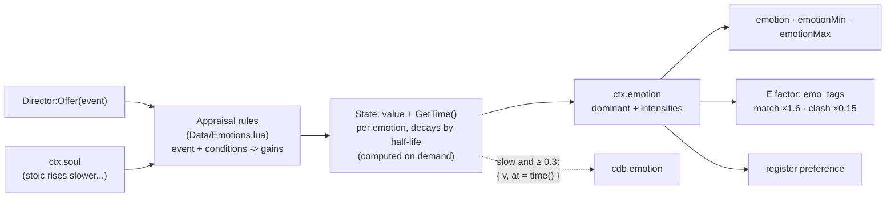

- **Emotions**: serene, happy, determined, curious, worried, tense, furious, melancholic, nostalgic, admiring, each from 0 to 1 with its own half-life (tense 3 minutes ... melancholic 2 hours). No timer: the value is decayed when read.
- **Appraisal**: `Director:Offer` appraises every spontaneous event before its line is chosen (death, resurrection, low health, battle, victory, level up, quest, first visit, a return to a place of a bad memory, landmark, inn, long flight, dawn, dusk, prayer, a known player, weather). Rules are data: `{ event, when?, gain = { emotion = -1..1 } }`. The personality multiplies a rise (`modulation`): a stoic character rises more slowly, an optimist worries less, a vengeful one burns faster.
- **Lines**: conditions `emotion` (the dominant one), `emotionMin`, `emotionMax`; the `E` factor (a line of the dominant emotion weighs more, a line of a clashing emotion much less, `temperament:cheerful` counts as happy); a register preference for the dominant emotion. These conditions do not raise the specificity tier.
- **Off**: the module `emotion` (settings, `/au emotion off`). Then `ctx.emotion` is nil, E is 1, every emotion condition is false and the saved values are cleared: the narrator behaves as before R4. `Engine.R1_COMPAT` switches it off too.
- **Saved**: only slow emotions at 0.3 or more, as a number and `time()`; decayed at login by the time away. Never the cause, never text (ADR 0017).
- **Debug**: `/au debug` has an **Emotion** line (state, dominant, last cause, what is saved); `/au emotion [on|off|reset]`.

### Living Memory

`Systems/LivingMemory.lua` gives the character continuity across sessions (GDD §7.4, [ADR 0017](adr/0017-living-memory-selective-memories-and-honest-recall.md)). Only significant moments, never every click, never chat text.

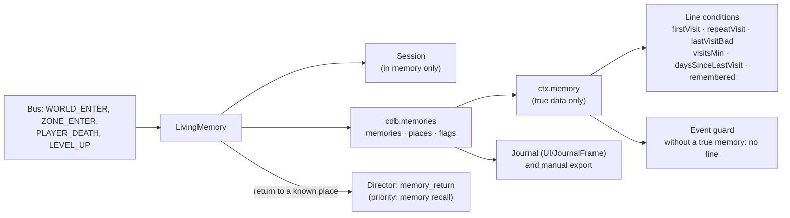

- **What is remembered**: first visit to a zone (more so if it is a capital), return after a day, a visit that ended badly (death or flight), deaths, levels (a milestone every ten). Places keep their counts (visits, deaths, outcome) separate from the memories: compacting the memories does not make a place forgotten.
- **Limits**: 500 ordinary memories (compaction of the least significant down to 450), 200 permanent, 300 places, 60 session moments. Reset has five targets, always with confirmation.
- **Honest recall**: memory conditions read `ctx.memory`; recall events (`memory_return`) have a guard in the engine and the validator requires a memory condition on their lines. Recall has the priority of §10 and beats the zone atmosphere in the same moment.
- **Privacy**: no chat source, no free text; `Record` and `Sanitize` admit only the expected fields.

### Relationships

`Systems/Relationships.lua` keeps the relationship with people ([ADR 0018](adr/0018-multi-axis-relations-automatic-npcs-and-user-chosen-players.md)). The axes are scales of `Engine/Traits.lua` (scope `rel`); labels, disposition, register and increments are data in `Data/Relationships.lua`.

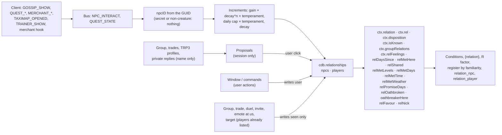

- **Axes**: `familiarity`, `fear` and `attraction` 0…100; `trust`, `respect`, `affection`, `loyalty` −100…100. Attraction is optional (off by default).
- **Derived label**: the first rule, by priority, that holds; a label chosen by hand takes precedence. **Disposition**: weighted average −100…100 in nine bands.
- **NPCs** are automatic (`relations.npcAuto`); **players** only with a user action (`R:AddPlayer(name, "user")`) or with the explicit option "register automatically".
- **Privacy**: no chat or whisper text (of a private reply only the name is read), nothing over the network, proposals are not saved.
- **Interface**: `/au relationships` opens `UI/RelationsFrame.lua`; the journal has the *Relationships* and *People met* tabs.
- **Temperament** (N2, #214, [ADR 0036](adr/0036-npc-temperament-visible-levels-and-the-first-meeting.md)): `R:Temper(npcID, rec, source)` gives two multipliers from `temperament` in `Data/Relationships.lua`. `gain` (on every automatic gain and on its daily cap, both ways) is the curated `warmth` of `Data/NPCs.lua`, else role × personality, times the race factor; `forget` (on the familiarity lost per day; the days of grace are divided by it) is the curated `forget` times the race factor. Role: the user's, the curated one, the saved or session one, or the one the source shows (`binder` → innkeeper). Race: the curated one, or the token the client gave at an interaction (kept as `race`). Clamped to `min`…`max`.
- **First meeting** (N2): a new NPC record keeps `met = { time, weather, zone, mapID, level }` (`R:Circumstances`, every reading through Compat, an unreadable weather absent). `R:MetContext` adds `ctx.relMetLevels`, `relMetDays`, `relMetTime`, `relMetWeather` for the `relation_npc` recall lines.
- **Visible levels** (N2): the disposition bands are the levels (`R:Level`). `RecordNPC` compares the band before and after an interaction: `R:LevelChanged` leaves a `relation_level` memory (tokens only, once per NPC and band, for the `levels.memorable` bands) and a `Narrator:Notice` (never chat): `levels.perSession` per session, `levels.npcHours` per NPC (saved as `levelT`), held during combat and shown on `COMBAT_END`, silent with the narrator off, paused or at intensity 0, off with `relations.levelNotices`. The user's sliders never announce.
- **Romance** (N3, #215, [ADR 0037](adr/0037-romance-with-npcs-opposite-sex-and-the-vow.md)): only with `relations.attraction` on. `InteractionNPC` also reads the NPC's sex and creature type (`R.Kin`, through Compat), kept for the session in `R.session.kin` (never saved). `R:RomanceEligible` is a fixed rule: both sexes known and opposite, humanoid (id 7 or a name in data). In `RecordNPC`, `R:Romance` adds attraction from the sources of `romance.gain` (no merchant) when the NPC was already at `romance.minLevel` and the interaction gave nothing negative, through `R:Increment` with a row of its own (`"romance"` in `rec.today`) and the temperament. `R:Vow` (attraction at `romance.vow.attraction` and derived label `lover`): `rec.noted.vow`, a permanent `relation_vow` memory with no name, one `Narrator:Notice` (never in combat or with the narrator silent); `ctx.relVowed` and the condition `relVowed`.
- **Promises and oaths** (N4, #216, [ADR 0038](adr/0038-promises-oaths-and-the-oathbreaker-mark.md)): `QUEST_STATE` accepted after an NPC's quest dialogue → `R:Promise` (`relationships.promises[questID] = { npc, t, r?, oath?, map? }`, ids and times only); turned in → `R:KeepPromise` (relief notice when late to the giver, `oath_kept`); removed → `R:QuestRemoved`, settled by `R:SettlePromises` after `promises.settle` seconds (at once after the `C_QuestLog.SetAbandonQuest`/`AbandonQuest` hooks; never for a quest flagged completed) → `R:BreakPromise` (`promise_broken`, or `oath_broken` plus `oathT` on the NPC, `relationships.marks[mapID]` and a `relation_oath` memory). `R:Affect` applies those increments with the temperament without counting a meeting. `R:MarkTrust` multiplies positive trust gains while a mark fades; `R:MeetPromises` (on `NPC_INTERACT`) gives at most one `Narrator:Notice`: the NPC or the place remembers an oath, or a promise open `remindDays`. `R:PromiseContext` adds `ctx.relPromiseDays`, `ctx.relOathbroken`; `R:Context` adds `ctx.oathbreakerHere`. Numbers in `promises` of `Data/Relationships.lua`; option `relations.promiseNotices`. `QUEST_REMOVED` is a source of this module now; World rereads the log on the `removed` state.
- **Favours and nicknames** (N5, #217, [ADR 0039](adr/0039-favours-and-nicknames.md)): on `NPC_INTERACT`, after `R:MeetPromises`, `R:MeetFavours` does at most one thing: completes an open favour (`return` from its wait on, `visit` once its zone was reached), gives a nickname (`R:GiveNickname`: a named NPC at `nicknames.band`, an id from `R:PickNickname` by deeds, then class, race and anyone's lists, kept as `rec.nick`), or asks a favour (`R:AskFavour`: a named NPC at `favours.band`, one per NPC, `perSession`, `max`, `restDays`, `chance`, templates by role; `rec.favour = { k, t, e, map?, zone?, s? }`). `R:FavourBought` (the `BuyMerchantItem` hook) completes `buy`; `R:FavourPlaceCheck` on `WORLD_ENTER`, `ZONE_ENTER` and `REST_CHANGE` completes `rest` and notes `visit`. `R:CompleteFavour` applies `favour_done` through `R:Affect` and records `relation_favour`; a lapsed favour goes silently (`R:LapseFavour`, also in `MaintainAll`). Asks and nicknames happen only when `Narrator:Notice` can be shown (options `relations.favours`, `relations.nicknames`). `R:FavourContext` adds `ctx.relFavour` and `ctx.relNick` (placeholder `{nickname}`). Data: `favours`, `nicknames` in `Data/Relationships.lua`.
- **Hostility** (N1, #213, [ADR 0041](adr/0041-hostility-grudges-betrayal-witnesses-and-guest-right.md)): `Systems/Hostility.lua` keeps a fight in memory (`R.Watch`: the target's snapshot from `TARGET_CHANGED`, the opening blows from `FOE_SIGNAL` (its own sources for `PLAYER_ENTER_COMBAT` and `UNIT_COMBAT`, which drop every unit but the character and the target) and `SPELL_SENT`, the witnesses read from the nameplate units at `COMBAT_START`, the death from `FOE_DIED` (its sources for `UNIT_DIED` and `PARTY_KILL` compare GUIDs and publish none)); `COMBAT_END` waits `hostility.linger` seconds, then `R:Hostility(fact)` applies `increments.attack`/`attack_host`/`kill`/`attack_witnessed` (rows in `towns.word.skip`), drops a named NPC to `hostility.grudge.drop`, writes `rec.foe`, adds `hostility.word[kind]` to the town's word when witnessed (or the host was struck), marks `town.betray`/`town.host`/`town.foe`, records `relation_host`, and shows one `R:FoeNotice` (option `relations.hostilityNotices`). `R:Increment` and `R:Hear` ask `R:GrudgeLimit` for a positive change of an NPC with `foe` (ceiling for ever with `relations.eternalGrudge`, else for `grudge.graceDays`, then `grudge.redeem`); `R:MarkTrust` multiplies by `R:BetrayalTrust`. `R:SetHome` on `binder`, `R:Home` checks `GetBindLocation`, `R:CheckHome` on the place events. Context: `ctx.relFoe` (`R:FoeContext`), `ctx.townBetrayed`, `ctx.townFoe`, `ctx.homeReturn` (`R:HostilityContext`).
- **Local reputation** (N6, #218, [ADR 0040](adr/0040-local-reputation-word-titles-and-rivals.md)): `R:TownHere` gives the town (a capital's city by `Place.zones[zone].capital`, else the subzone folded by `towns.aliases`; none in the open or an instance). `RecordNPC` puts the NPC in it (`rec.town`), lets them `R:Hear` the town's word (`relationships.towns[name].word`, minus what they already `heard`), counts a `quest_turnin` there, and after the gains `R:Spread`s `towns.word.share` of them (both ways, within `word.limit`, never from a source in `word.skip`) and `R:UpdateTitle`s the town: `R:Esteem` sums the NPCs' dispositions (each within `perNpc`) and `perQuest` per quest; titles in `towns.titles`, kept above `keep` x their threshold, none new while `R:CityMark(town.map)` (N4) lasts, the first time a permanent `relation_title` memory. `R:Affect` (N4's promise rows) spreads and updates too. Curated pairs from `NS:RegisterRivalries` (`R.rivals`): `R:NoticeRival` at a counted meeting applies `rival_noticed` once per rival (`rec.rival`). Local notices (`R:LocalNotice`, option `relations.localNotices`, `towns.perSession`) wait in `R.localQueue` until the meeting is settled and only the most important is shown. `R:TownContext` adds `ctx.townName`, `ctx.townWord`, `ctx.townTitle`, `ctx.townTitleName` (`{title}`); `R:RivalContext` adds `ctx.relRival`. `relationships.version` 6 (after N5's 5).

#### Player records: `user` and `seen` ([ADR 0026](adr/0026-player-records-user-choices-apart-from-observations.md))

`relationships.version` is 7 (3 adds `met`, `race` and `levelT` to NPC records, N2; 4 adds `promises`, `marks` and `oathT`, N4; 5 adds `favour`, `favourT`, `favourN`, `quests` and `nick`, N5; 6 adds `towns` and the NPC fields `town`, `heard`, `rival`, N6; 7 adds the NPC field `foe`, `home` and the town fields `betray`, `host`, `foe`, N1; nothing to migrate from 2 to 6). A player record is `{ source, noted, user, seen }`; NPC records stay flat.

| Block | Holds | Written by |
|---|---|---|
| `user` | `axes` (by hand, sparse), `label`, `feeling` (up to two), `note`, `tags`, `traits`, `role` | **only** the user actions: the setters behind `Edit` in `Systems/Relationships.lua`, `AddPlayer`, `Interlocutor:SetTrait`, and the shaping of loaded data (`MigrateV1`, `CleanRecord`) |
| `seen` | `first`, `last`, `count`, `kinds` (encounters by type), `facts` (ring of the last 5: kind, map id, zone, time; no text), reserved `guid` | `R:Observe` and `R:ForgetObservations` |

- **The software never writes `user`.** Proved by `Tests/TestPlayers.lua` (every automatic path over a full record, with a control) and by `Tests/check_user_block.py` (a source check with a short allowed list of writers). Suggestions of the future are proposals the user accepts through the same setters.
- **Encounters** (`R:Observe`, #108): only for a player **already in the list** (nothing creates a record, D11). `group` (a listed player joins), `trade`, `duel`, `invite`, `emote` (aimed at us), `whisper` (the recipient's name) and `target` update `last`, `count` and `kinds`; `group_combat` (a fight in a group with listed players) updates `last` and `kinds` only. The same kind with the same person within 10 minutes is one encounter. The group is read once, a second after the last roster update.
- **Feelings** (#109): `trust`, `liking`, `wariness`, `fear`, `resentment`, `gratitude`, chosen by the user (the tag `rel.feeling:<id>`, a set; the condition `feeling`). Each has a preset of axes the user can ask for. The label `ally` is `manualOnly`. The `R` factor drops a `warm` line for a negative feeling.
- **`relation_player`** (#106): `R:Recognize(key)` offers one Director candidate per person and session, on joining the group, an interaction aimed at us and, if the user turns it on (`relations.recognizeTarget`), the target. The observation is recorded even when the narrator stays silent.
- **Conditions from the observations** (#110): `ctx.relDaysSince`, `ctx.relMetHere` and `ctx.relShared` come from `seen` and from `session.prior`, the state before the session's first meeting.
- **Migration**: `R.MigrateV1` (version 1 → 2) runs in `Sanitize`; data of a newer version stays read-only.

#### Proximity: nameplates and mouseover ([ADR 0030](adr/0030-proximity-session-proposal-and-account-shared-list.md))

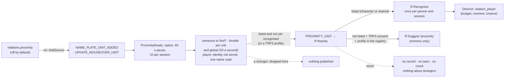

- The two client events are registered **only while the option is on** (`EventBus:AddSource` / `EventBus:RemoveSource`, `R:ApplyProximity`); with it off the client does not call the addon for them.
- `R:Nearby(unit)` reads nothing from a unit whose identity is secret (`Compat:IsUnitIdentitySecret`), and drops a secret name or realm. A listed player goes through `R:Recognize` (the guard shared with the group, the interactions and the target); with the Total RP 3 consent of S6c an unlisted person with a TRP3 profile becomes a session suggestion (`source = "proximity"`).
- It **writes nothing** (a sighting is not an encounter) and keeps nothing about a stranger, not even in memory. "Register by itself" does not apply: `R:Suggest` never registers.
- Limits: `R.PROXIMITY_GAP` = 60 s between proposals and `R.PROXIMITY_MAX` = 10 per session; a person already recognised costs none of the budget.
- A crowd costs almost nothing (#164): the source passes a unit through `R:ProximityReady`, then `R:ProximityHasTargets` (a listed player in the character's or the account's list, or the TRP3 consent: constant time, so with an empty list not even a name is read), then `R:ProximityAllow` (a unit token is looked at again after `R.PROXIMITY_UNIT_GAP` = 0.5 s; all units together get `R.PROXIMITY_LOOKUPS` = 20 lookups a second, a bucket of `R.PROXIMITY_BURST` = 20), and only then reads the name once. A stranger, or a person already recognised this session, is never published. The limiter keeps a time per unit token and counters (`/au debug` shows "throttled"), never a name. In a flood a single sighting of a listed player may be dropped by the throttle; the next one is looked at. `Tests/bench_proximity.py` measures a synthetic crowd.
- The sources unregister themselves when the module or the option is found off (`R:ApplyProximity`), and the settings window and `Config:ApplyPreset` call it when the relations module changes.

#### The list shared in the account ([ADR 0030](adr/0030-proximity-session-proposal-and-account-shared-list.md))

`relations.sharePlayers` (off by default; two steps with a warning to turn on) keeps the **choices** about people in `AzerothUnspokenDB.sharedPlayers` and shares them between the account's characters.

| Layer | Where | Holds |
|---|---|---|
| character (always, the default) | `cdb.relationships.players` | `user` (choices), `seen`, `noted`, `scope` |
| shared (opt-in) | `gdb.sharedPlayers = { version = 1, players = { [key] = { source, user } } }` | choices only: no observations, no journal flags |

- **Precedence**: a character record with choices of its own (non-empty `user`, or `scope = "character"`) wins **as a whole**; otherwise the shared block counts. Blocks are never mixed field by field. `R:Get("player", key)` returns the real character record, or a view (`rec.view`) whose `user` is the shared block and whose `seen` is this character's; `R:ScopeOf(key)` says which one counts.
- **Writes** go to the block that counts (`Edit` calls `R:Adopt` to make the shared record on demand); `R:SetScope` switches a person between *shared* and *character*. Only user actions put people in the shared list (`AddPlayer` with sharing on, `SetScope`, `ShareAll`).
- **Migration and the way back**: turning it on moves nothing; `R:ShareAll` moves this character's choices up (the character's own win where the account has choices); `R:CopySharedHere` copies the account's choices into the character. **Off** keeps the account list intact and unused.
- Listing, counts, the window and the export use the union of the layers; `Remove person` with sharing on removes from both; `reset players` clears the character's records and `reset shared` the account's list.

### NPC Alive

`Systems/NPCAlive.lua` and `UI/DialogueFrame.lua` ([ADR 0020](adr/0020-simulated-dialogue-and-real-dialogue-npc-alive.md)) are the ambient dialogues: a **simulated** micro-dialogue with an identifiable NPC, in a separate window, never in chat.

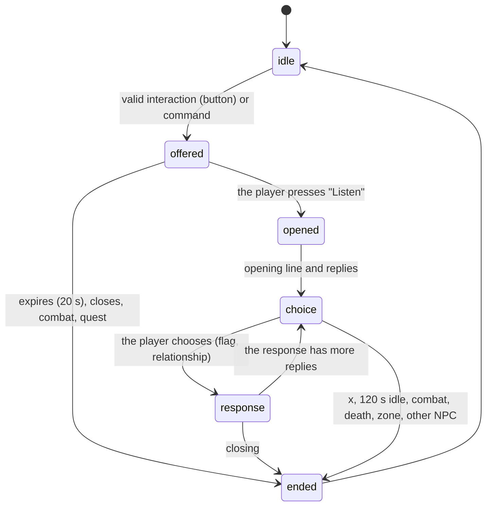

- **Identity**: the `npcID` from the GUID. *Specific*: it is in `Data/NPCs.lua` (or the user gave it a role). *Archetype*: the role is proven by the current interaction (merchant, flight, training, innkeeper setting the home) or one already done with the same NPC; gossip alone is not enough. Players, hostile creatures, dead NPCs, secret identity and unreadable GUIDs: no dialogue.
- **Scripts** (`Data/Dialogues.lua`): per archetype (`innkeeper`, `merchant`, `guard`, `flightmaster`, `trainer`) or per `npc:<npcID>` (with `extends`), nodes with the event of the lines and the replies they offer; each reply has a neutral IT/EN label, the target node, a narrative flag and a relationship source. Checked by `NPCAlive:Check()` and by the validator (`badDialogue`).
- **Voice** (`Data/RegistryDialogues.lua`, texts `Dialogues.lua`): engine rules with `speaker = "npc"` and events `npcd_<role>_<node>`: chosen by `Engine:PickEntry` with the context of the interlocutor (way of speaking, temperament) and of the relationship (`isKnown`); they come out only inside a dialogue (guard on the event); anti-repetition as for every line. During a dialogue the spontaneous narrator is silent (`SetRhythm`).
- **Effects**: a narrative flag `npcd_<archetype>_<name>` (S6 memory, never a quest), a bit of relationship (`ambient`, `ambient_talk`), an `npc_talk` memory if the player replied (without text or name). The test NPC (`/au talk test`) writes nothing.
- **Window**: always-visible label, position that avoids the visible Blizzard windows and corrects itself if one opens underneath, draggable and resettable; it neither calls nor hides anything of Blizzard's.
- **Commands**: `/au talk` (`test [gruff|jovial|warm|formal|terse|neutral]`, `close`, `role <role>`, `offer on|off`, `status`), key binding "Ambient dialogue with the NPC (open/close)".

### Story Arcs

`Systems/StoryArcs.lua` ([ADR 0021](adr/0021-story-arcs-micro-stories-without-game-effects.md)) keeps the personal micro-stories: they are **not server quests**, give no rewards, and do not touch real NPCs. The structure of the arcs is data (`Data/Arcs.lua`, `NS:RegisterArcs`), the lines are rules of three events (`arc_open`, `arc_step`, `arc_resolve`), the texts are per language.

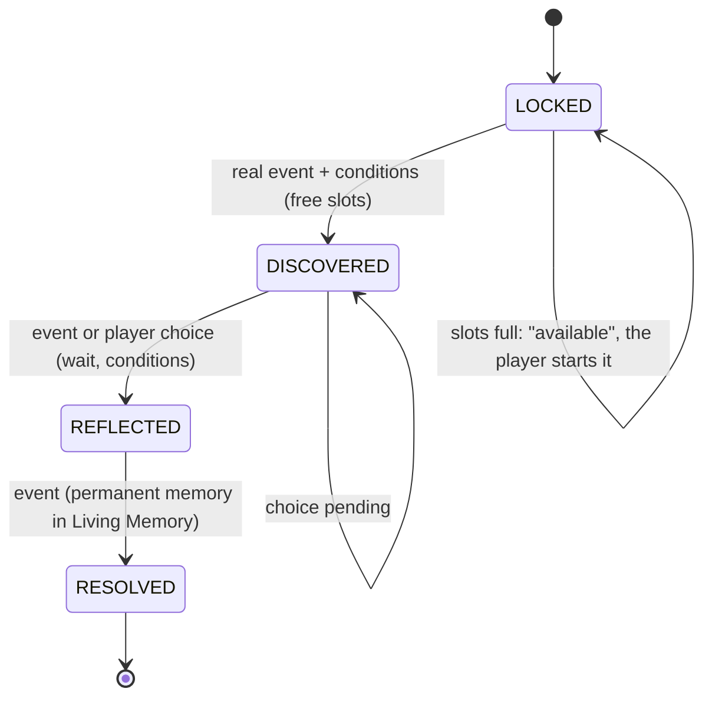

An arc's own states (for example `JOURNEY` in "The Three Doors") sit between `LOCKED` and `RESOLVED`; from one state you only go to the next.

- **Events**: `SA:Fire(event)` is subscribed to the bus: `ZONE_ENTER`/`WORLD_ENTER` (evaluation after two seconds), `PLAYER_DEATH`, `LEVEL_UP`, `NPC_INTERACT` (not quests), `MEMORY_FLAG` (a new flag set by a system of the addon, for example the ambient dialogues; not hand-set ones, nor the automatic ones of the memory, nor the `arc_…` ones of the arcs themselves). Only the arcs with a step from that state and for that event build the context. One event moves an arc by a single step.
- **Choices**: a step with `choose` waits for the player (`pending`); the journal or `/au stories choose` apply the step with the **option id**. `player` steps have no event: they are offered when conditions and wait hold.
- **Slots and modes**: `arcs.maxActive` (1–2); mode `active`, `suspended`, `skipped` or `off`; `waiting` for an arc whose opening arrived with slots full. The `storyArcs` module turns everything off.
- **Lines**: `QueueBeat` puts the line in `SA.owed`; `Flush` offers it to the Director (`Director:Offer(event, extra, onResult)`, "exceptional" priority, one at a time, at least 90 s after the previous one) only in a quiet moment; the event guard requires `ctx.arc.beat`, so `/au event` does not produce them. The state advances even if the line stays silent.
- **Data**: `cdb.arcs = { version, items = { [id] = { state, mode, since, t, choices, subject, pending, waiting, memoryId, ended } }, stats }`, schema 6, internal `SA.migrations`, `SA:Sanitize`. Closing records a permanent `story` memory (only id and place).
- **Conditions** (`Engine/RuleEngine.lua`): sub-table `arc = { id, state, from, choice, withSubject }`, `arcDone`, `capitalsVisitedMin`.
- **Journal** (`UI/JournalFrame.lua`): "Stories" tab with in progress, available, concluded, skipped, and the detail with the story and the choices made. **Command** `/au stories`.

### Interlocutor and place

`Systems/Interlocutor.lua` and `Systems/Place.lua` say **whom we meet** and **where we are** ([ADR 0019](adr/0019-interlocutor-and-place-ordered-sources-and-places-by-mapid.md)).

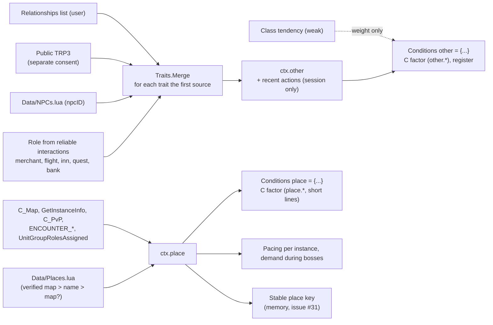

- **Actions**: only from reliable events (dialogue, quest, merchant, trade, group, duel, invitation, standard emotes aimed at us, target), never from the combat log; they stay in memory for the session.
- **Secrets**: with a secret identity `ctx.other = { secret = true }`; a secret place value means "I don't know".
- **Events**: `npc_meet`, `other_action`, `encounter_end`, each with a guard in the engine.
- **Commands**: `/au place` and `/au who` (`trp3 on|off` for consent to read other people's public Total RP 3 profile, and `trait <trait> <value>` to correct an interlocutor's trait by hand).

### The world: weather, day, places, quests, reputation, rest and flight

`Systems/World.lua` reads what the client says about the world and offers events to the Director ([ADR 0028](adr/0028-world-variables-weather-day-subzones-quests-reputation-rest-and-flight.md)).

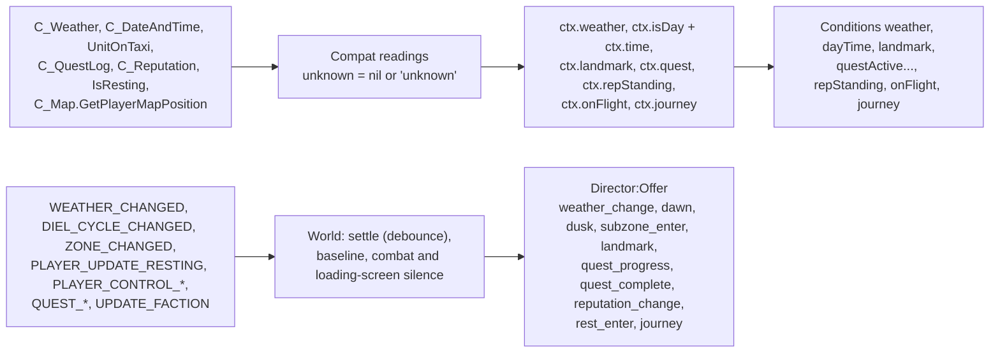

- **Unknown is never a value.** A missing, restricted, secret or incoherent reading gives `"unknown"` (weather) or `nil`; a condition on it is false for `true` and for `false`, so the lines that name it are not chosen and everything else behaves as before.
- **Debounce.** Each event waits for the state to stay (3 seconds for the weather, 2.5 for a subzone, 2 for rest, 1 for the quest log, 0.8 for a flight start); the first reading is a baseline, not a change; the world is silent in combat and for six seconds after a loading screen.
- **Time.** `ctx.time` is night when the client says night; dawn and dusk are the transition hours, calibrated by the last day/night change of the session (fixed hours until then). Without `IsDayTime` the fixed thresholds are the fallback.
- **Subzones never load packs.** Regional packs listen to `WORLD_ENTER` and `ZONE_ENTER` only; a landmark is a subzone with a name (`Data/Landmarks.lua`) and an optional position check.
- **Privacy.** Quest ids and numbers, reputation standings: session only, never text, never saved.
- **Director.** `quest_complete` and `reputation_change` have priority 2, the others are ordinary atmosphere; `weather_change`, `dawn`, `dusk`, `subzone_enter`, `landmark` and `journey` belong to the module `world`.

## 5. The Chat Gateway

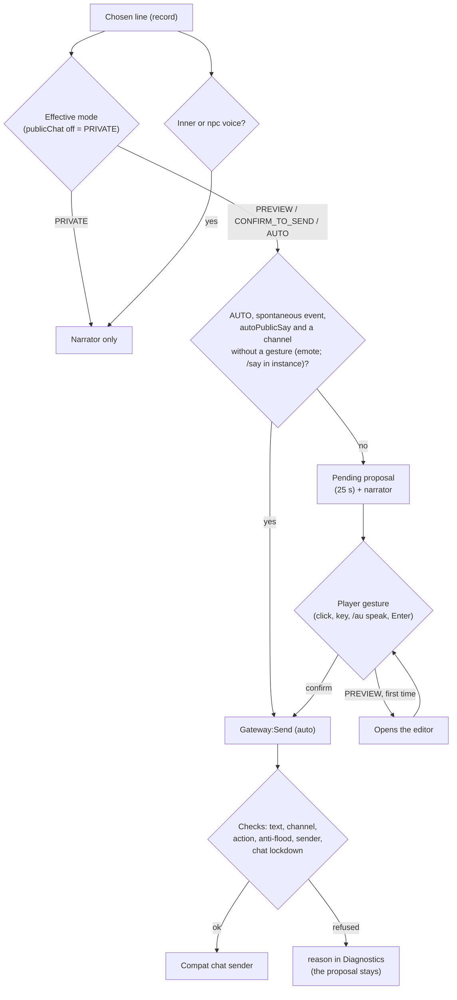

Fixed rules, verified by the tests (`Tests/TestChatGateway.lua`):

- Sending by gesture goes only through `Gateway:PlayerAction(fn)`. Outside that scope `Gateway:Send` refuses everything except `EMOTE` and, in an instance, `SAY` and `YELL` (`needs_action`).
- The `inner` and `npc` voices never become proposals.
- Anti-flood: `floodSeconds` (4), `maxPerMinute` (6), `autoMaxPerMinute` (2); text of at most `Config.CHAT_LIMITS[channel]` bytes (255; the same table is read by the validator); pending proposal `pendingSeconds` (25 by default; 60, 120 or 0 = until dismissed, from the settings panel), and a new one replaces the old one. With the editor open the proposal does not expire and a spontaneous line does not replace it; with the mouse over the narrator the wait pauses (`Gateway:SetHovered`) and resumes where it was. `Gateway:PendingLeft` gives the countdown shown in the narrator.
- The text sent is adapted to the channel (`Gateway:TextFor`: emote outside `/e` with the name, spoken line in `/e` with "dice: «…»"). As an alternative to sending, `Gateway:CopyToChat` puts the proposal in the standard chat box (`Compat:OpenChatWith`).
- Automatic sending is activated only with two steps (a confirmation dialog with the whole warning, then a confirmation that counts after `Consent.MIN_DELAY` seconds and within `Consent.WINDOW`: a double-click does not pass, `Gateway:SelectAuto`, [Core/Consent.lua](../AzerothUnspoken/Core/Consent.lua)) and is not in the panel's mode cycle.
- Channels: `SAY`, `EMOTE`, `YELL`, `PARTY`, `RAID`, `GUILD`, `INSTANCE_CHAT`, with an availability check.
- **Hypothesis not yet measured in game**: which channels the client accepts without a gesture ([G1](G1_checklist.md) (in Italian), SP-05).

## 6. Data and SavedVariables

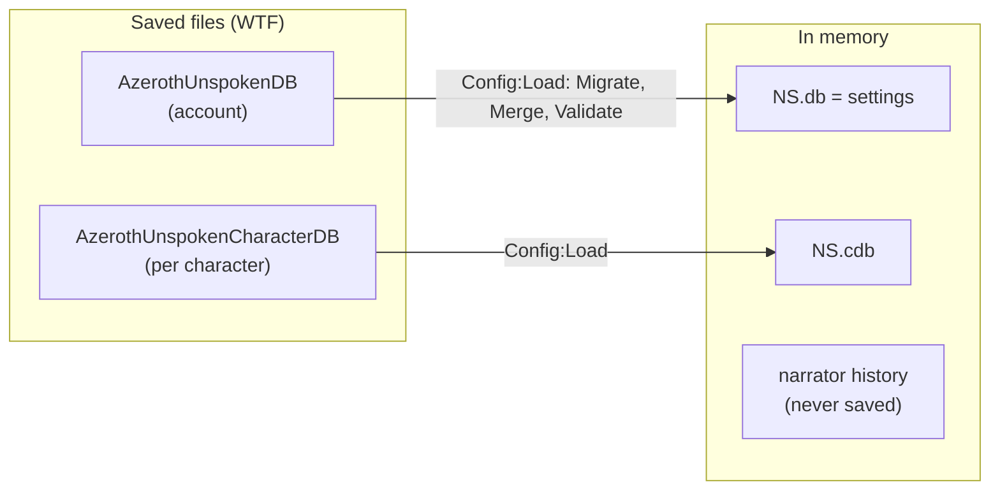

| Variable | Content |
|---|---|
| `AzerothUnspokenDB` | `schemaVersion` (currently 7), `sharedPlayers` (only if the user turned the shared list on: `version` 1 and the choices about people, see above) and `settings`: `locale`, `preset`, `intensity`, `proseDepth`, `modules`, `output`, `chat`, `privacy`, `pacing`, `enabled`, `chance`, `ignored`, `disabledPacks`, `relations` (`npcAuto`, `attraction`, `autoRegisterPlayers`, `proposePlayers`, `recognizeTarget`, `proximity`, `sharePlayers`), `interlocutor` (`trp3Others`: consent to read other people's public Total RP 3 profile), `npcAlive` (`autoOffer`), `arcs` (`maxActive`), `ui` (button, wizard done, `narrator`: duration, reading speed, background opacity, size, reduce motion, lock, history; `dialogue`: size, opacity, lock, position). |
| `AzerothUnspokenCharacterDB` | `schemaVersion`, `memory` (anti-repetition, bounded: uses, last variants, running cooldowns, recent lines, tone), `personality` (`version`, `archetype`, `base`, `traits`, `trp3`, `legacy`: explicit Character Soul intensities, the preset they started from, consent to Total RP 3 and the S5 choices before the conversion, as identifiers), `emotion` (`version`, `values`: only slow emotions at 0.3 or more, each as `{ v, at = time() }`) `relationships` (relationships: `version` 3, `npcs` by `npcID` with the first meeting `met`, `players` by "Name-Realm" with a `user` and a `seen` block; see above), `memories` (Living Memory: `version`, `nextId`, `entries`, `places`, `flags`, `stats`, see above) `arcs` (Story Arcs: `version`, `items` by arc with state, mode, choices and moment, `stats`; see above) and, for future steps, `history` (empty today). |

Every per-character datum also has its **own version** (`personality.version`, `emotion.version`, `memories.version`, `relationships.version`, `arcs.version`), with migrations and cleanup (`Sanitize`) in its own module. A version newer than the one known (you went back to an older addon) is read but **not rewritten**.

| Datum | Schema version | Where the migration lives |
|---|---|---|
| `AzerothUnspokenDB` / `AzerothUnspokenCharacterDB` | `Config.SCHEMA_VERSION` = 7 | `Config.migrations.global[n]` and `.character[n]` |
| `cdb.personality` | 2 (intensities, R4; 1 = S5 choices, converted by `Personality:Migrate`) | `Personality:Profile`, `Personality:Sanitize` |
| `cdb.emotion` | 1 | `Emotion:Load` |
| `cdb.memories` | 2 (place key by uiMapID, #31) | `LM.migrations[n]` |
| `cdb.relationships` | 2 (user/seen blocks, #107) | `R:Sanitize`, `R.MigrateV1` |
| `gdb.sharedPlayers` | 1 (#114) | `R:SanitizeShared` |
| `cdb.arcs` | 1 | `SA.migrations`, `SA:Sanitize` |

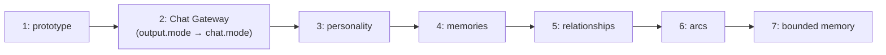

- Defaults are in `Config.defaults` and `Config.characterDefaults`; validity rules in `Config.rules`.
- Migrations are `Config.migrations.global[n]` and `.character[n]` ([ADR 0006](adr/0006-savedvariables-and-schema-versions.md)).
- **Chat content is never saved**, nor the lines of the dialogues, nor the arcs' texts (only the ids of the choices); of the relationships with players only those chosen by the user are saved, with the counts, places and times of the meetings the addon observed for people already in the list (never a text). Proximity (nameplates, mouseover) saves nothing and keeps nothing about strangers; the account-wide list of choices exists only if the user turned it on. The `privacy.*` fields (`socialOptIn`, `shareMemories`, `acceptSceneInvites`) already exist, switched off, for the future Social module.
- The rest of the state (immediate pause `NS.paused`, pending proposal, history, error log, memory of the last send) lives in memory only.

### Folders of the download and when they are loaded

One download, several folders (decision D4 in #130, [ADR 0025](adr/0025-language-and-regional-packs-loaded-on-demand.md)). The folders hold the **approved** content and are what the game reads: content is written directly in them or exported into them by the authoring archive (see [the next subsection](#the-authoring-archive-outside-the-game)).

| Folder | Holds | Loaded |
|---|---|---|
| `AzerothUnspoken` | engine, every base rule, frames, vocabulary, places, structures, interface strings of every language | at login by the client |
| `AzerothUnspoken_enUS`, `AzerothUnspoken_itIT` | the phrase texts of one language | at login, **only the chosen language**, by `Core/Packs.lua` (outside combat); English if the chosen one is missing |
| `AzerothUnspoken_<Region>` | the rules of the lines bound to that region (a continent: `kalimdor`, `eastern`) | when the character enters the region, outside combat |
| `AzerothUnspoken_<Region>_<language>` | their texts in one language | with the region, only for the phrase language |
| `AzerothUnspoken_Example`, `AzerothUnspoken_Versi`, other packs | their own content | by the client at login (not LoadOnDemand), unless their `.toc` declares a language or a region |

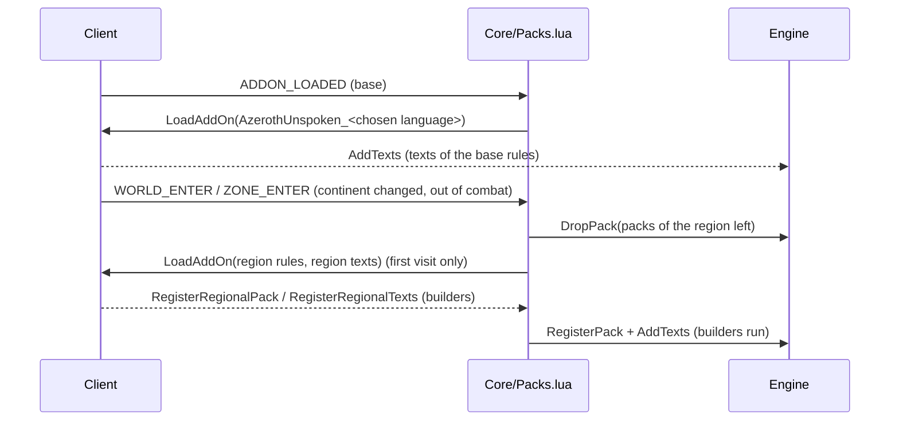

A loaded folder stays loaded until `/reload`: what a region left keeps in memory is the code of its builders (about a third of its built size, `Tests/bench_packs.py`). At login `Engine:DecayMemory` does not know the ids of a region not built yet: their uses decay as usual and their last use is kept at most `Engine.DORMANT_LAST_MAX` (30 days).

### The authoring archive (outside the game)

[ADR 0027](adr/0027-sqlite-authoring-archive-and-exporter.md), issues #87 and #88. An addon cannot read a database, so the archive is only where content is **written, reviewed, searched and measured** (`tools/archive/`, Python standard library, never loaded in game).

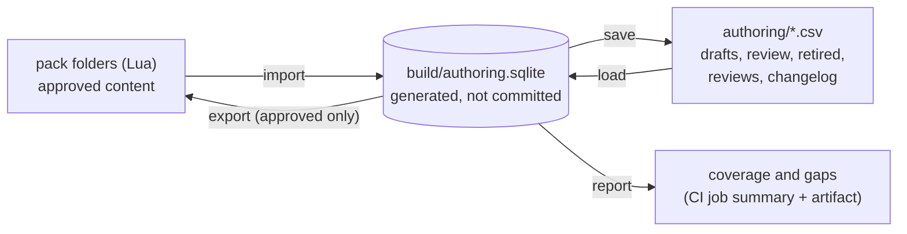

- **Each intention is in one committed place:** approved ones in the folders (hand-written or exported), everything else in the overlay `authoring/*.csv` (text, one row per intention and per variant, sorted, so a PR diff reads line by line). `export` moves approved content from the overlay into the folders. The archive becomes the single source of truth only in a later stage (ADR 0027).
- **The importer reads Lua as data** (`lualit.py`, no Lua is run) and keeps each file as prelude, entries and the gaps with their comments; **`export` of the imported folders is identical byte for byte to every file** (a test in the required CI job). Changed entries are rendered again in the canonical style, new ones are appended to the table of their pack. A rules file that computes its rules by code is reported as "not archived"; since #143 there is none: the 202 intentions of `base_arcs` and `base_dialogues` are literal tables like the others.
- **Arcs and dialogue scripts are data too (#143).** `Data/Arcs.lua` (`NS:RegisterArcs({ pack, arcs })`), `Data/Dialogues.lua` (`NS:RegisterDialogues({ pack, scripts })`) and the journal texts of each language (`NS:AddArcTexts(lang, map, packId)`) are read into the tables `arc`, `arc_text` and `script` (the definition as JSON, the form the exporter writes back), with the search indexes `arc_step`, `script_node` and `script_reply`; the engines (`Systems/StoryArcs.lua`, `Systems/NPCAlive.lua`) are unchanged and generic, they interpret whatever is registered. A file can hold more than one table (a language file of arcs has the journal texts and the lines), so a source file is a list of parts. `check` also validates the structures (`structures.py`: unreachable states and nodes, dangling transitions, missing languages, replies that put words in the player's mouth); the game runs its own checks on load (`badArc`, `badDialogue`). `Tests/check_archive.py` runs the Lua of these files with lupa and compares what the game registers with what the archive holds.
- **Review flow:** `draft -> review -> approved -> retired` (`submit`, `approve`, `reject`, `retire`, `restore`); only `approved` is exported; approval needs a text in every language of the pack and, for invented lore in a narrator line, an attribution (D7).
- **Reports:** `report` counts intentions (D2) with their variants per language, by region, voice, depth and register; lists the event x context cells (the index groups of ADR 0024) with fewer than *k* eligible intentions or texts; and gives the cheap part of the M1 and M2 measurements. Thresholds are in `tools/archive/thresholds.json`; the CI workflow `Content coverage` prints the report as a job summary and an artifact and **never blocks**.
- **Themes, motifs and tiers** (ADR 0029): the intention has the columns `theme`, `motifs` (JSON list, also in the search index `intention_motif`) and `tier`, read and written by the importer and the exporter like the other fields (canonical style: on their own line after tags and depth); `search --theme`, `--motif`; a draft is refused with an unknown theme or motif (the vocabularies are read from `AzerothUnspoken/Data/Themes.lua`). The full M2 of a simulated session is `Tests/bench_m2.py`.
- **Monologues and composite situations** (ADR 0032): the columns `kind`, `parts` (JSON list), `part_order` (the rule field `order`) and `chainable` (JSON: `true` or `"only"`), in the overlay and in drafts, written on their own line by the canonical style; `situation` is a condition. A draft monologue is refused unless it has 2-3 parts that are chainable phrases of its own private voice; it needs no texts. The coverage report counts a monologue as a line of its event and a `chainable = "only"` part as none.

## 7. Extension points

### For phrase pack authors (stable)

A pack is a separate addon with `## Dependencies: AzerothUnspoken`. The API is described in [PACK_FORMAT.md](../AzerothUnspoken/PACK_FORMAT.md), whose examples are tested by the tests as external packs. **An external pack calls the functions from the global `AzerothUnspoken:` object**; the `NS` in the first line `local ADDON, NS = ...` is the pack's own namespace and does not have these functions.

| Call | What it is for |
|---|---|
| `AzerothUnspoken:RegisterPack({ id, name, languages, registry, texts, events, styles, categories, conditions, frames, vocab })` | schema v2: rules (`registry`), texts per language with variants (`texts`), events, registers, new categories and conditions, frames and vocabulary |
| `AzerothUnspoken:AddTexts(language, { [id] = texts }, packId)` | texts (also translations and extra variants) for ids of this or of other packs (`AddTranslations` is the old alias) |
| `AzerothUnspoken:RegisterEvent(name, { category, chance, cooldown })` · `RegisterStyle` · `RegisterCategory(id, { budget, window, cooldown, minCooldown }?)` · `RegisterCondition` | new events, registers, categories (with their own pacing, #118) and conditions |
| `AzerothUnspoken:RegisterLanguage(code, { name, ui })` | adds a language (interface texts) |
| `AzerothUnspoken:RegisterSpellKeywords({ kind = …, element = …, classElement = … })` | classifies spells and creates new kinds (each one fires the event of the same name) |
| `AzerothUnspoken:SetEventDefaults(event, probability, pause)` | default probability and pause of a new event |
| `AzerothUnspoken:RegisterZoneMoods({ ["Zone name"] = "atmosphere" })` | atmosphere of the zones, for the `mood` condition and for style |
| `AzerothUnspoken:RegisterEventStyles(event, { registers })` · `RegisterMoodStyles({ atmosphere = { registers } })` | registers allowed for an event and preferred by an atmosphere (StyleResolver) |
| `AzerothUnspoken:SetEventPriority(event, "memory")` | priority of an event in the Narrative Director (`dialogue`, `exceptional`, `memory`, `ambient`) |
| `AzerothUnspoken.LivingMemory:RegisterRecall(event, check)` | a memory recall event: `memory` priority, `memory` module and guard (without a true memory it does not speak) |
| `AzerothUnspoken.LivingMemory:RegisterKind(kind, importance)` · `:Record{ kind, zone, tags, … }` · `:SetFlag(name)` | other systems (arcs, relationships) register memories and flags |
| `AzerothUnspoken:RegisterRelationData({ axes, labels, disposition, … })` · `AzerothUnspoken.Relationships:RegisterRelationEvent(event, check)` | new relationship labels and axes (by id, they replace); events that cite a relationship, with a guard |
| `AzerothUnspoken:RegisterPlaces({ zones, subzones, instances, continents })` · `RegisterNPCs({ [npcID] = … })` · `RegisterTendencies({ class = … })` | places, NPCs and weak tendencies for interlocutor and place. A key another pack already holds is **refused** unless the entry or the call says `override = true`; `pack` says who registers ([ADR 0033](adr/0033-keys-shared-between-packs-refused-unless-overridden.md)) |
| `AzerothUnspoken:RegisterDialogues({ scripts = { [key] = script } })` | ambient dialogues: archetype, or `npc:<npcID>` with `extends`; a key held by another pack is refused unless `override = true` ([ADR 0033](adr/0033-keys-shared-between-packs-refused-unless-overridden.md)) |
| `AzerothUnspoken:RegisterArcs({ pack, arcs, texts })` · `AddArcTexts(language, map, packId)` | narrative arcs: states, steps, choices and texts |

A pack can also use `func = function(ctx) … end` in conditions for rules written in Lua, with the context of `NS:BuildContext`.

### For macros, other addons and tools (in use, no stability guarantee)

| Point | Use |
|---|---|
| `/au event <name>`, `/au cast <spell>`, `/au greet`… | from macros or other addons with `SlashCmdList` |
| `AzerothUnspoken:Trigger(event, extra)` (`NS:Trigger`) | fires a narrative event; it always goes out through the narrator and the Chat Gateway, **never to chat on its own** |
| `AzerothUnspoken_Speak()` | the "speak" gesture (also from a key or macro) |
| `AzerothUnspoken.EventBus:Subscribe(type, owner, fn)` | observe the normalized events (envelope) |
| `AzerothUnspoken.EventBus:AddSource(wowEvent, { normalize, unit })` | translate a new client event; registration goes through Compat |
| `AzerothUnspoken.Compat` (`caps`, `Query`, `SafeCall`, `Readable`, `IsSecret`) | use the client APIs defensively |
| `AzerothUnspoken.Gateway:Send(...)` | **outside `PlayerAction`** it refuses everything except emotes (and `/say`/`/yell` in instances): whoever uses it does not bypass the rules |
| `AzerothUnspoken.Engine.byId[id]` and `byEvent[event]` | read the registered rules; read their texts with `Engine.VariantText` and the other accessors, because most variants are plain strings since R1 ([ADR 0024](adr/0024-selection-index-compact-registry-and-bounded-memory.md)) |

These points are internal: they may change from one version to the next while the roadmap is open. Only the pack API is meant to last, and its changes will be announced in the [CHANGELOG](../CHANGELOG.md).

### For those writing a new system inside the addon

1. Create the file in the right folder and add it to the `.toc` **after** the modules it depends on.
2. Register the module with `NS:RegisterModule("name")` and initialize it in `OnInit` (isolated by `Guard`).
3. For every new client API: check it in the dump ([ADR 0010](adr/0010-forever-api-dump-as-reference.md)), go through Compat and degrade gracefully.
4. For a new client event add a source to the bus; do not register events on your own.
5. To speak, go through the Director (if it is spontaneous: `NS.Director:Offer(event, extra)`) and the Gateway (always).
   To influence the choice without touching the Director use the hooks: `Engine:SetWeightHook("C"|"P"|"R"|"E", name, fn, pure)` (weight factors; `pure = true`, or a function of the context, declares that `fn` reads only the context and the rule's descriptive fields, never its id, texts or conditions, and draws no random numbers: the selection then calls it once per combination of those fields in a pick, #157), `StyleResolver:SetModifier(name, fn)` (register preferences), `NarrativeDirector:SetRhythm(name, fn)` (probability and pause multipliers), `NarrativeDirector:SetDemandCheck(name, fn)` (demanding moment), `Engine:SetEventGuard(event, name, fn)` (an event speaks only if the guard says yes), `JournalFrame:RegisterTab(id, def)` (a journal tab).
6. New saved data: defaults in `Config.defaults`, rules in `Config.rules`, migration and tests.
7. Annotate the public API with EmmyLua and add the new globals to `.luarc.json` (see [CONTRIBUTING.md](../CONTRIBUTING.md)).

## 8. What is planned and not there yet

From the [roadmap](../ROADMAP.md). The current `main` has milestones M0–M3: foundations, narrator and Chat Gateway (S1–S2), data schema, Narrative Director, Character Soul, Living Memory, relationships, interlocutor and place, Alpha content (S3–S7, [see above](#the-character-soul)), NPC Alive (S8) and Story Arcs (S9). Missing:

| Step | What it adds | Where it hooks in |
|---|---|---|
| S10 (M4) | social play with addon messages, consent and safety; G4 test with two clients | new module, `privacy.*`, `ARC_STATE`; **nothing of an arc, a memory or an NPC goes into a message without a separate consent** |
| S11 (M5) | content up to 1,000 intentions | phrase packs |
| S12 (M5) | accessibility, profiling, manual, privacy, troubleshooting, Definition of Done | cross-cutting |
| G1, G2, G3 | the user's in-game tests (SP-01…SP-05, vertical slice A, B and C, arcs) | [checklist](G1_checklist.md) (in Italian), 108 numbered steps plus the R sections |

## 9. Known limits

- **Authoring archive (R2, #87, #88, #143)**: it covers every intention (0 not archived) and the structures of the arcs and the dialogue scripts. The arcs, the scripts and the journal texts are approved content of the folders only: they do not go through the review flow or the overlay yet (new ones are written in the folders and validated by `check`). `attribution` (D7) lives only in the archive: the pack format has no such field yet, so the archive refuses unattributed invented lore at approval and the exporter does not write the field. "Eligible" in the reports is an upper bound (only the first index group of each rule is used), and the repetition numbers are proxies, not the seeded M2 simulation ([ADR 0027](adr/0027-sqlite-authoring-archive-and-exporter.md)).
- **Scale (R1, #157, #138)**: at 50,000 synthetic entries with one language (`Tests/bench_scale.py --langs enUS`, lupa) a pick takes 3.2 ms on average (p95 10.9 ms) and the addon uses 61.6 MB (94 MB before shapes, shared conditions and the memo of a pick): the targets of R1 (5 ms, 40 MB) are met only for the mean pick time. Compare two versions with `--archive-dir` (the same synthetic rules) and read the instructions per pick, which do not depend on the load of the machine. The targets are hypotheses until the in-game budget is decided (D3 in #130); see [ADR 0024](adr/0024-selection-index-compact-registry-and-bounded-memory.md) and #138.
- **Language and regional packs (#85, #101)**: `C_AddOns.LoadAddOn`, `IsAddOnLoaded`, `GetAddOnMetadata` and the change of continent have not been tried in the real client. A folder loaded on demand stays loaded until `/reload` (WoW cannot unload an addon): a region left keeps its builders in memory, about a third of its built size (`Tests/bench_packs.py`, [ADR 0025](adr/0025-language-and-regional-packs-loaded-on-demand.md)). Changing the phrase language needs a reload.
- **Nothing has been tested in the real client.** Everything is verified only with the simulated client; the G1 test is postponed ([checklist](G1_checklist.md)).
- In the settings the `personal`, `world`, `memory`, `emotion`, `relations`, `npc`, `storyArcs`, `publicChat` and `totalRP3` modules take effect; social and audio are still placeholders.
- The per-event probabilities and pauses (`NS.DEFAULT_CHANCE`, `NS.EVENT_COOLDOWN`) come from the prototype; the Narrative Director's numbers (budget, category pauses, style bonuses and penalties) are hypotheses to tune with in-game tests ([G1](G1_checklist.md), steps 27–31).
- The recognition of demanding combat uses bosses, raid, elites in an instance and, since S6c, boss encounters (`ENCOUNTER_START`), which have not yet been tested in the real client.
- The ambient dialogues (S8) have not been tested in the real client: neither the names of the Blizzard windows that the window avoids (`GossipFrame`, `MerchantFrame`...), nor `GetRect`, nor which interactions actually put an NPC in the `npc` unit; the curated registry has few NPCs (and the numbers are not verified). See [G1](G1_checklist.md), G3.
- The story arcs (S9) have not been tested in the real client: neither that `C_Map` gives the uiMapID of the starting zone (the English name is the fallback), nor the thresholds of familiarity, levels and waits of the steps, nor the look of the journal's "Stories" tab.
- The uiMapIDs, instanceIDs and npcIDs of the data (`Data/Places.lua`, `Data/NPCs.lua`) come from Classic Era and are not verified in Forever: places are recognized by name until they are (`/au place`).
- The APIs of the capability matrix have not been checked in the client of build 70658: see `/au debug full` and [REFERENCES.md](REFERENCES.md).
