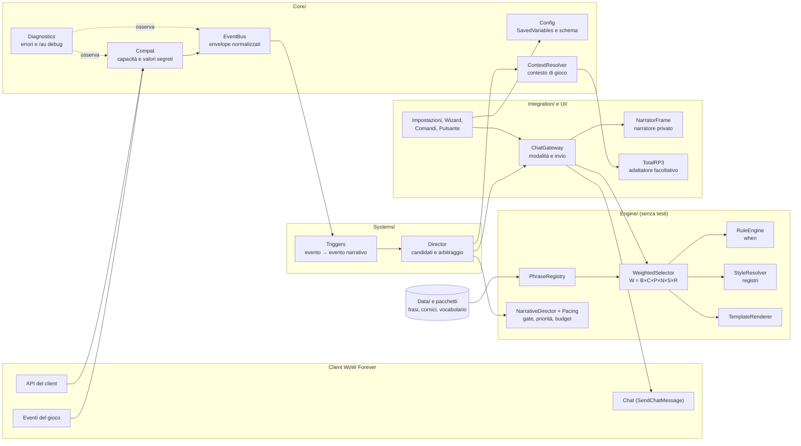
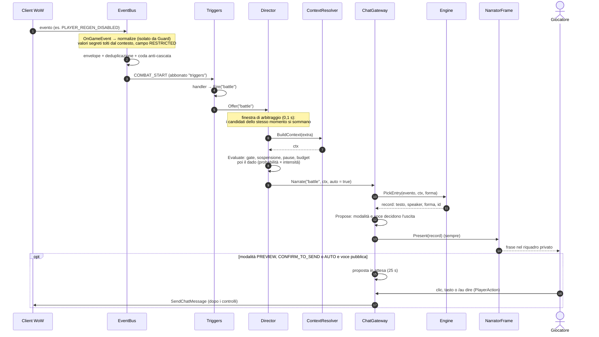
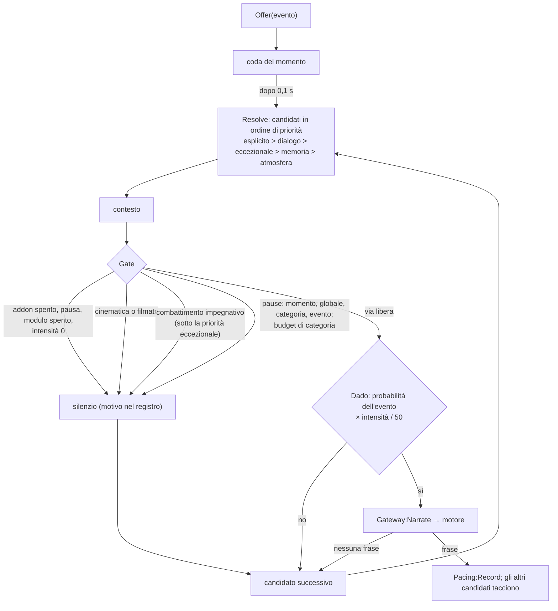
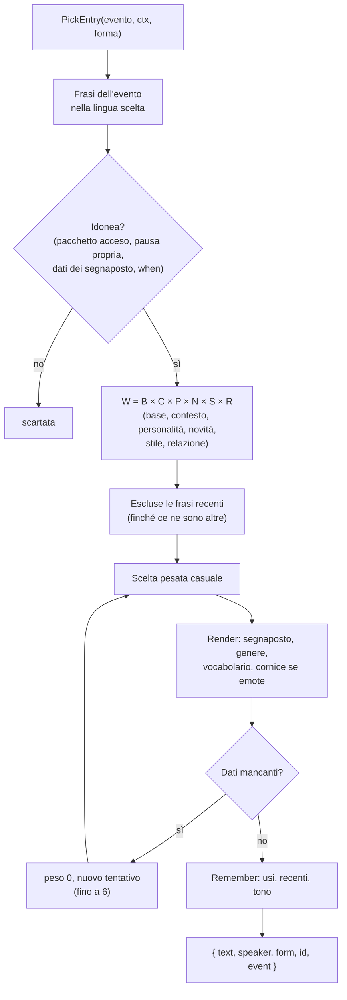
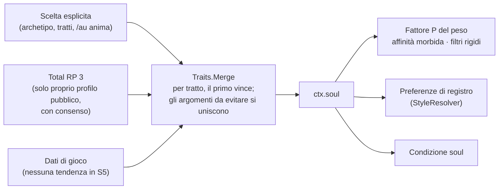
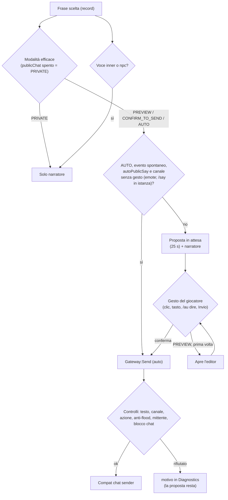
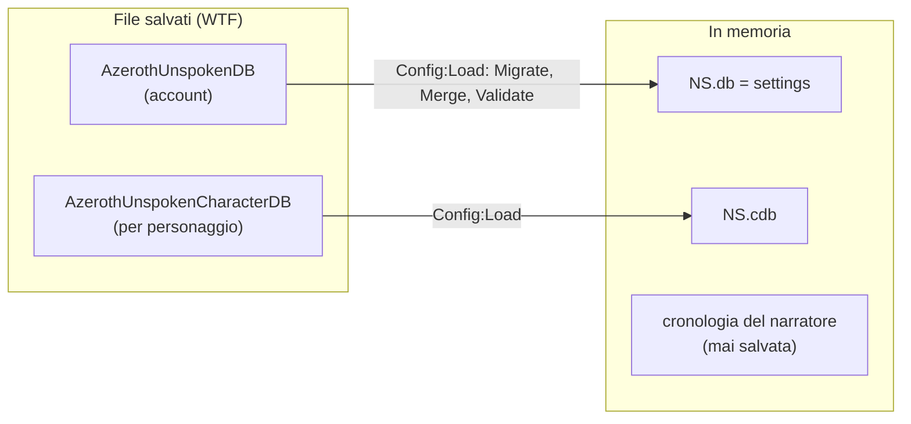

# Architettura di Azeroth Unspoken

Questo documento descrive come è fatto l'addon **oggi, su `main`** (versione 0.1.0, step S1–S5), e dove si aggancia ciò che la [roadmap](../ROADMAP.md) prevede. Le parti non ancora presenti sono indicate come *previste*. Per le motivazioni delle scelte vedi le [ADR](adr/README.md); per la specifica di prodotto, il [GDD](Immersion_Director_GDD_v1.0.md) (§11 è l'architettura Lua).

## Indice

1. [Visione d'insieme](#1-visione-dinsieme)
2. [Moduli e responsabilità](#2-moduli-e-responsabilità)
3. [Flusso di un evento](#3-flusso-di-un-evento)
4. [Come si sceglie una frase](#4-come-si-sceglie-una-frase)
5. [Il Chat Gateway](#5-il-chat-gateway)
6. [Dati e SavedVariables](#6-dati-e-savedvariables)
7. [Punti di estensione](#7-punti-di-estensione)
8. [Cosa è previsto e non c'è ancora](#8-cosa-è-previsto-e-non-cè-ancora)
9. [Limiti noti](#9-limiti-noti)

## 1. Visione d'insieme

L'addon è una catena: il **client** emette un evento, un **bus** lo traduce in un formato uniforme, il **Director** decide se è il momento di parlare, il **motore** sceglie una frase intera dal **database** di pacchetti, il **Chat Gateway** decide dove può andare, e il **narratore privato** la mostra. Ogni API del client passa da **Compat**, che dice che cosa è disponibile, mancante o limitato.

Principi che reggono tutto il resto:

- **Il motore non contiene testi** ([ADR 0001](adr/0001-motore-e-database-narrativo-separati.md)).
- **Nessuna rete** ([ADR 0002](adr/0002-tutto-offline-senza-ia.md)).
- **Niente in chat senza un'azione del giocatore** ([ADR 0003](adr/0003-narratore-privato-e-chat-gateway.md)).
- **Se una funzione del client manca, si spegne quella funzione, non l'addon** ([ADR 0005](adr/0005-compat-valori-segreti-ed-eventi-difensivi.md)).
- **Un errore in un modulo non ferma gli altri** ([ADR 0014](adr/0014-bus-di-eventi-normalizzati-e-moduli-isolati.md)).

## 2. Moduli e responsabilità

I file si caricano nell'ordine del `.toc` (`AzerothUnspoken/AzerothUnspoken.toc`). Ogni file riceve `ADDON, NS = ...`: `NS` è lo spazio dei nomi dell'addon, esposto anche come globale `AzerothUnspoken`.

| Cartella / file | Responsabilità |
|---|---|
| **`Core/Bootstrap.lua`** | spazio dei nomi `NS`; lingue (`RegisterLanguage`, `NS:L`, `NS:Lang`); `NS:Print`; registro dei moduli (`NS:RegisterModule`); su `ADDON_LOADED` esegue `NS:Initialize`: `Config:Load`, `Compat:Probe`, `EventBus:Start`, poi `OnInit` di ogni modulo, ciascuno isolato da `Diagnostics:Guard`; nomi dei tasti. |
| **`Core/Compat.lua`** | matrice delle capacità (`AVAILABLE`, `MISSING`, `RESTRICTED`); `Query`, `SafeCall`, `IsSecret`, `Readable`; registrazione protetta degli eventi; `GetBuildInfo` (riconosce Forever); restrizioni (`C_RestrictedActions`); identità segrete (`C_Secrets`); sorgente della chat e blocco della chat. |
| **`Core/Diagnostics.lua`** | `Guard` (esecuzione isolata con `xpcall`), registro degli errori (al massimo 30, raggruppati), rapporto `/au debug`, matrice per gruppo. |
| **`Core/Config.lua`** | predefiniti, `Merge`, `Validate`, migrazioni per `schemaVersion`, `Get`/`Set` per percorso, preset dei moduli, modalità e canali del Chat Gateway. Imposta `NS.db` e `NS.cdb`. |
| **`Core/EventBus.lua`** | sorgenti WoW → tipi normalizzati; envelope; deduplicazione; coda anti-cascata; `Publish`, `Subscribe`, `Recent`. |
| **`Core/ContextResolver.lua`** | `NS:BuildContext(extra)`: costruisce il contesto su cui si valutano le condizioni (personaggio, luogo, ora, gruppo, istanza, bersaglio, incantesimo), classifica gli incantesimi, registra le zone e le parole chiave dei pacchetti. |
| **`Engine/PhraseRegistry.lua`** | `RegisterPack`; registra frasi, cornici, vocabolario e traduzioni; indici per evento e per id; speaker provvisorio; statistiche. |
| **`Engine/RuleEngine.lua`** | `Match(when, ctx)`: le condizioni dichiarative (valori, elenchi, `not`, `any`, `func`, intervalli). |
| **`Engine/StyleResolver.lua`** | registri adatti al momento (GDD §5.2): ammessi per evento, preferiti da zona, profondità e voce; affinità di una frase (parte del fattore `S`); compatibilità tra cornice e frase. |
| **`Engine/Traits.lua`** | il modello dei tratti (GDD §7.1): definizioni (`choice`, `scale` con fasce, `set`), profili con i soli tratti impostati, `Sanitize`, `Merge` (priorità tra le fonti), tag di affinità (`Evaluate`, `CheckTag`), nomi localizzati. Non conosce il personaggio: lo riusano Character Soul (S5), interlocutore (S6c) e relazioni (S6b). |
| **`Engine/WeightedSelector.lua`** | idoneità, peso `W = B × C × P × N × S × R` (`Engine.Factors`, `Engine:Weight`, agganci `Engine:SetWeightHook`), anti-ripetizione, memoria degli usi, `PickEntry`/`Pick`. |
| **`Engine/Pacing.lua`** | pause (momento, globale, categoria, evento) e budget per categoria degli interventi spontanei; stato solo in memoria. |
| **`Engine/NarrativeDirector.lua`** | priorità del §10, gate di opportunità guidato dall'intensità, sospensione (schermate invasive, combattimento impegnativo), dado, ordine dei candidati; agganci del ritmo e dell'impegno. |
| **`Engine/TemplateRenderer.lua`** | segnaposto, genere, vocabolario, cornici. Se manca un dato, la frase è scartata. |
| **`Integration/TotalRP3.lua`** | adattatore facoltativo ([ADR 0004](adr/0004-total-rp-3-facoltativo-con-adattatore.md)): il nome del profilo e, con consenso, i tratti psicologici pubblici del **proprio** profilo mappati sui tratti del Soul ([ADR 0016](adr/0016-character-soul-tratti-opt-in-e-total-rp-3-con-consenso.md)). |
| **`Integration/ChatGateway.lua`** | modalità, proposte, canali, invio solo da azione del giocatore, anti-flood, `AzerothUnspoken_Speak`. |
| **`Systems/Personality.lua`** | il Character Soul: otto tratti opt-in, archetipi, profilo effettivo (scelta > Total RP 3 > dati di gioco > neutro), fattore `P` del peso, preferenze di registro, condizione `soul`, `ctx.soul`, comando `/au anima`. |
| **`Systems/Director.lua`** | il Narrative Director degli eventi spontanei: `Offer` (candidato), `Resolve` (al massimo un intervento per momento), `Evaluate` (il gate, punto di aggancio di S2), pausa immediata, riepilogo per `/au debug`. |
| **`Systems/Triggers.lua`** | abbonato al bus: trasforma gli eventi normalizzati in eventi narrativi (`battle`, `victory`, `lowhp`, `death`, `rez`, `levelup`, `zone`, `attack`, `heal`, `buff`, `travel`, `rezother`) e li offre al Director; tiene le probabilità e le pause proprie di ogni evento. |
| **`UI/Widgets.lua`** | piccoli componenti condivisi dell'interfaccia. |
| **`UI/NarratorFrame.lua`** | il narratore privato: riquadro, durata, opacità, cronologia, editor, pulsanti, pausa. |
| **`UI/SpeakButton.lua`** | il pulsante "pronuncia" e il tasto: gesto che conferma il Chat Gateway. |
| **`UI/ProfileFrame.lua`** | la finestra del profilo: archetipo, tratti, argomenti da evitare, consenso a Total RP 3, profilo neutro. |
| **`UI/Wizard.lua`** | procedura guidata del primo avvio (6 passi, 7 con Total RP 3). |
| **`UI/SettingsFrame.lua`** | pannello delle impostazioni (`Settings.RegisterCanvasLayoutCategory`, con ripiego su `InterfaceOptions_AddCategory`). |
| **`UI/Commands.lua`** | `/au` e `/unspoken`. |
| **`Data/<lingua>/Interface.lua`** | testi dell'interfaccia (`itIT`, `enUS`). |
| **`Data/*.lua`** | pacchetti di frasi di base (schema v2): `Vocabulary`, `Frames`, le regole `Registry{Combat,Spells,Life,Exploration,Social,Classes}` e i testi per lingua in `Data/itIT/` e `Data/enUS/`. |
| **`Bindings.xml`** | tasti `AZEROTHUNSPOKEN_SPEAK` e `AZEROTHUNSPOKEN_PAUSE`. |
| **`AzerothUnspoken_Example/`** | pacchetto di esempio, addon separato con `## Dependencies: AzerothUnspoken`. |
| **`Tests/`** | test fuori dal gioco (lupa) e client simulato ([ADR 0007](adr/0007-test-fuori-gioco-con-lupa-e-mock.md)). |

Direzione delle dipendenze: `Core` non conosce `Engine`, `Systems` né `UI`; `Engine` usa `Core` ma non conosce il Gateway né l'interfaccia; `Integration` e `Systems` usano `Core` ed `Engine`; `UI` usa tutto. Un modulo si trova con `NS.NomeModulo` (ad esempio `NS.Gateway`, `NS.Director`, `NS.Narrator`).

## 3. Flusso di un evento

Il percorso completo, dal client alla frase mostrata (e, solo dopo un gesto, alla chat):

I passaggi, in parole:

1. **Client → bus.** `Core/EventBus.lua` registra gli eventi del client tramite `Compat:RegisterEvent` (con controllo di validità, dentro un `pcall`). Ogni sorgente (`EventBus:AddSource`) ha una funzione `normalize` che produce un tipo, un contesto e opzioni (chiave di deduplicazione, campi attesi). La funzione gira dentro `Diagnostics:Guard`.
2. **Envelope.** `NewEnvelope` crea `{ type, timestamp, source, context, fields }`. I valori segreti non entrano nel contesto e il loro campo è `RESTRICTED`; i campi attesi ma assenti sono `MISSING`.
3. **Deduplicazione e coda.** Un doppione (stesso tipo e chiave entro la finestra) si scarta e si conta. Un evento pubblicato mentre se ne consegna un altro va in coda (al massimo 32; oltre 5 secondi di età si scarta).
4. **Consegna.** Ai gestori del tipo e a quelli di `"*"`, ciascuno in `Guard`.
5. **Triggers.** I gestori in `Systems/Triggers.lua` mantengono un po' di stato (inizio del combattimento, zona precedente, bersagli degli incantesimi) e chiamano `Fire(evento, extra)`, cioè `Director:Offer`; alcuni ritardano con `C_Timer.After` per lasciare che il gioco aggiorni lo stato.
6. **Narrative Director.** I candidati arrivati entro la finestra di arbitraggio si risolvono insieme, in ordine di priorità; per ognuno il Director costruisce il contesto, chiede il gate (`Evaluate`) e tira il dado. Il primo che produce una frase vince, gli altri tacciono ([dettagli sotto](#il-narrative-director)).
7. **Contesto.** `NS:BuildContext(extra)` raccoglie i dati del momento. Con l'identità del bersaglio segreta non si legge né si confronta alcun dato del bersaglio (resta `targetSecret`); ogni lettura passa da `SafeCall`; il nome del personaggio può venire da Total RP 3.
8. **Gateway e motore.** `Gateway:Narrate` sceglie la forma (parlata o emote) e chiede a `Engine:PickEntry` una frase ([sezione 4](#4-come-si-sceglie-una-frase)). Se non c'è nessuna frase adatta, **non succede nulla**: il silenzio è valido.
9. **Uscita.** `Gateway:Propose` mostra sempre la frase nel narratore. Solo se la modalità lo prevede e la voce può andare in chat, crea anche una **proposta** ([sezione 5](#5-il-chat-gateway)).

**Richieste esplicite.** `/au saluto`, `/au evento`, `/au incanta` e il tasto "pronuncia" non passano dal Narrative Director: chiamano `NS:Trigger`/`Gateway:Narrate` direttamente, anche in pausa e a intensità 0 (GDD §4.2). Non consumano budget, ma aprono il "momento": per qualche secondo nessuna frase spontanea le segue. Restano comunque soggetti alle regole del Gateway: mai un invio in chat senza un'azione del giocatore.

### Il Narrative Director

| Controllo | Regola | Chi lo salta |
|---|---|---|
| Momento | 4 s tra due interventi qualsiasi (anche espliciti) | nessuno |
| Pausa globale | `pacing.globalCooldownSeconds` (45) × (1,5 − intensità/100) | eventi eccezionali |
| Pausa di categoria | `Pacing.CATEGORY_COOLDOWN` (combattimento 15 s, esplorazione 30 s...) × lo stesso fattore | eventi eccezionali |
| Pausa dell'evento | `NS.EVENT_COOLDOWN` × lo stesso fattore | nessuno |
| Budget | `Pacing.BUDGET` per categoria in 10 minuti (combattimento 6...) × intensità/50 | eventi eccezionali |
| Schermate invasive | `InCinematic`, `IsInCinematicScene`, `CinematicFrame`/`MovieFrame` visibili | nessuno |
| Combattimento impegnativo | in combattimento con boss, in incursione, élite in istanza (`pacing.suppressInHighDemand`) | eventi eccezionali |
| Pausa della frase (id) | `cooldown` della regola e finestra anti-ripetizione, nel motore | nessuno (vale anche per gli espliciti) |

Il registro delle ultime decisioni (`Director.log`) e il budget usato compaiono in `/au debug` alla riga **Narrative Director**. La motivazione delle scelte è nell'[ADR 0015](adr/0015-narrative-director-un-intervento-per-momento.md).

## 4. Come si sceglie una frase

- **Peso** (`Engine.Factors`, GDD §10): `B` = `weight`; `C` = 1 + 0,35 × condizioni (più gli agganci `C` di S6c); `P` = personalità (Character Soul): affinità morbida dei tag `tratto:valore` (×1,6 / ×0,6), voce interiore e ironia; 0 esclude la frase per `req:`, `not:` e `topic:`; neutra (1) col profilo neutro ([dettagli](#il-character-soul)); `N` = ÷ (1 + 0,3 × usi recenti), ×0,6 se il registro è quello dell'ultima frase dell'evento; `S` = profondità (×0,3 se diversa) × affinità di registro del StyleResolver (×0,5 fuori dall'evento, +25% per ogni preferenza di zona, profondità e voce); `R` = relazione, neutra fino a S6b. `Engine:Weight(frase, evento, ctx)` restituisce la scomposizione.
- **Carattere**: i tratti pesano le frasi e, per i tag rigidi, le escludono; vedi [il Character Soul](#il-character-soul).
- **Stile**: i registri pesano e non escludono, quindi il ripiego neutro è automatico. In forma emote, una cornice con registri accoglie solo frasi di registro uguale o vicino (`StyleResolver:Compatible`).
- **Condizioni** (`when`): vedi [FORMATO_PACCHETTI.md](../AzerothUnspoken/FORMATO_PACCHETTI.md). Più condizioni → frase più specifica → peso maggiore.
- **Memoria**: `NS.cdb.memory` (`uses`, `last`, `recent`, `lastTone`), per personaggio. Gli usi si attenuano a ogni accesso (`DecayMemory`, ×0,75). La finestra delle frasi recenti è circa il 60% di quelle disponibili, al massimo `pacing.recentPhraseWindow` (30).
- **Voce (`speaker`)**: `narrator`, `inner`, `character`, `npc`. Oggi, se un pacchetto non la indica, `say` → `character` ed `emote` → `narrator`. Una frase parlata inserita in una cornice è `narrator`.
- Il silenzio è un esito valido: se nessuna frase è idonea, il motore restituisce `nil`.

### Il Character Soul

`Systems/Personality.lua` dà al personaggio una voce propria (GDD §7.1, [ADR 0016](adr/0016-character-soul-tratti-opt-in-e-total-rp-3-con-consenso.md)). Tutto è facoltativo: senza scelte il profilo è **neutro** e il narratore resta com'era.

- **Tratti**: temperamento, morale, curiosità (scala), fede, motivazione, ironia (scala), voce interiore e argomenti da evitare (insieme). Archetipi pronti più il profilo neutro; scegliere un archetipo copia i suoi tratti, modificarne uno rende il profilo "personalizzato". Il cambio vale subito: le frasi successive usano il nuovo profilo.
- **Tag sulle frasi** (campo `tags`): `tratto:valore` affinità morbida (×1,6 se combacia, ×0,6 se il profilo ha un altro valore, mai zero); `req:tratto:valore` (la frase afferma qualcosa del personaggio: esce solo se il profilo lo dice), `not:tratto:valore` e `topic:argomento` sono filtri **rigidi** (fattore 0). I tag senza due punti restano descrittivi. Il validatore controlla i tag di affinità.
- **Priorità** (GDD §8), tratto per tratto: scelta esplicita > Total RP 3 > dati di gioco > valori neutri; il riepilogo (`/au anima lista`) dice la fonte di ogni tratto.
- **Total RP 3**: solo con il consenso `personality.trp3` e il modulo `totalRP3` acceso; legge solo `characteristics/PS` del proprio profilo e non scrive mai. Se l'API manca o cambia, il livello sparisce e le scelte restano (capacità `integration:totalRP3:traits`).
- **Riuso**: `Engine/Traits.lua` non conosce il giocatore. S6c lo userà per `ctx.other` (ambito di tag `other.`), S6b per gli assi delle relazioni.
- **Interfaccia**: `/au anima` apre `UI/ProfileFrame.lua` (archetipo, tratti, argomenti, consenso, profilo neutro); `/au anima lista | neutro | archetipo <id> | trp3 on|off | <tratto> <valore> | evita <argomento>`.

## 5. Il Chat Gateway

Regole fisse, verificate dai test (`Tests/TestChatGateway.lua`):

- L'invio da gesto passa solo da `Gateway:PlayerAction(fn)`. Fuori da quell'ambito `Gateway:Send` rifiuta tutto tranne `EMOTE` e, in istanza, `SAY` e `YELL` (`needs_action`).
- Le voci `inner` e `npc` non diventano mai proposte.
- Anti-flood: `floodSeconds` (4), `maxPerMinute` (6), `autoMaxPerMinute` (2); testo di al massimo `Config.CHAT_LIMITS[canale]` byte (255; la stessa tabella è letta dal validatore); proposta in attesa `pendingSeconds` (25), e una nuova sostituisce la vecchia. Con l'editor aperto la proposta non scade e una frase spontanea non la sostituisce.
- Il testo inviato è adattato al canale (`Gateway:TextFor`: emote fuori da `/e` con il nome, parlato in `/e` con «dice: «…»»). In alternativa all'invio, `Gateway:CopyToChat` mette la proposta nella casella della chat standard (`Compat:OpenChatWith`).
- L'invio automatico si attiva solo con due gesti (avviso e conferma entro 10 secondi, `Gateway:SelectAuto`) e non è nel ciclo delle modalità del pannello.
- Canali: `SAY`, `EMOTE`, `YELL`, `PARTY`, `RAID`, `GUILD`, `INSTANCE_CHAT`, con controllo di disponibilità.
- **Ipotesi non ancora misurata in gioco**: quali canali il client accetta senza gesto ([G1](G1_checklist.md), SP-05).

## 6. Dati e SavedVariables

| Variabile | Contenuto |
|---|---|
| `AzerothUnspokenDB` | `schemaVersion` (oggi 3) e `settings`: `locale`, `preset`, `intensity`, `proseDepth`, `modules`, `output`, `chat`, `privacy`, `pacing`, `enabled`, `chance`, `ignored`, `disabledPacks`, `ui` (pulsante, wizard fatto, riquadro del narratore: durata, opacità, dimensione, posizione). |
| `AzerothUnspokenCharacterDB` | `schemaVersion`, `memory` (usi, ultime frasi, tono), `personality` (`version`, `archetype`, `traits`, `trp3`: scelte esplicite del Character Soul e consenso a Total RP 3) e, per gli step futuri, `memories`, `arcs`, `history` (oggi vuoti). |

- I predefiniti sono in `Config.defaults` e `Config.characterDefaults`; le regole di validità in `Config.rules`.
- Le migrazioni sono `Config.migrations.global[n]` e `.character[n]` ([ADR 0006](adr/0006-savedvariables-e-versioni-dello-schema.md)).
- **Non si salva mai il contenuto della chat.** I campi `privacy.*` (`socialOptIn`, `shareMemories`, `acceptSceneInvites`) esistono già, spenti, per il futuro modulo Social.
- Il resto dello stato (pausa immediata `NS.paused`, proposta in attesa, cronologia, registro degli errori, memoria dell'ultimo invio) vive solo in memoria.

## 7. Punti di estensione

### Per chi scrive pacchetti di frasi (stabile)

Un pacchetto è un addon separato con `## Dependencies: AzerothUnspoken`. L'API è descritta in [FORMATO_PACCHETTI.md](../AzerothUnspoken/FORMATO_PACCHETTI.md) (il formato cambierà con lo schema v2, step S3):

| Chiamata | A che cosa serve |
|---|---|
| `AzerothUnspoken:RegisterPack({ id, name, phrases, frames, vocab, translations })` | aggiunge frasi, cornici narrative, vocabolario e traduzioni |
| `AzerothUnspoken:RegisterLanguage(codice, { name, ui })` | aggiunge una lingua (testi dell'interfaccia) |
| `AzerothUnspoken:AddTranslations(lingua, { [id] = testo })` | traduce frasi di altri pacchetti |
| `AzerothUnspoken:RegisterSpellKeywords({ kind = …, element = …, classElement = … })` | classifica gli incantesimi e ne crea di nuovi tipi (ognuno lancia l'evento omonimo) |
| `AzerothUnspoken:SetEventDefaults(evento, probabilità, pausa)` | probabilità e pausa predefinite di un evento nuovo |
| `AzerothUnspoken:RegisterZoneMoods({ ["Nome zona"] = "atmosfera" })` | atmosfera delle zone, per la condizione `mood` e per lo stile |
| `AzerothUnspoken:RegisterEventStyles(evento, { registri })` | registri ammessi per un evento (StyleResolver) |
| `AzerothUnspoken:RegisterMoodStyles({ atmosfera = { registri } })` | registri preferiti da un'atmosfera |
| `AzerothUnspoken:SetEventPriority(evento, "memory")` | priorità di un evento nel Narrative Director (`dialogue`, `exceptional`, `memory`, `ambient`) |

Un pacchetto può anche usare `func = function(ctx) … end` nelle condizioni per regole scritte in Lua, con il contesto di `NS:BuildContext`.

### Per macro, altri addon e strumenti (in uso, senza garanzia di stabilità)

| Punto | Uso |
|---|---|
| `/au evento <nome>`, `/au incanta <incantesimo>`, `/au saluto`… | da macro o da altri addon con `SlashCmdList` |
| `AzerothUnspoken:Trigger(evento, extra)` (`NS:Trigger`) | lancia un evento narrativo; esce sempre da narratore e Chat Gateway, **mai in chat da solo** |
| `AzerothUnspoken_Speak()` | il gesto "pronuncia" (anche da tasto o macro) |
| `AzerothUnspoken.EventBus:Subscribe(tipo, proprietario, fn)` | osservare gli eventi normalizzati (envelope) |
| `AzerothUnspoken.EventBus:AddSource(eventoWoW, { normalize, unit })` | tradurre un nuovo evento del client; la registrazione passa da Compat |
| `AzerothUnspoken.Compat` (`caps`, `Query`, `SafeCall`, `Readable`, `IsSecret`) | usare le API del client in modo difensivo |
| `AzerothUnspoken.Gateway:Send(...)` | **fuori da `PlayerAction`** rifiuta tutto tranne emote (e `/say`/`/yell` nelle istanze): chi lo usa non aggira le regole |

Questi punti sono interni: possono cambiare tra una versione e l'altra finché la roadmap è aperta. Solo l'API dei pacchetti è pensata per durare, e i suoi cambiamenti saranno annunciati nel [CHANGELOG](../CHANGELOG.md).

### Per chi scrive un nuovo sistema nell'addon

1. Crea il file nella cartella giusta e aggiungilo al `.toc` **dopo** i moduli da cui dipende.
2. Registra il modulo con `NS:RegisterModule("nome")` e inizializzalo in `OnInit` (isolato da `Guard`).
3. Per ogni API del client nuova: controllala nel dump ([ADR 0010](adr/0010-dump-api-di-forever-come-riferimento.md)), passa da Compat e degrada con eleganza.
4. Per un nuovo evento del client aggiungi una sorgente al bus; non registrare eventi per conto tuo.
5. Per parlare, passa dal Director (se è spontaneo: `NS.Director:Offer(evento, extra)`) e dal Gateway (sempre).
   Per influire sulla scelta senza toccare il Director usa gli agganci: `Engine:SetWeightHook("C"|"P"|"R", nome, fn)` (fattori del peso), `StyleResolver:SetModifier(nome, fn)` (preferenze di registro), `NarrativeDirector:SetRhythm(nome, fn)` (moltiplicatori di probabilità e pause), `NarrativeDirector:SetDemandCheck(nome, fn)` (momento impegnativo).
6. Dati salvati nuovi: predefiniti in `Config.defaults`, regole in `Config.rules`, migrazione e test.
7. Annota con EmmyLua l'API pubblica e aggiungi le nuove globali a `.luarc.json` (vedi [CONTRIBUTING.md](../CONTRIBUTING.md)).

## 8. Cosa è previsto e non c'è ancora

Dalla [roadmap](../ROADMAP.md); nulla di questo esiste sul `main` attuale (S5, il Character Soul, c'è: [vedi sopra](#il-character-soul)).

| Step | Cosa aggiunge | Dove si aggancia |
|---|---|---|
| S6 | memoria vissuta e diario | `NS.cdb.memories`, `UI/JournalFrame.lua` |
| S6b | relazioni e affinità con NPC e giocatori | `Systems/Relationships.lua`, `Data/Relationships.lua`; aggancio `R` (0 esclude le frasi incoerenti); gli assi sono scale di `Engine/Traits.lua` |
| S6c | interlocutore (`ctx.other`) e luogo (`ctx.place`) come condizioni | `Systems/Interlocutor.lua`, `Systems/Place.lua`, `Data/NPCs.lua`, `Data/Places.lua`; i tratti dell'interlocutore usano `Engine/Traits.lua` con l'ambito `other`; aggancio `C`, ritmo per tipo di istanza (`NarrativeDirector:SetRhythm`), scontri con i boss (`SetDemandCheck`) |
| S8 | dialoghi con NPC (finestra, stati, registro) | nuovo modulo e `Data/NPCs.lua` |
| S9 | archi narrativi | `NS.cdb.arcs` |
| S10 | gioco sociale con messaggi addon, consenso e sicurezza | nuovo modulo, `privacy.*` |

## 9. Limiti noti

- **Nulla è stato provato nel client vero.** Tutto è verificato solo con il client simulato; la prova G1 è rimandata ([checklist](G1_checklist.md)).
- Nelle impostazioni solo i moduli `personal`, `world`, `publicChat` e `totalRP3` hanno effetto.
- Le probabilità e le pause per evento (`NS.DEFAULT_CHANCE`, `NS.EVENT_COOLDOWN`) vengono dal prototipo; i numeri del Narrative Director (budget, pause di categoria, bonus e penalità di stile) sono ipotesi da regolare con le prove in gioco ([G1](G1_checklist.md), passi 27–31).
- Il riconoscimento del combattimento impegnativo usa solo boss, incursione ed élite in istanza: gli scontri con i boss dei dungeon senza classificazione `worldboss` arriveranno con S6c (`ENCOUNTER_START`).
- Le API della matrice delle capacità non sono state controllate nel client della build 70658: vedi `/au debug full` e [RIFERIMENTI.md](RIFERIMENTI.md).
