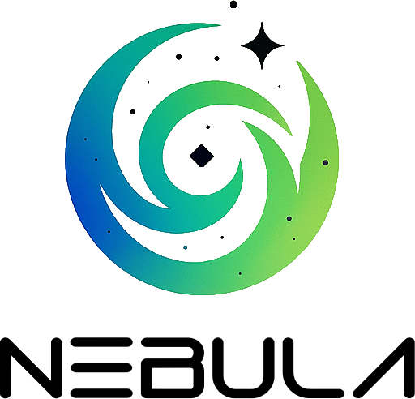

# Informazioni e crediti

<picture>
  <source media="(prefers-color-scheme: dark)" srcset="../../assets/nebula/nebula-logo-dark.png">
  <source media="(prefers-color-scheme: light)" srcset="../../assets/nebula/nebula-logo-light.png">
  
</picture>

Azeroth Unspoken è un compagno di gioco di ruolo per World of Warcraft: un narratore che vedi solo tu, la voce interiore del tuo personaggio, piccole storie e un diario. Questa pagina dice chi l'ha fatto, di chi è il lavoro che condivide, con quale licenza è distribuito e dove trovarlo. Gli stessi crediti sono nel gioco: **Impostazioni → Informazioni**, oppure `/au about` (`/au about chat` li stampa in chat). Questa pagina è la traduzione italiana di [[About and Credits|About]]; il resto del wiki è in inglese.

## Chi l'ha fatto

- **Finland** ha fatto l'addon: l'idea, il codice e le frasi.
- Un ringraziamento alla **community NEBULA** per lo stile che l'addon condivide con gli altri suoi addon (i temi Nebula e Aurora) e per il suo logo, che compare qui sopra. Il logo è usato con il permesso del suo proprietario. È l'immagine della community e non è coperto dalla licenza del codice dell'addon.

## Licenza

La licenza è mista, perché un addon di gioco è fatto di cose diverse:

- il **codice** è GPL-3.0 o successiva: puoi studiarlo, modificarlo e condividerlo, e le versioni condivise restano aperte;
- le **frasi e i dati narrativi** sono tutti i diritti riservati: puoi giocarci, citarne brevi estratti e mostrarle in screenshot, video e dirette, ma copiarle in altre opere, ripubblicarle o usarle per addestrare sistemi di IA richiede un permesso scritto;
- il **pacchetto di esempio** è MIT, libero da copiare per il tuo pacchetto;
- questa **documentazione** è CC BY 4.0;
- i **font** sono sotto la SIL Open Font License, le icone e le forme sono disegnate per l'addon e non si usa nessuna grafica di Blizzard.

## Opera di fan

Azeroth Unspoken è un addon fatto dai fan. Non è affiliato a Blizzard Entertainment né da essa approvato. World of Warcraft® è un marchio di Blizzard Entertainment, Inc. Tutte le frasi sono originali e non riproducono testi del gioco.

## Link

| Che cosa | Dove |
|---|---|
| Il codice sorgente | https://github.com/Finland6738/azeroth-unspoken |
| Bug e idee | https://github.com/Finland6738/azeroth-unspoken/issues |
| La community NEBULA | https://nebula-community.github.io/giochi/wow-forever/ |
| Sostieni l'autore (facoltativo) | https://ko-fi.com/finland6738 |

Nel gioco questi quattro sono caselle di sola lettura: il gioco non può aprire una pagina web, quindi clicca una casella e premi Ctrl+C per copiare il link. Ko-fi è facoltativo e non sblocca nulla; l'addon non lo chiede mai e il suo link sta solo in questa pagina delle impostazioni.
