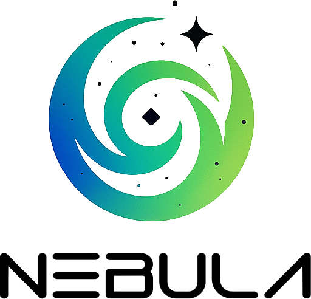

# About and credits

<picture>
  <source media="(prefers-color-scheme: dark)" srcset="../../assets/nebula/nebula-logo-dark.png">
  <source media="(prefers-color-scheme: light)" srcset="../../assets/nebula/nebula-logo-light.png">
  
</picture>

Azeroth Unspoken is an immersive roleplay companion for World of Warcraft: a narrator only you see, your character's inner voice, small stories and a journal. This page says who made it, whose work it shares, how it is licensed and where to find it. The same credits are in the game: **Settings → Info**, or type `/au about` (`/au about chat` prints them in the chat).

## Who made it

- **Finland** made the addon: the idea, the code and the lines.
- The **NEBULA community** is thanked for the look the addon shares with its other addons (the Nebula and Aurora themes) and for its logo, which appears above. The logo is used with its owner's permission. It is the community's picture and is not covered by the licence of the addon's code.

## Licence

The licence is mixed, because a game addon is made of different things:

- the **code** is GPL-3.0-or-later: you may study it, change it and share it, and shared versions stay open;
- the **phrases and narrative data** are all rights reserved: you may play with them, quote short extracts and show them in screenshots, videos and streams, but copying them into other works, re-uploading them or using them to train AI systems needs written permission;
- the **example pack** is MIT, free to copy for your own pack;
- this **documentation** is CC BY 4.0;
- the **fonts** are under the SIL Open Font License, the icons and shapes are drawn for the addon, and no Blizzard art is used.

## Fan-made

Azeroth Unspoken is a fan-made addon. It is not affiliated with or endorsed by Blizzard Entertainment. World of Warcraft® is a trademark of Blizzard Entertainment, Inc. All lines are original and do not reproduce in-game text.

## Links

| What | Where |
|---|---|
| The source code | https://github.com/Finland6738/azeroth-unspoken |
| Bugs and ideas | https://github.com/Finland6738/azeroth-unspoken/issues |
| Support the author (optional) | https://ko-fi.com/finland6738 |

In the game only the Ko-fi link is shown, in a read-only box: the game cannot open a web page, so click the box and press Ctrl+C to copy the link. The addon carries no other link. Ko-fi is optional and unlocks nothing; the addon never asks for it, and its link is only on this page of the settings.

Italian version of this page: [[Informazioni (italiano)|About-it]].
