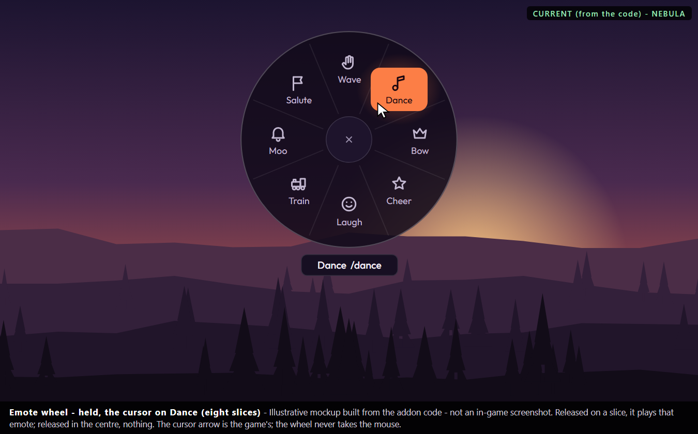
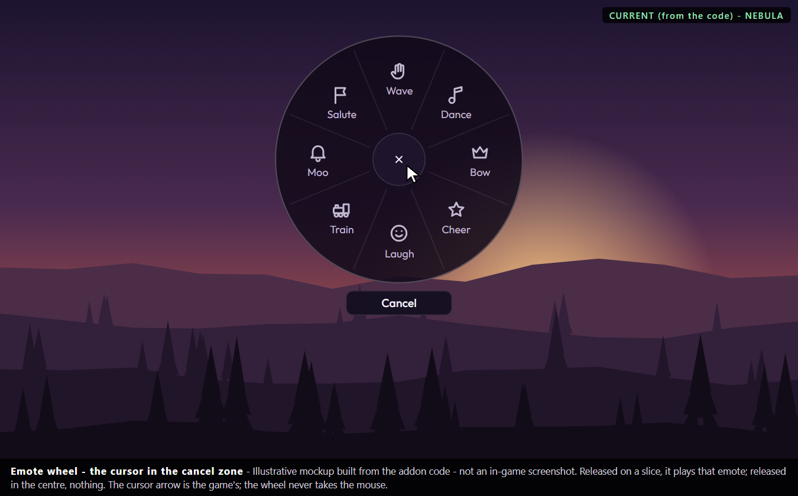
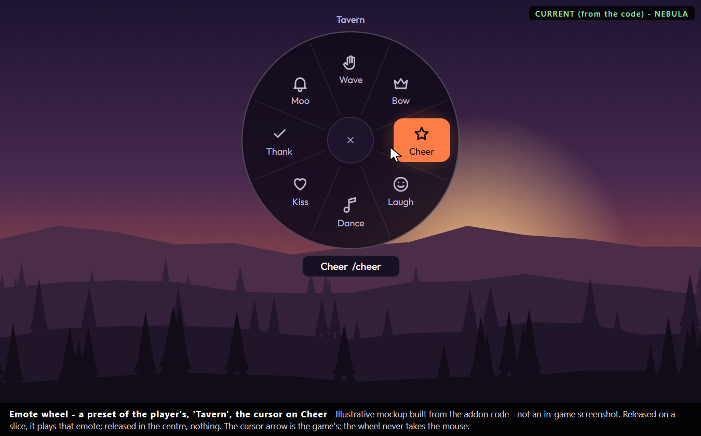
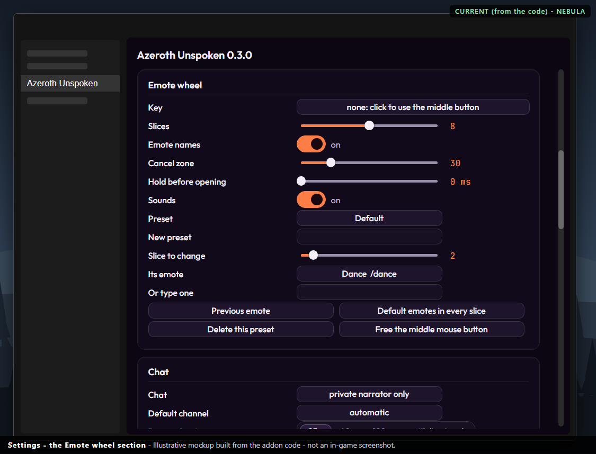
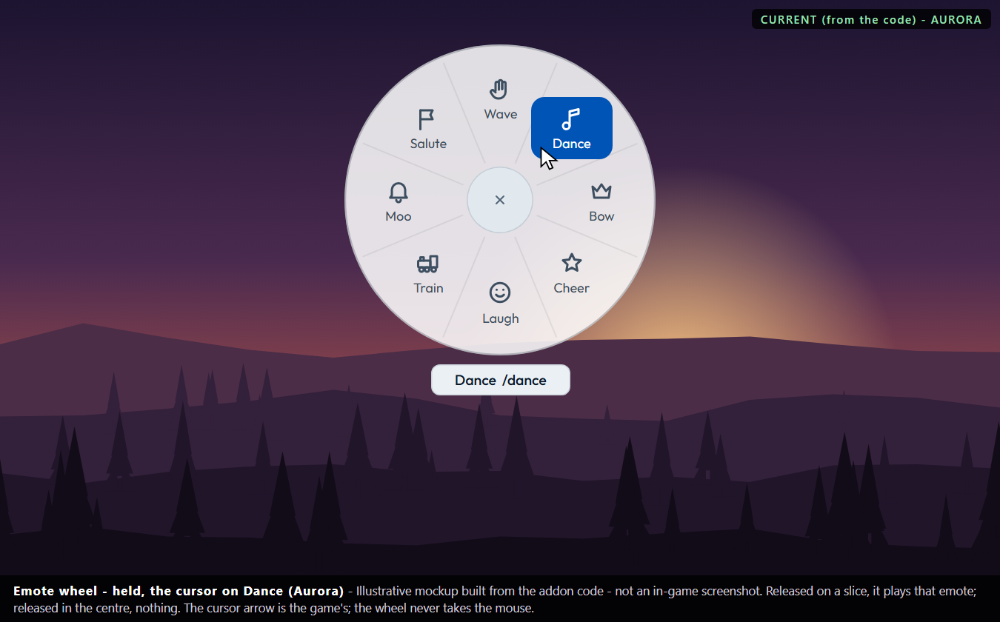

# Emote Wheel

A round menu of the game's emotes: hold a key, move the mouse towards an emote, let go. Your character waves, dances, bows,
pretends to be a train or moos, without typing `/dance` in the chat box.

*Illustrative mockup, not an in-game screenshot: the wheel held, the cursor towards Dance.*

> **Not yet tried in the game.** The wheel is built and tested offline only. How the game reports the key, which emotes it
> lists, the sounds, the size of the wheel at your interface scale, its look and its animations are all still to be checked
> in the game client. If something does not work, see [[Reporting Bugs and Feedback|Reporting-Bugs-and-Feedback]].

## How it works

1. **Hold** the wheel's key. A round, semi-transparent wheel appears **at the mouse cursor**, with eight emotes around it.
2. **Move the mouse** towards an emote. Only the direction counts, not the distance: the slice in that direction lights up,
   with a soft tick, and its name and command are written under the wheel (for example *Dance /dance*).
3. **Let go** of the key. Your character plays the lit emote, with a short confirmation sound, and the wheel fades away.

To **cancel**, move back to the centre (the circle with a cross; the text under the wheel says *Cancel*) and let go there.
Nothing is played.

*Illustrative mockup, not an in-game screenshot: released here, the wheel closes and plays nothing.*

The emote is the game's own: the same as typing its command. Like `/dance`, it is seen by the players around you, and some
emotes say something different when you have a target (`/bow` to your target, for example). The wheel never sends chat
text and never speaks for you.

## Choosing the key

The wheel has **no key until you choose one**. The addon never takes a key by itself.

- **The middle mouse button (the wheel button).** In the settings, *Emote wheel > Key* says *none: click to use the middle
  button*. Click it once: it tells you what the middle button does now, if anything. Click it again within ten seconds to
  give the middle button to the wheel. The same in the chat: `/au wheel bind`. To give the button back: *Free the middle
  mouse button*, or `/au wheel unbind`; the button then does nothing until you bind it again.
- **Any other key or button.** Open the game menu, **Options → Keybindings → AddOns → Azeroth Unspoken**, and bind
  **Emote wheel (hold, release to choose)**.

Keys cannot be changed during a fight: the game refuses it. Do it out of combat.

## The emotes

The wheel shows **8 slices** by default, clockwise from the top:

| Slice | 1 | 2 | 3 | 4 | 5 | 6 | 7 | 8 |
|---|---|---|---|---|---|---|---|---|
| Emote | Wave | Dance | Bow | Cheer | Laugh | Train | Moo | Salute |

With more slices (up to 12) it adds Thank, Kiss, Point and Roar. You can put **any emote the game knows** in any slice:

- In the settings: choose the slice with *Slice to change*, then click *Its emote* to go to the next emote of the game's
  list, or *Previous emote* to go back. Faster: type the emote's name or command in *Or type one* (for example `train`,
  `moo` or `/lol`) and press Enter. *Default emotes in every slice* puts the table above back.
- In the chat: `/au wheel set 3 dance` puts Dance in slice 3. The command of an emote works too: `/au wheel set 5 /lol`.
- `/au emotes` prints every emote the game lists, with its command. The list comes from the game itself, so an emote that
  WoW Forever adds shows up there too.

## Presets

A **preset** is a whole wheel: its own emote in every slice. Keep one for the tavern, one for a fight, one for a ceremony,
and switch between them.

- **The default preset** always exists. You can change its slices and reset them, never delete it.
- **A new preset**: in the settings, type a name in *New preset* and press Enter (or `/au wheel save Tavern`). It starts as
  a copy of the preset shown, and the wheel shows it at once; then change its slices as above. Up to 10 presets, names of
  up to 24 characters.
- **Switching**: click *Preset* in the settings to show the next one, type `/au wheel use Tavern`, or bind the key
  **Emote wheel: next preset**. That key also works while you hold the wheel open: it changes under the cursor.
- **Deleting**: *Delete this preset* in the settings (a second click confirms it), or `/au wheel delete Tavern`. The wheel
  goes back to the default preset.
- `/au wheel presets` lists them; the one shown is marked with `>`. When you have more than one, the wheel writes the name
  of the preset shown above itself.

*Illustrative mockup, not an in-game screenshot: a preset called Tavern, with its own emotes.*

Emotes the addon has a name for are shown in your interface language (English or Italian); any other shows the game's own
command, without the slash.

## Settings

All of them are in the settings panel, section **Emote wheel**, and are shared by the characters of your account.

| Setting | Default | What it does |
|---|---|---|
| Key | none | the middle mouse button, after a second click (see above) |
| Slices | 8 | from 4 to 12 emotes on the wheel; a wheel with more slices is a little wider |
| Emote names | on | the name under each icon; off, only the icons |
| Cancel zone | 30 | the size of the centre circle where letting go cancels, from 16 to 80 |
| Hold before opening | 0 ms | 0 opens the wheel the moment you press the key. Up to 500 ms: a short click then does nothing, and only a held key opens the wheel |
| Sounds | on | the tick when the lit slice changes and the confirmation sound |
| Preset, New preset, Delete this preset | Default | the preset shown, a new one by name, deleting one (see [Presets](#presets)) |
| Slice to change, Its emote, Or type one | | which emote each slice of the preset shown holds (see above) |

The wheel also follows the general settings: the **theme** (Nebula or Aurora), **Neon effects** (the glow behind the lit
slice), **Animations** (off: the wheel appears and goes at once, without its 0.15-second opening and 0.1-second fade) and the
**window scale**.

*Illustrative mockup, not an in-game screenshot: the settings section of the wheel.*

## It never stays on screen

The wheel closes, **without playing anything**, when you press **Esc**, when a fight starts, during a loading screen or a
cinematic, when you hide the interface (Alt+Z), and after 15 seconds. If the game loses the key's release (for example when
another window took the mouse), the wheel notices the key is no longer held and closes within a tenth of a second. A
`/reload` always starts with the wheel closed.

Inside a fight you can still open it: emotes are allowed there.

*Illustrative mockup, not an in-game screenshot: the wheel in the light theme Aurora.*

## See also

- [[Commands Reference|Commands]]: `/au wheel`, its presets, and `/au emotes`.
- [[Settings Reference|Settings]]: every setting of the addon.
- [[Interface Tour|Interface-Tour]]: the other windows.
