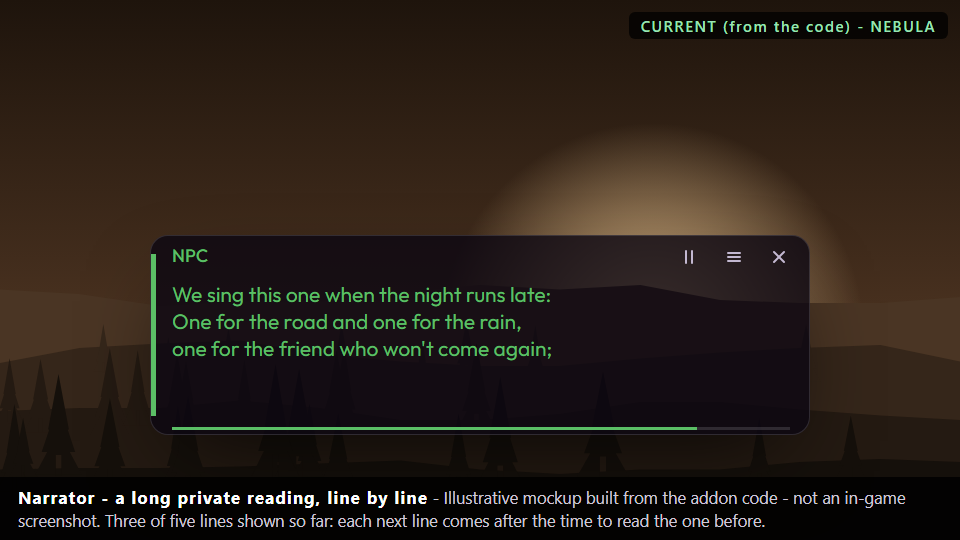
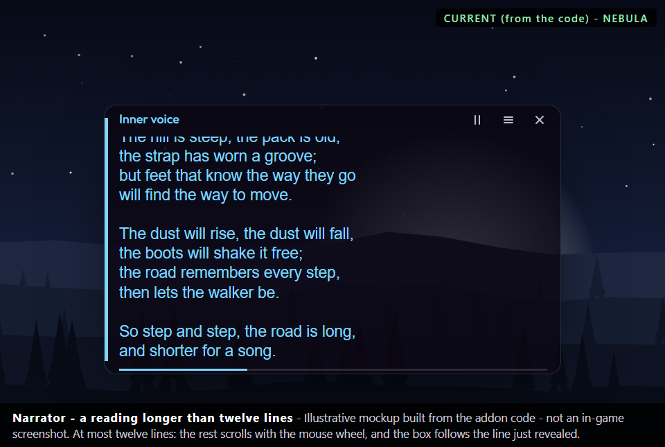
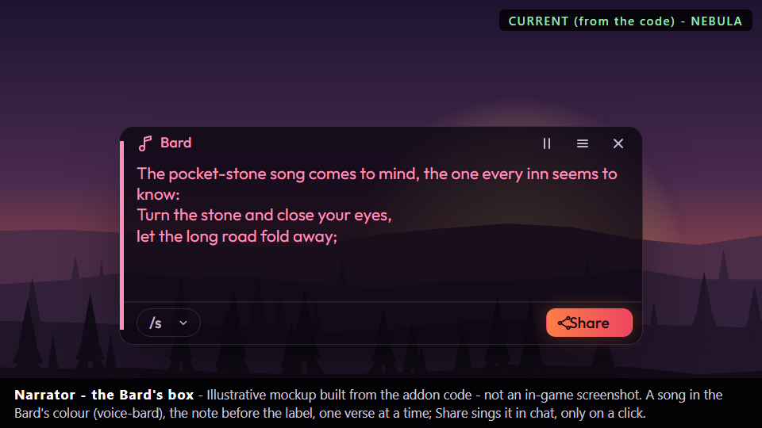
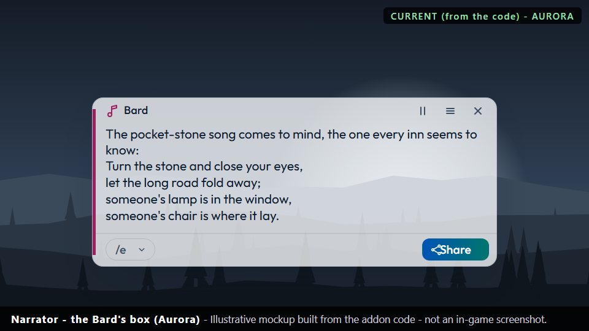
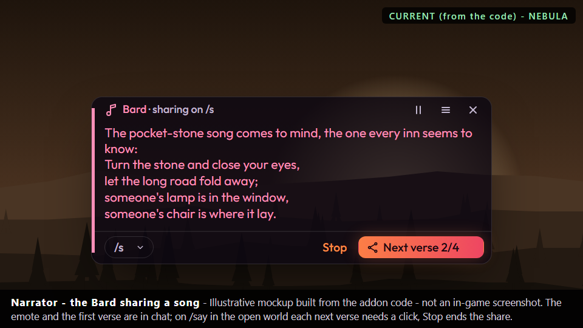
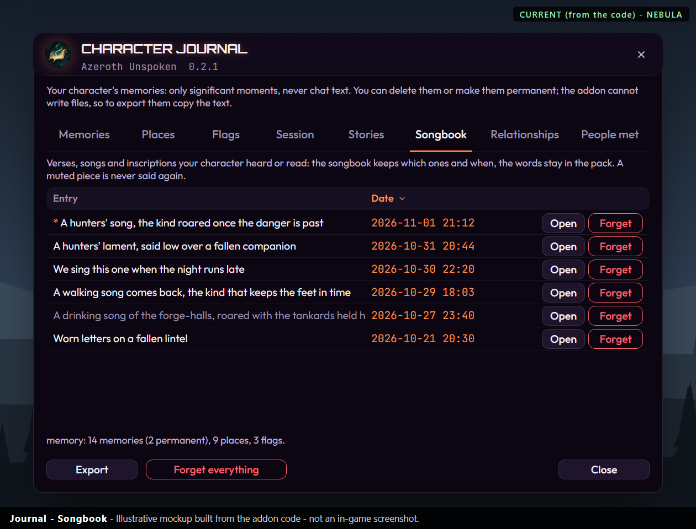
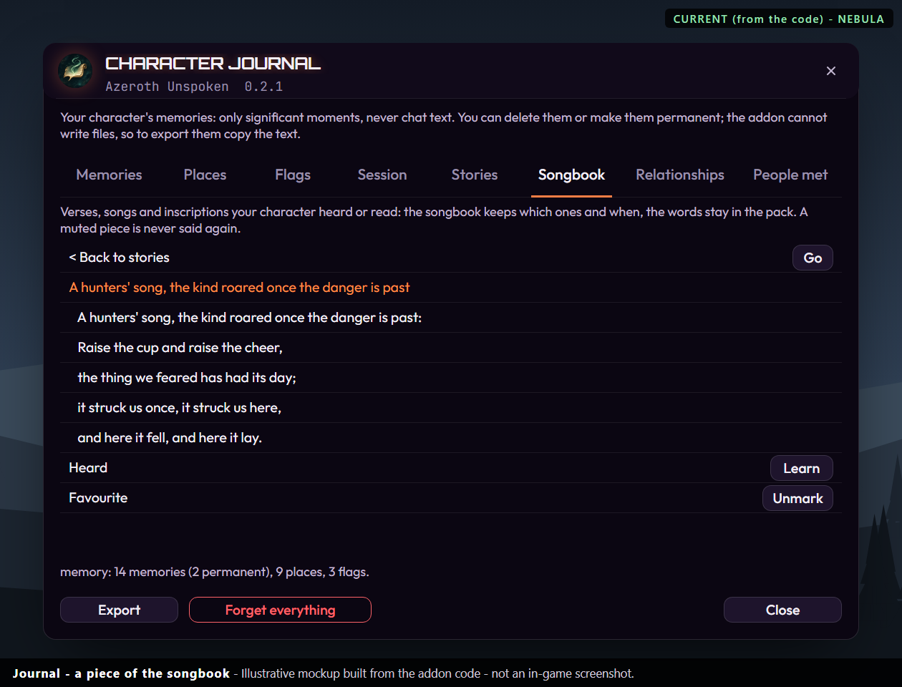

# Literary Forms

Now and then the narrator can offer something older than a passing thought: words carved on a ruined lintel, a verse that comes back when you return somewhere, a rhyme an innkeeper sings, a song for the road, a saying about friends, a hymn, a lament after a lost fight.

## Where they come from

For now these pieces come from an optional pack, **Azeroth Unspoken - Verses** (the folder `AzerothUnspoken_Versi`, pack id `versi`). It holds 43 pieces (seven songs of a nemesis's fall, seven laments for a loss, a piece of each culture of origin, two short tales), each written in English and in Italian. Install it like any other pack: see [[Phrase Packs|Phrase-Packs]].

## What they are like

- **Private, unless you share them.** They appear only in your narrator: the songs, verses and tales your character remembers in the **Bard**'s box (see [The Bard](#the-bard)), inscriptions and formulas in your character's inner voice, an NPC's song in that NPC's voice. They are never offered for chat by themselves, whatever your [[Chat Gateway]] mode, even in automatic mode. Only the Bard's **Share** button sends one, and only when you click it.
- **Rare.** About one piece every 20 to 30 minutes at the default intensity (50), never two within ten minutes at any intensity, never in combat; and each piece comes back at most once every three to seven days. The setting **Literary forms** changes how often (see below).
- **At the right moment only.** The first time you enter a ruin or a holy place; when you return to a place your character remembers; when you sit or ask for news in an innkeeper's [[NPC dialogue|NPC-Dialogues]]; when you use your Hearthstone or travel by spell; on a long ride; when someone you know (a friend, or someone you are wary of) acts toward you; when you pray with `/au pray`; after a lost boss fight; in a quiet moment, at dusk or dawn, or when you come in to rest (a tale, or a piece of your culture of origin).
- **Told, not claimed.** Every song, legend or inscription says who carries it: "worn letters on a fallen lintel", "a proverb from the market stalls", "the kind told to children". These are local color, the sort of thing people say and sing in Azeroth, not the history of the world.
- **One verse per line.** First comes who carries the words (*Worn letters on a fallen lintel:*), then each verse on its own line. The lines appear **one at a time** in the narrator box, each after the time to read the one before, so you can follow a song as it is sung. A long piece (a tale) makes the box taller, up to twelve lines; beyond that, scroll it with the **mouse wheel** over the text. With **Animations** off (Settings > Appearance), the whole piece appears at once. The history keeps the verses on separate lines too. See [[The Narrator|The-Narrator]].
- **The right piece for the moment.** Each piece knows what it is (a verse, a song, a saying, an inscription...), what it is for (to remember, to mourn, to amuse, to keep you company on the road...) and whose it is (something anyone could have heard, or your own). Nobody sings a tavern rhyme in a cursed land or right after a death, an inscription appears where there is stone to carve it, and a piece that speaks of the night comes in the evening or at night. The hymn and the late inn song, for example, come only after dusk.
- **Songs that change.** Some songs have several verses, of which you hear one or two each time, always in their order and always with the same refrain, so a song you have heard before can still surprise you. The walking song of the Verses pack, on a long ride, is the first: four verses, two at a time. The inn song the regulars strike up when you sit down with an innkeeper is the second: four verses, one at a time.
- **Your prose depth counts.** At the *natural* depth the road songs come out as one short sentence, and the other pieces are rarer. See [[Intensity and Prose Depth|Intensity-and-Depth]].
- **Your topics count.** The hymn touches religion and the lament touches death: if you chose to avoid those topics in your character's profile, they do not appear. See [[Character Soul and Total RP 3|Character-Soul-and-Total-RP-3]].



*Illustrative mockup, not an in-game screenshot: a verse appears one line at a time; the box is as tall as the whole text from the start.*



*Illustrative mockup, not an in-game screenshot: past twelve lines the text scrolls with the mouse wheel, and the box follows the line just revealed.*

## The Bard

The songs, rhymes, hymns, laments, verses and tales your character remembers appear in a box of their own: the **Bard** (*Bardo* in Italian). It is the narrator box in another colour, a rose on the dark theme and a wine red on the light one, with a small **note** before the label "Bard". Everything else works as for any line: the verses appear one at a time, a long piece scrolls past twelve lines, the history keeps it (labelled *Bard*, in its colour), the pause and the close button work, and with **Animations** off the whole piece appears at once.

Not every literary piece is the Bard's. **Inscriptions** and solemn **formulas** are read, not sung: they stay in the inner voice. A song an **NPC** sings (the innkeeper's rhyme, for example) stays in that NPC's voice. A piece that comes back to mind later follows the same rule.



*Illustrative mockup, not an in-game screenshot: a song in the Bard's colour, three of its lines shown so far; under it the Share bar.*



*Illustrative mockup, not an in-game screenshot: the same box on the light theme (Aurora), with /emote chosen.*

### Sharing a piece in chat

Under a Bard piece the box has a **Share** bar: on the left the channel, **/s** (`/say`) or **/e** (`/emote`) (click it to change), on the right **Share**. Nothing is sent until you click it. Then:

1. the first line of the piece (who carries it, *"The pocket-stone song comes to mind..."*) is replaced by an **emote** on `/emote`: *Elyra sings an old song:* (or *recites a few verses:*, *tells an old tale:*);
2. the verses follow, **one message per verse**, a few seconds apart (at least 4 seconds, or the Chat Gateway's own pause if it is longer); the empty line between two stanzas is skipped;
3. on `/emote` each verse is written in quotes after your name, and the share goes on by itself until the last verse;
4. on `/say` in the open world the game wants a click for every message: the button becomes **Next verse 2/4** and each click sends one. Inside an instance `/say` goes on by itself, like `/emote`.

While a piece is being shared it stays in the box (other lines wait in the history), the label says *sharing on /s*, and **Stop** ends the share; so does the box's close button. A share also stops when a fight begins, when Total RP 3 says you are out of character, and after two minutes without a click. Each message obeys the Chat Gateway's rules: at most 255 bytes, never two within its pause, never more than its messages per minute (the share waits), nothing while the game holds chat. The Bard **never** shares by itself, in any mode, also in automatic mode. A piece of a single line has no Share bar: there is nothing to sing line by line.



*Illustrative mockup, not an in-game screenshot: the emote and the first verse are in chat; Next verse sends the second, Stop ends the share.*

You can also share a piece you heard before: open it in the **Songbook** tab of the journal, and click **/say** or **/emote** on the row *Share it in chat, line by line*. The piece appears again in the Bard's box and the share starts.

### The Bard's settings and commands

| Setting | Default | Where | Command |
|---|---|---|---|
| **Bard** | on | Settings > General | `/au bard on\|off` (off: songs and verses appear in the inner voice, as before) |
| **Share button** | on | Settings > General | `/au bard share on\|off` (off: no Share bar, no Share row in the songbook) |
| **Share on** | /say | Settings > General, or the chip of the Share bar | `/au bard channel say\|emote` |
| How often pieces come | rare | Settings > General, **Literary forms** | `/au literary never\|rare\|normal` |

`/au bard` alone shows the three settings. `/au bard sing [say|emote]` shares the last Bard piece shown, `/au bard next` sends the next verse (a typed command counts as a click), `/au bard stop` ends a share.

## Trying them

You do not need to wait for the right place. Type:

```
/au event lore_test
```

Each time, the narrator shows one of the pieces, picked at random, in your language. Trying a piece this way does not use it up: it can still appear by itself later.

## How often: the setting "Literary forms"

In the [[settings panel|Settings]] (General), the row **Literary forms** cycles through three values, or type `/au literary`:

| Value | What it means |
|---|---|
| **Rare** (default) | About one piece every 20-30 minutes at intensity 50, never two within ten minutes. Fewer at a low [[intensity|Intensity-and-Depth]], a little more at a high one. |
| **Normal** | About twice as often, still never two within ten minutes. |
| **Never** | No literary piece at all, not even with `/au event lore_test`. |

They never come during a fight, whatever the setting.

## The songbook

Every piece your character hears or reads goes in the **songbook**: the tab **Songbook** of the [[journal|Memory-and-Journal]], or `/au songbook`. It keeps **which** pieces and **when**, never their words: the words are read from the pack when you open a piece, so a piece whose pack you removed is listed by its name only, until you forget it. Open a piece to read it whole, and:

- **Learn** it by heart, or mark it as a **Favourite**: it comes back to mind more often, and a favourite heads the list;
- **Mute** it: it is never said again, anywhere, until you let it speak again;
- **Forget** it (two clicks): it leaves the songbook and can be heard again.

When a [[nemesis|Relationships]] falls by your hand, a **song of its fall** is added to the songbook (a victory song after one meeting, a feud song after a long feud, or an old saying that mourns a fallen foe), and a private notice gives its title. It needs the verses pack; with the literary forms set to *never* no song is added.

With a **grief** (your pet falls, an NPC you were close to is found dead, a companion of the road dies beside you: see [[Relationships]]) a **lament** for that loss is added the same way, with a private notice. Never in chat, never during a fight.

The songbook keeps at most about 300 pieces (well under 10 KB); when it is full the oldest pieces you only heard make room. `/au songbook list` prints it, `/au songbook reset` empties it. With the memory turned off nothing is noted.



*Illustrative mockup, not an in-game screenshot: the Songbook: the pieces your character heard, a favourite first, with their marks.*



*Illustrative mockup, not an in-game screenshot: a piece open in the Songbook, with its marks: learned by heart, favourite, muted.*

## A verse that comes back

Some hours after you heard a piece, at a quiet moment (resting at an inn, a long ride, dusk, nightfall, a change of weather), it may **come back to mind**: a line such as *A tune I heard somewhere starts up again in my head:* and then its verses, in the inner voice. An inscription comes back as something read (*The words cut in that stone come back to me, letter by letter:*). Only a piece the songbook says you really heard can come back, never in a fight, never in chat, never with the inner voice turned off, and always as rare as the other pieces.

## Your culture of origin

In the [[character soul|Character-Soul-and-Total-RP-3]] you may choose the **culture of origin**: the people your character grew up among. Only your choice counts, never race or class: a human raised among the kaldorei can choose *Kaldorei*. A piece of that culture comes more often; a piece of another culture comes only from someone else's mouth (an innkeeper sings it), never as your character's own; with no culture chosen, only the pieces that belong to no culture are said. Every culture has at least one piece of its own: a plowing song of the human farms, a dwarven drinking song, a gnomish workshop rhyme, a kaldorei watch-song at moonrise, a verse of the quel'dorei exiles, an orcish marching chant, a troll saying of the tide, a tauren dawn blessing, a dry saying of the Forsaken; and some songs of a fall and laments belong to a people too. An innkeeper may also tell a tauren tale or repeat an orcish saying, which anyone with a culture chosen can hear.

## Turning them off

Choose **Never** (above), or type `/au pack versi off` (and `/au pack versi on` to bring them back), or simply do not install the `AzerothUnspoken_Versi` folder.

## Tell us what you think

This pack is a trial. If a piece sounds wrong, comes at the wrong moment or too often, appears too fast or too slowly line by line, or does not fit in the box, please say so: see [[Reporting Bugs and Feedback|Reporting-Bugs-and-Feedback]].
