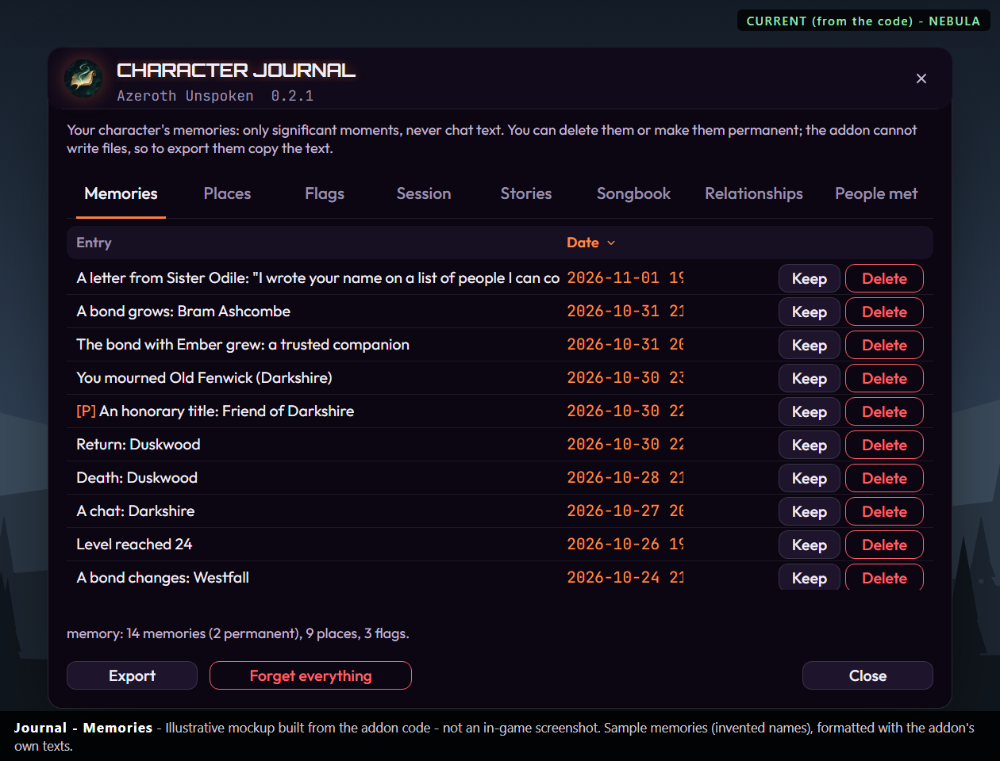
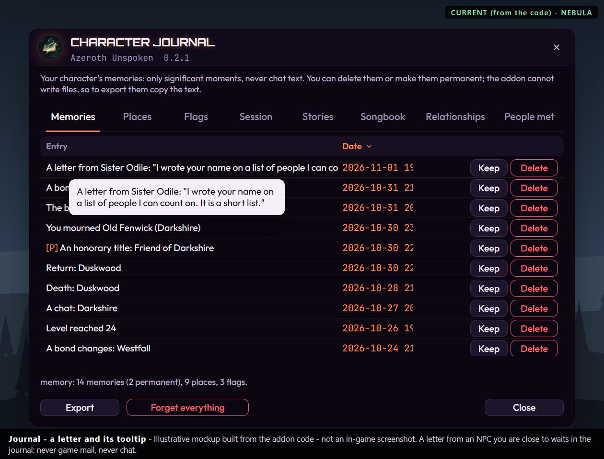
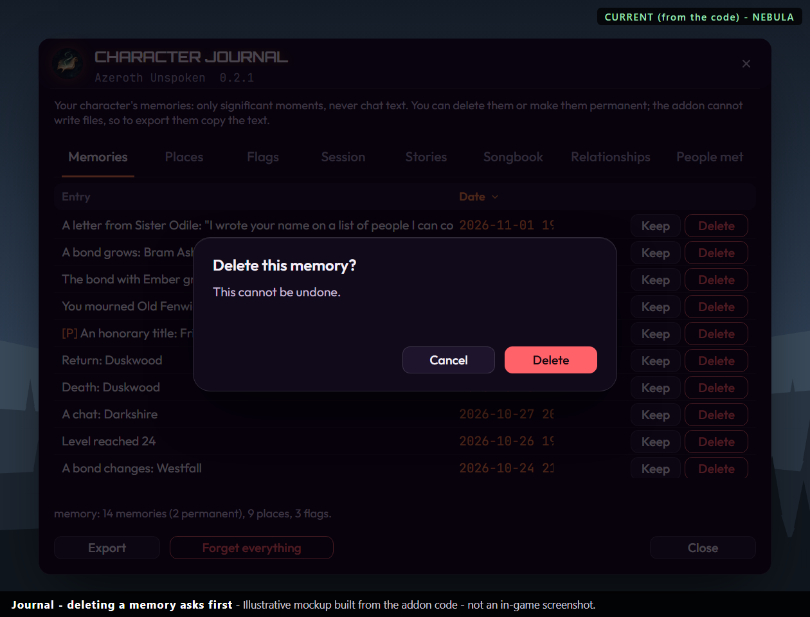
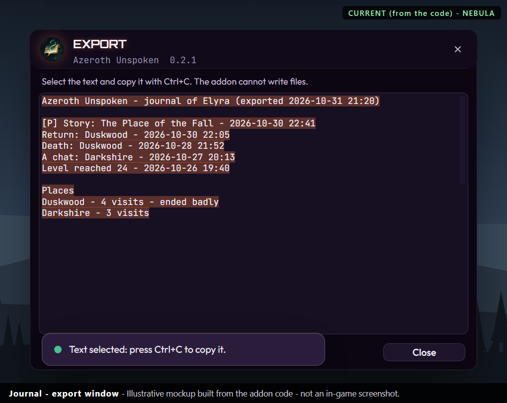

# Memory and Journal

**Living Memory** lets the narrator remember what your character has lived through, and recall it later. The **journal** is where you read, keep or erase those memories.

## What it is

The addon keeps only **significant moments**, never chat text. For example:

| Memory | When it is saved |
|---|---|
| **First visit** | the first time you enter a zone (a capital counts more) |
| **Return** | you come back to a zone after at least a day away |
| **Death** | you die (two deaths in the same zone within a minute count as one) |
| **Flight** | you leave a zone in combat or with low health (below about a third) |
| **Level reached** | you gain a level (every tenth level is a milestone) |
| **Story** | a [[personal story|Story-Arcs]] ends |
| **A bond changes** | a [[relationship|Relationships]] changes in a meaningful way |
| **An oath broken** | you abandon a quest you had sworn to an NPC who was your friend (see [[Relationships]]) |
| **A favor done** | you did a small favor a friendly NPC asked of you (see [[Relationships]]) |
| **A nickname** | a close friend among the NPCs gave your character a nickname: the line shows it (see [[Relationships]]) |
| **Guest-right broken** | you raised your hand against the innkeeper of your hearth, or under their roof (kept for good, the town only; see [[Relationships]]) |
| **An honorary title** | a town gives you a title for the first time, such as *Friend of Goldshire* (kept for good; see [[Relationships]]) |
| **A bond with a companion** | the bond with your pet becomes *trusted* or *beyond words* (kept for good; see [[Relationships]]) |
| **A companion fallen** | your pet died |
| **Mourning** | you found dead an NPC you were close to (kept for good) |
| **A companion of the road lost** | a member of your group died beside you (no name is kept) |
| **A letter** | an NPC you are close to wrote to you while you were away: the line is the letter (kept for good; never game mail) |
| **A chat** | you finish an [[NPC ambient dialogue|NPC-Dialogues]] |

It also remembers **places**: how many times you visited, when first and last, and whether the last visit ended badly.

### Honest recall

The narrator only says *"I remember this place"* when there **really is** a memory behind it. It never pretends. A return after one day might bring a line about the first time you came; coming back to where you fell might bring a darker thought. If there is no memory, there is no recall line.

Memory is saved **per character**.

## How to use it

### The journal window

Open it with `/au journal` or the **Character journal...** button in the [[settings panel|Settings]]. Close it with **Esc**, the **X** at the top right of its title band or **Close**. Drag the window by any free spot to move it; its size follows the **Window scale** setting.

| Tab | Shows |
|---|---|
| **Memories** | your saved memories, newest first, with their date |
| **Places** | the places you remember, with visits and whether the last one ended badly |
| **Flags** | narrative flags (small markers set by stories, dialogues or you) |
| **Session** | the moments of this session only; forgotten when you log out |
| **Stories** | your [[personal stories|Story-Arcs]] |
| **Songbook** | the verses, songs and inscriptions your character heard or read (see [[Literary Forms|Literary-Forms]]): open one to read it whole, learn it by heart, mark it as a favourite, mute it or forget it |
| **Relationships** and **People met** | a view of your [[relationships|Relationships]] |

The tabs sit in one row under the short introduction, however many lines it takes at your text size. The open tab is brighter and has a **2-unit bar** under its name that slides from the tab you left to the one you chose (at once when **Animations** are off), so it does not depend on colour alone. A tab's note, such as *"This session only"*, sits on its own line under the tabs. The rows are a **table** that scrolls with the mouse wheel (there are no pages): the text of the entry, its date in the monospaced font, and the buttons of the row. Click a column title (**Entry**, **Date**) to sort by it; click it again to reverse the order, and the sorted column is marked with an arrow. Each tab keeps the order you chose while the window is open. The Stories tab and an open song are read in their own order, so they have no column titles and do not sort. A row too long for the window is cut: point at it to read it whole in a tooltip.

On each row you can:

- **pin** a memory to make it **permanent** (it is never compacted), or unpin it;
- **delete** a memory;
- **forget** a place (the next visit counts as a first visit again);
- **clear** a flag.

Deleting, forgetting and clearing cannot be undone, so their buttons have the red outline of the actions that lose data and **ask in a dialog** over the window: *"Delete this memory?"* with *This cannot be undone.*, the action's own word as the red button (**Delete**, **Forget**, **Clear**) and **Cancel**. **Esc**, **Cancel** or closing the window cancels the question and changes nothing; **Esc** closes only the dialog, not the journal. When you confirm, a short **toast** says what happened (*Memory deleted.*, *Place forgotten.*, *Flag cleared.*)  and goes by itself after a few seconds. Keeping a memory, or opening a story, asks nothing: you can undo it.

At the bottom:

- **Export** shows the whole journal as text, in a window of its own that scrolls to the end however long the journal is. The text is already selected: press **Ctrl+C** to copy it (a toast says so); **Esc** or the **X** closes it. The addon cannot write files, so copying is the way to keep a copy outside the game.
- **Forget everything** (red outline) erases the memory. It asks in the same kind of dialog (*"Forget everything?"*, *Erases every memory, place and flag. The relationships stay. This cannot be undone.*) and confirms with a toast. It does not touch relationships.
- **Close**.

A line under the table sums up what the journal holds. The colours of the window follow the theme you chose in **Settings > Appearance** at once, without `/reload`.

## Commands

| Command | What it does |
|---|---|
| `/au journal` | opens the journal window |
| `/au journal list` | prints a summary and the 8 newest memories with their numbers |
| `/au journal places` | prints the places you remember |
| `/au journal flag` | lists the flags |
| `/au journal flag <name>` | sets a flag, or clears it if already set (letters, digits and `_`) |
| `/au journal export` | shows the journal as text to copy |
| `/au journal pin <n>` | makes memory `n` permanent, or not |
| `/au journal delete <n>` | deletes memory `n` |
| `/au journal forget <place>` | forgets a place |
| `/au journal reset [what]` | erases memories (see below); asks for confirmation |
| `/au memory` | clears the list of **lines already used** (see below) |

### Resetting

`/au journal reset` erases part or all of the memory. Choose what:

| Value | Erases |
|---|---|
| `all` (default) | everything |
| `memories` | all memories |
| `ordinary` | memories that are not permanent |
| `places` | the places |
| `flags` | the flags |

The addon asks you to **repeat the same command within 15 seconds** to confirm. If you do not, nothing is erased.

### Two different "memories"

- The **journal** holds your character's memories, described on this page.
- `/au memory` clears something else: the list of **lines recently used**, which the addon keeps so it does not repeat itself. Clearing it lets familiar lines come back sooner. It does not touch the journal and asks no confirmation.

## Examples

- See your last memories: `/au journal list`, then keep the one you like: `/au journal pin 12`.
- Make a place feel new again: `/au journal forget Elwynn Forest`.
- Mark something for yourself: `/au journal flag met_the_stranger`.
- Start a character's memory over: `/au journal reset all`, then the same command again within 15 seconds.

## Limits

To keep things light, the journal keeps up to **500 ordinary memories** per character. Above that, the least significant and oldest ones are dropped first. **Permanent** memories are never dropped (up to 200). Up to 300 places and 1,000 flags are kept. Small moments of low importance stay only in the **Session** tab.

## Settings

| Setting | Default | Where |
|---|---|---|
| Memory module | on | [[settings panel|Settings]], modules |

With the module off, nothing new is remembered, recall lines stop, and `/au journal` says that memory is off.

The journal window can still be opened from the settings panel. Its memory tabs then say *"Memory is off: turn it on in the settings"* under the tabs: you can read the journal, but the row buttons and **Forget everything** are greyed out. The same happens, with *"Read-only: saved by a newer version of the addon"*, when the memory was saved by a newer version of the addon. The Stories, Relationships and People met tabs follow their own modules.

## What you will see

- New entries in the journal after the moments listed above. There is no pop-up when a memory is saved.
- Now and then, a line that recalls a real memory, in the narrator box.
- After a command, a short confirmation in your chat window, such as *"memory #12 is now permanent."*

*Illustrative mockup, not an in-game screenshot: the Memories tab, with a letter, a bond that grew, a companion and a grief.*

*Illustrative mockup, not an in-game screenshot: a letter from an NPC you are close to; a row too long for the window shows its whole text when you point at it.*

*Illustrative mockup of the earlier look, not an in-game screenshot: the old way of asking, a second click that turned the button into OK. Since UI-5 the window asks in a dialog instead (see above); the mockups are redrawn in the last step of the new look.*

*Illustrative mockup, not an in-game screenshot: Export opens the journal as text, selected and ready to copy.*

## Tips

- Pin the memories that define your character, so they stay forever.
- Export the journal now and then and paste it into your RP notes or a document.
- If you play a character who "forgets", reset the ordinary memories and keep only the pinned ones.
