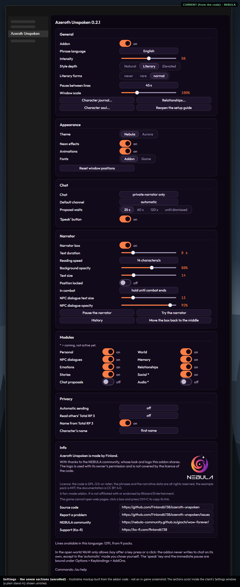
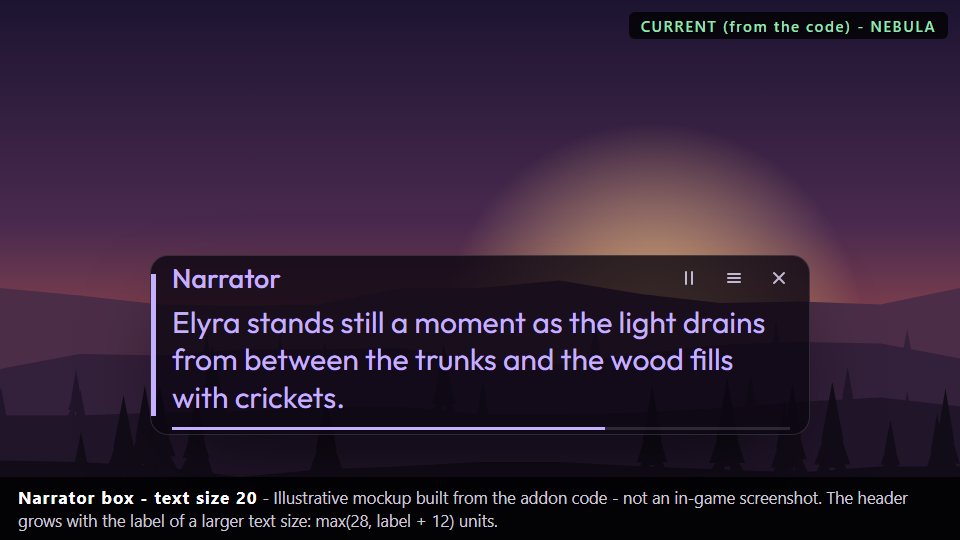

# Settings Reference

Every setting of Azeroth Unspoken, its default value and where to change it.

## Where settings live

- **The settings panel.** Open it with `/au options`. It is also listed among the game's addon options, under **Azeroth Unspoken**. It has seven sections under their headers: **General**, **Appearance**, **Chat**, **Narrator**, **Modules**, **Privacy** and **Info**; scroll to see them all. The page follows the theme you choose in Appearance, and each section is a card with its own title. Each row is a name, with its control next to it: a **switch** for an on/off setting (it slides to the right when on, and the word *on* or *off* is written next to it), a row of **segments** for a choice among a few short words (the chosen segment is the raised, bright one), a **slider** with **-** and **+** for a number (its value is written beside it in the mono font; the mouse wheel scrolls the page and never moves a slider here), or a button that shows the value and goes to the next one when the choices are too many or too long for segments (the language, the chat mode, the channel, the pause, the reading speed, the combat behaviour, the character's name) and for the two consents, which say their state in words. A value button grows to fit a long value. A row of buttons at the end of General and Narrator opens a window or acts once.
- **Commands.** Many settings also have a command. See the [[Commands Reference|Commands]].
- **Windows.** Personality, journal, relationships and stories have their own windows, with their own choices. Every window has a title bar with the addon's round logo and the window's name, a close box at the top right, and closes with **Esc**. Drag a window by its title bar or its body: it opens in the same place next time, for that character (**Reset window positions** in Appearance puts every window back). The NPC dialogue window is the exception to Esc, because Esc also closes the game's own NPC windows (see [[NPC Dialogues|NPC-Dialogues]]).
- **The wizard.** The [[setup wizard|First-Run-Wizard]] sets the most important ones in one go.

**Per account or per character?** General settings (everything on this page unless noted) are shared by all characters on your account. Personality, memories, relationships and stories belong to **each character**; the only exception is the optional **Share with the account** list of relationships (off by default), which keeps your choices about people in the account.

Changes take effect at once. There is no Save button.

*Illustrative mockup, not an in-game screenshot: the five sections of the panel, unrolled (in game they scroll).*

## General

| Setting | Default | Panel row | Command | What it does |
|---|---|---|---|---|
| Addon on/off | on | **Addon** | `/au on`, `/au off` | Off: no spontaneous lines, no NPC dialogues, stories stop. Commands still work. |
| Phrase language | English (`en`) | **Phrase language** (click to cycle) | `/au language it` | Language of lines and interface. Choose it in the wizard or with the command. See [[Languages]]. |
| Intensity | 50 | **Intensity** (- / + by 10) | `/au intensity <0-100>` | How often the narrator speaks. 0 = silent for spontaneous events. |
| Style depth | Literary | **Style depth** (three segments) | `/au depth natural\|literary\|elevated` | Which style of line is preferred. |
| Literary forms | Rare | **Literary forms** (three segments) | `/au literary never\|rare\|normal` | How often verses, songs, inscriptions and tales come, in the private narrator (never offered for chat by themselves; only the Bard's Share sends one) and never in combat. Rare: about one every 20-30 minutes at intensity 50. Normal: about twice as often. Never: none at all. See [[Literary Forms|Literary-Forms]]. |
| Bard | on | **Bard** (switch) | `/au bard on\|off` | The songs, verses and tales your character remembers appear in the Bard's box, in its own colour. Off: in the inner voice, as before. See [[Literary Forms|Literary-Forms#the-bard]]. |
| Share button | on | **Share button** (switch) | `/au bard share on\|off` | The Bard's box and the songbook offer **Share**, which sings the piece in chat line by line, only on your click. Off: no Share button. |
| Share on | /say | **Share on** (two segments) | `/au bard channel say\|emote` | The channel of a share. The first line is always an emote; on `/say` in the open world each verse needs a click. |
| Pause between lines | 45 s | **Pause between lines** (cycles 15, 30, 45, 60, 90, 120, 180) | `/au cooldown <0-3600>` | Minimum pause between two spontaneous lines. |
| Window scale | 100% | **Window scale** (- / + by 10%) | — | 80–150%. The size of the journal, export, relationships, character soul, setup guide and NPC dialogue windows. Open windows follow at once. The narrator box has its own **Text size**. |
| Event probability | per event, see below | — | `/au chance <event> <0-100>` | Chance that an event produces a line. |
| Ignored spells | none | — | `/au ignore <spell>` | Spells that never produce lines. |
| Phrase packs on/off | all on | — | `/au pack <id> on\|off` | See [[Phrase Packs|Phrase-Packs]]. |

General ends with buttons that open the **Character journal...**, **Relationships...** and **Character soul...** windows, and **Reopen the setup guide**.

See [[Intensity and Prose Depth|Intensity-and-Depth]] for how intensity, depth and the pause work together.

### Default event probabilities

These are the chances before intensity is applied. Intensity 50 keeps them as they are; lower intensity makes them smaller, higher intensity makes them bigger (up to double at 100). Important moments (death, coming back to life, a level, resurrecting someone) never get rarer than at 50. `/au chance` with no values lists the current ones.

| Event | When | Chance |
|---|---|---|
| `zone` | you enter a new zone | 40% |
| `battle` | a fight starts | 35% |
| `victory` | a fight ends well | 30% |
| `lowhp` | your health gets low | 60% |
| `death` | you die | 85% |
| `rez` | you come back to life | 70% |
| `levelup` | you gain a level | 100% |
| `attack` | you cast an attack spell | 8% |
| `heal` | you cast a heal, or (warrior, rogue, hunter, mage) put a bandage on yourself; a line that speaks to the one you heal is said only when the heal goes to someone else, never on a potion or a heal on yourself | 15% |
| `buff` | you cast a buff; out of combat also a warrior's Battle Shout, a rogue's poison or sharpening stone, a hunter's aspect; a line that speaks to the one you buff is said only when the buff goes to someone else | 25% |
| `travel` | you cast a travel spell | 60% |
| `rezother` | you resurrect someone | 80% |
| `weather_change` | the weather changes and stays changed | 60% |
| `dawn`, `dusk` | the game passes from night to day, or from day to night | 50% |
| `subzone_enter` | you enter a new subzone | 30% |
| `landmark` | you enter a named place (an inn, a village, a graveyard...) | 50% |
| `quest_progress` | a quest step is finished, or a quest is ready to hand in | 35% |
| `quest_complete` | you hand in a quest | 75% |
| `reputation_change` | your standing with a faction goes up or down | 70% |
| `rest_enter` | you start resting (an inn, a city) | 55% |
| `journey` | a flight starts or ends | 70% |

Events added by phrase packs have their own default (30% if the pack sets none).

## Appearance

The look of every window of the addon, shared by the characters of your account. Each change shows at once, without `/reload`.

| Setting | Default | Panel row | What it does |
|---|---|---|---|
| Theme | Nebula | **Theme** (two segments) | **Nebula** is dark, **Aurora** is light. Both keep the text readable (4.5:1 contrast). |
| Neon effects | on | **Neon effects** | The glows and soft shadows of the windows and buttons. Off: a flat look. |
| Animations | on | **Animations** | Fades and short movements of the windows, the buttons and the narrator box. Off: everything changes at once. It replaces the narrator's older **Reduce motion** (that setting is no longer used; if you had it on, Animations started off). With Animations off the narrator box appears at once, with no time line. |
| Fonts | Addon | **Fonts** (two segments) | **Addon**: the addon's own fonts (Outfit, JetBrains Mono, Orbitron for the window titles). **Game**: the game's fonts. If a font file cannot be read, the game's font is used for it anyway. |
| Window positions | first place | **Reset window positions** | The windows remember where you left them, per character. This button puts them all back. |

## Emote wheel

The [[emote wheel|Emote-Wheel]]: hold its key, point at an emote, let go. Shared by the characters of your account; each
change counts the next time the wheel opens.

| Setting | Default | Panel row | What it does |
|---|---|---|---|
| Key | none | **Key** | The wheel has no key until you choose one. The first click says what the middle mouse button does now; a second click within ten seconds gives it to the wheel (never in combat). Any other key: the game's Key Bindings, *Emote wheel (hold, release to choose)*. |
| Slices | 8 | **Slices** (4 to 12) | How many emotes the wheel shows; a wheel with more slices is a little wider. |
| Emote names | on | **Emote names** | The name under each icon. |
| Cancel zone | 30 | **Cancel zone** (16 to 80) | The size of the circle in the centre where letting go plays nothing. |
| Hold delay | 0 ms | **Hold before opening** (0 to 500 ms) | 0: the wheel opens on the press. Longer: a short click does nothing, only a held key opens it. |
| Sounds | on | **Sounds** | A tick when the lit slice changes and a sound when an emote is played. |
| Presets | one, *Default* | **Preset**, **New preset**, **Delete this preset** | A preset is a whole wheel with its own emote in every slice. A click on *Preset* shows the next one; a name and Enter in *New preset* makes a copy of the one shown and shows it; *Delete this preset* asks for a second click (the default preset cannot be deleted). Up to 10. Also `/au wheel save`, `use`, `delete`, `presets`, and the key *Emote wheel: next preset*. |
| The emote of each slice (of the preset shown) | Wave, Dance, Bow, Cheer, Laugh, Train, Moo, Salute (then Thank, Kiss, Point, Roar) | **Slice to change**, **Its emote**, **Or type one**, **Previous emote**, **Default emotes in every slice** | Choose a slice, then click its emote to go through the game's list, or type an emote's name or command and press Enter. Also `/au wheel set <slice> <emote>`. |
| | | **Free the middle mouse button** | The middle button no longer opens the wheel. Also `/au wheel unbind`. |

## Chat

| Setting | Default | Panel row | Command | What it does |
|---|---|---|---|---|
| Chat mode | Private narrator only | **Chat** (cycles private, preview, confirm) | `/au mode private\|preview\|confirm` | What may reach chat. |
| Automatic sending | off | **Automatic sending**, in the **Privacy** section (a confirmation dialog, then **Turn on**; or click again after a couple of seconds) | `/au mode auto` (twice, a few seconds apart) | Lets some lines go out by themselves, in your character's name, seen by everyone nearby. The row says *off, read first*, then *off, confirm*, then *on*. If the game client blocks an automatic send, nothing goes out by itself for the rest of the session: every line waits for you to confirm it, and the row says *on, held: confirm to send until /reload*. Choosing automatic sending again, or `/reload`, turns it back on. |
| Default channel | automatic | **Default channel** (click to cycle) | `/au channel <channel>` | Where proposals go. Automatic = `/say` for your character's words, `/emote` for the narrator's. To change the channel of the proposal that is waiting, click its channel chip, use the **Next channel** key or type `/au channel next`. |
| Speak button | shown | **'Speak' button** | `/au button` | Shows or hides the speak button. `/au button editor on` makes a click open the editor instead of sending (see [[Chat Gateway]]). |
| Proposal waits | 25 s | **Proposal waits** (four segments: 25, 60, 120 s, until dismissed) | — | How long a proposal waits before it expires. The time stops while the mouse is over the narrator box and while you edit the proposal. *Until dismissed*: it waits until you send or discard it. |
| Chat proposals module | on | module **Chat proposals** | — | Off: the same as private mode. |

These limits are fixed and cannot be changed:

| Limit | Value |
|---|---|
| Minimum time between two sends | 4 seconds |
| Sends per minute, any channel | 6 |
| Automatic sends per minute | 2 |
| Longest message | 255 bytes; longer lines are cut with "..." |

See [[Chat Gateway]].

## Narrator box

| Setting | Default | Panel row | Range |
|---|---|---|---|
| Narrator box on/off | on | **Narrator box** | Off: lines appear in your chat window instead, visible only to you. |
| Text duration | 8 s | **Text duration** (- / + by 1) | 2–30 s. The base time; the reading time of the line is added to it. |
| Reading speed | 14 characters/s | **Reading speed** (click to cycle) | 8, 11, 14, 18 or 24 characters a second. Each line stays the text duration plus its length divided by this speed: slower = longer on screen. |
| Background opacity | 80% | **Background opacity** (- / + by 5%) | 55–100%. Only the box's background: the text always stays fully opaque, so it stays readable over bright scenes. |
| Text size | 14 | **Text size** (- / + by 1) | 10–28. The voice label is 12 or more. |
| Position locked | no | **Position locked** | Locked: the box cannot be dragged. |
| In combat | hold until combat ends | **In combat** (click to cycle) | `/au combat show\|chat\|hold\|silent`. What a spontaneous line does during a fight. **Show**: as before, in the box. **Chat frame only**: written in your chat window (visible only to you) and in the history, not in the box. **Hold until combat ends** (default): nothing on screen during the fight; the last three lines come after it, one after the other. **Silent**: no spontaneous line during any fight. In every setting a chat proposal waits for the end of the fight, the editor never opens in combat, and lines you ask for yourself (a command) are never held. See [[The Narrator and the Four Voices\|The-Narrator#in-combat]]. |
| Position | near the bottom centre | **Move the box back to the middle** | Drag the box to move it. `/au narrator reset` also resets it. The place is saved by the box's bottom-left corner, so a longer line makes the box grow upwards, never down over the action bars. |
| History | 30 lines | **History** (opens the list) | This session only. |
| NPC dialogue text size | 13 | **NPC dialogue text size** (- / + by 1) | 10–24. The text of the [[NPC dialogue window|NPC-Dialogues]]: its title, line and answers are laid out again for the new size. |
| NPC dialogue opacity | 92% | **NPC dialogue opacity** (- / + by 5%) | 30–100%. The background of the NPC dialogue window. |

The Narrator section ends with **Pause the narrator** (**Resume the narrator** while paused; also `/au pause`, for this session only), **Try the narrator**, which shows a sample line, **History** and **Move the box back to the middle**. Turning the **Narrator box** or the **Addon** off takes the line on screen away at once. See [[The Narrator and the Four Voices|The-Narrator]].

*Illustrative mockup, not an in-game screenshot: with a larger text size the top strip grows with the label.*

## Modules

Modules are big switches for whole features. All are on by default, except Audio.

| Module | Default | What it controls |
|---|---|---|
| **Personal** | on | spontaneous lines about you: fights, low health, death, coming back, levels, spells, quests, reputation, rest in an inn |
| **World** | on | spontaneous lines about the world: entering a zone, travelling, the weather, dawn and dusk, subzones and named places, flights |
| **NPC dialogues** | on | [[NPC ambient dialogues|NPC-Dialogues]] |
| **Memory** | on | the [[journal and memories|Memory-and-Journal]] |
| **Emotions** | on | your character's [[mood|Character-Soul-and-Total-RP-3#emotions]]: events change it, time heals it, lines follow it. Off = the narrator as before, and the saved mood is cleared. Also `/au emotion on\|off` |
| **Relationships** | on | [[relationships|Relationships]] with NPCs and players |
| **Stories** | on | [[personal stories|Story-Arcs]] |
| **Social** `*` | on | not active yet: a placeholder for future social play |
| **Chat proposals** | on | the [[Chat Gateway]]; off = private only |
| **Audio** `*` | off | not active yet: a placeholder |

Modules marked `*` do nothing in this version. In the panel each module is a name and a switch with *on* or *off* written next to it; the modules sit two on a line.

### Presets

A preset sets several modules at once. Choose one in the wizard. Changing a single module makes the preset "Custom". Presets do not change Chat proposals, Emotions, Audio or Total RP 3.

| Preset | Personal | World | NPC dialogues | Memory | Relationships | Stories | Social |
|---|---|---|---|---|---|---|---|
| **Complete** (default) | on | on | on | on | on | on | on |
| **Personal RPG** | on | off | off | on | on | on | off |
| **Narrative world** | off | on | on | on | on | off | off |
| **Social RP** | on | off | off | on | on | off | on |

## Privacy and Total RP 3

The panel's **Privacy** section has the three choices about what may leave your screen or be read from others: **Automatic sending** (see [Chat](#chat)), **Read others' Total RP 3** and **Name from Total RP 3**, then **Character's name**. Under them, in the normal text size, the panel explains the chat mode you chose and any consent that waits for something.

| Setting | Default | Where | What it does |
|---|---|---|---|
| Name from Total RP 3 | on | panel **Name from Total RP 3**, wizard | Uses your own RP profile's name (first name and last name) in lines. |
| Character's name | both names | panel **Character's name** (click to cycle: first name, last name, both names), `/au name first\|last\|both` | How the addon names your character before an emote: in the narrator box, in an emote proposed for a channel other than `/emote`, in the `/au test` preview. The name comes from your Total RP 3 profile (first name and last name) when *Name from Total RP 3* is on and the profile has a first name; otherwise from your character's name, whose first word is the first name and the rest the surname (on WoW Forever a name may be "Arthas" or "Arthas Menethil"). Without a surname every choice gives the first name. On the real `/emote` channel the game itself writes your character's WoW name before the emote, and no addon can change it (Total RP 3 users see your RP name there, through Total RP 3). |
| Traits from Total RP 3 | off | `/au soul trp3 on`, personality window | Uses your own profile's public personality traits where you made no choice. |
| Read others' Total RP 3 | off | panel **Read others' Total RP 3**, wizard, `/au who trp3 on` | Reads race, class and traits from other players' public profiles. Turning it on asks for a confirmation (like automatic sending). Needs *Name from Total RP 3* on too: with that off the row says *on, needs name* and a line under the panel explains it. |

See [[Character Soul and Total RP 3|Character-Soul-and-Total-RP-3]].

## Romance

Right after Privacy. Everything here needs the **Attraction axis** of [Relationships](#relationships): with it off, *Active romance* is greyed out and says so. See [[Relationships|Relationships#romance]].

| Setting | Default | Where | What it does |
|---|---|---|---|
| Active romance | on | panel **Active romance**, `/au romance on\|off` | Romantic answers in the NPC dialogues and the romance window, with an NPC of the opposite sex you know well enough. |
| Tone | Courteous | panel **Tone**, `/au romance tone` | *Courteous*: words and glances. *Intimate*: closer moments that fade to black. *Explicit (18+)*: only with the 18+ consent and the separate 18+ pack; it reads as Intimate without the pack. |
| Explicit texts (18+) | off | panel **Explicit texts (18+)**, `/au romance adult` | A consent in two steps (the warning, then a second click after a couple of seconds). Kept for the whole account. Off in one click; the tone goes back to Intimate at most. |
| 18+ pack | — | panel **18+ pack** | Not a setting: says whether the optional pack is *not installed*, *installed* or *loaded*. The pack, `AzerothUnspoken_Romance18`, is a separate zip on the GitHub [Releases page](https://github.com/Finland6738/azeroth-unspoken/releases) from the first release after 0.3.3, never on CurseForge; it loads only with the 18+ consent on and the tone *Explicit*. |

## Info

The last section of the panel is about the addon, not a setting. It says who made it (Finland), thanks the NEBULA community and shows its logo (the dark art with the Nebula theme, the light art with Aurora), states the licence and that the addon is fan-made and not affiliated with or endorsed by Blizzard Entertainment, and has one box with the only link the addon carries, Ko-fi. The game cannot open a web page, so click the box (its text is selected) and press **Ctrl+C**; the box cannot be edited. `/au about` opens the panel on this section and `/au about chat` prints the same in the chat. See [[About and Credits|About]].

## Personality (per character)

| Setting | Default | Where |
|---|---|---|
| Archetype | Neutral | `/au soul archetype <id>`, personality window (panel button **Character soul...**) |
| Traits | none chosen | `/au soul <trait> <0-100>`, the sliders of the personality window |
| Topics to avoid | none | `/au soul avoid <topic>`, personality window |

## Memory (per character)

The journal opens from the panel button **Character journal...** or `/au journal`. It has no switches besides the Memory module; you manage the memories themselves. See [[Memory and Journal|Memory-and-Journal]].

## Relationships

| Setting | Default | Where | What it does |
|---|---|---|---|
| Automatic NPCs | on | relationships window | Works out your standing with NPCs by itself. |
| Suggest people | on | relationships window | Suggests players you meet. It does not add them. |
| Register by itself | off | relationships window, `/au relationships auto on\|off` | Adds the players you meet without asking. |
| Attraction axis | off | relationships window, `/au relationships attraction on\|off` | Turns on the optional attraction axis. |
| Recognise on target | off | relationships window | Lets the narrator also recognise a known player when you target them (joining your group or an interaction already do). |
| Recognise nearby | off | relationships window, `/au relationships proximity on\|off` | Nameplates and mouseover can let the narrator recognise a player already in your list (and suggest people with a Total RP 3 profile if you allowed reading them). Turning it on asks for a confirmation. This session only: nothing is saved and no one is added. |
| Share with the account | off | relationships window, `/au relationships share on\|off` | Keeps your choices about people in the account and shares them between your characters. Turning it on shows a warning in a confirmation dialog (privacy, role play) and needs a second step; turning it off deletes nothing. |
| Identity code | on | relationships window, `/au relationships guid on\|off` | For people in your list the addon keeps the game's identity code (never shown, exported or sent) to ask you whether a known name is a new character or a known person has a new name. It never changes anything by itself, and stops for the session if codes change too often. Off stops reading and keeping it. |
| Level notices | on | relationships window | A short private line when an NPC moves to another level. Rare, never in combat, never in chat. |
| Promise notices | on | relationships window | A short private line when an NPC reminds you of a quest you promised, is relieved by a late one, or remembers an oath you broke. Rare, never in combat, never in chat. The promises are kept either way. |
| Favors | on | relationships window | NPCs at Friend or above may ask a small favor the game can check by itself (come back, buy from them, rest at their inn, visit a zone); it completes on its own. Off: no new favors. |
| Nicknames | on | relationships window | NPCs at Close friend or above give your character a nickname, which their lines use. Off: no new nicknames, and the lines stop using them. |
| Eternal grudge | on | relationships window | A named NPC you attacked first stays Hated for ever. Off: the grudge holds about half a year after the last attack, then they may come round, very slowly. Narration only. |
| Hostility notices | on | relationships window | A short private line after a fight you started with an NPC (a grudge, a kill, a betrayal seen, guest-right broken) and when you come back to your hearth's town after a long journey. Never in combat, never in chat. |
| Companion pet | on | relationships window | Your hunter's or warlock's pet: a bond that grows with the hours together, a private thought when you call or dismiss it or its mood changes, and grief if it falls. Off, the bond is still counted. Narration only. |
| Letters | on | relationships window | An NPC you are close to and have not met for weeks may write you a letter: it waits in the journal and is announced at login. Never game mail, never chat. |
| Town notices | on | relationships window | A short private line when word of you has reached a newcomer in a town, when a town gives you an honorary title (Friend of Goldshire), or when an NPC notices you grew close to their rival. Rare, never in combat, never in chat. The word and the titles are kept either way. |

The window opens from the panel button **Relationships...** or `/au relationships`. See [[Relationships]].

## NPC dialogues

| Setting | Default | Where | What it does |
|---|---|---|---|
| Automatic offer | on | `/au talk offer on\|off` | The dialogue button appears by itself when you open a vendor, flight or training window, or talk to a known innkeeper. |

The dialogue window can be dragged. Its text size, opacity and scale are in the panel (see [Narrator box](#narrator-box) and [General](#general)). See [[NPC Dialogues|NPC-Dialogues]].

## Stories (per character, except the maximum)

| Setting | Default | Where |
|---|---|---|
| Stories under way at the same time | 2 | `/au stories max <1\|2>` |
| Single stories on/off | all on | `/au stories enable\|disable <story>`, the journal's Stories tab |

## Resetting settings

There is no single "reset all settings" button. To start over:

- **Back to safe chat:** `/au mode private`.
- **One value:** set it again with its command or panel row (the defaults are on this page).
- **Everything, for all characters:** log out, delete `AzerothUnspokenDB.lua` from the account's saved-data folder, and log in again. The wizard opens again. See [[Privacy and Data|Privacy-and-Data]] and [[Troubleshooting]].
